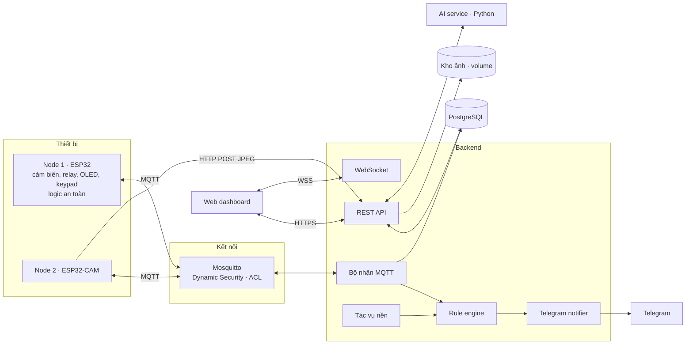
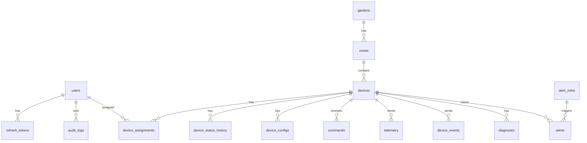
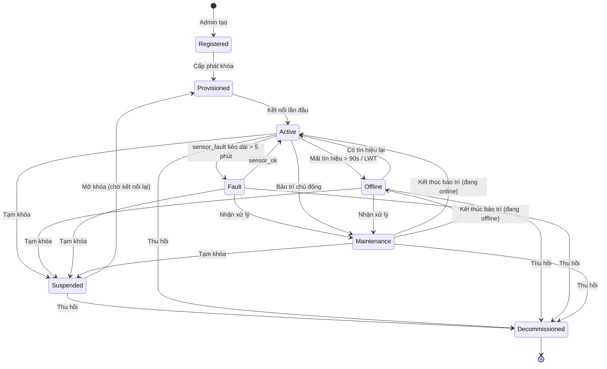

# Đặc tả hệ thống — Hệ thống chăm sóc vườn ươm thông minh

> Đồ án kết thúc học phần **IoT và ứng dụng** · Tài liệu đặc tả v1.4 · 07/11/2026 (đã chốt các điểm ở §22, còn mở C8)
>
> **Thay đổi v1.3 (05/11):** chạy trực tiếp trên một máy Windows, không Docker (C21); mọi thứ gói trong thư mục repo (C22); mạng demo là Mobile Hotspot của chính máy chủ, IP cố định `192.168.137.1` (C17); bỏ Nginx và chrony; demo khoảng 18/11 với 2–3 người (C23); thêm 2 quy tắc chống lỗi khi reset CSDL hoặc xóa flash (§8.10, §9.3). Các mục đổi: §1, §6.7, §6.10, §8.9, §8.10, §9.3, §14.2, §17, §18.1, §21, §22, §23.2.
>
> **Thay đổi v1.4 (07/11):** thêm chiếu sáng bổ sung bằng đèn LED 5 V trên relay kênh 3, dùng chung củ sạc 5V/3A (§6.11, C25): khung giờ + bù theo lux có trễ, debounce, thời gian giữ, BH1750 lỗi thì bật theo lịch, khóa nhiệt; mọi lần bật relay lệch nhau 400 ms. Các mục đổi: §1.2, §3.4, §5, §6.6, §6.8, §6.11, §8.3, §8.5, §8.6, §8.7, §11.2, §16, §19.1, §21.2, §22.
>
> Tài liệu này gom toàn bộ phân tích và các quyết định đã chốt, rồi chi tiết hóa tới mức có thể bắt tay vào code: chân GPIO, firmware, MQTT, REST API, schema CSDL, máy trạng thái, bảo mật, AI, triển khai, kiểm thử và demo.
>
> **Ký hiệu**
> - **[ĐỀ x.y]**: mục tương ứng trong đề bài.
> - **FR / NFR / UC**: yêu cầu chức năng / phi chức năng / use case.
> - **⚠ CHỐT**: điểm nhóm cần quyết định trước khi code phần liên quan.
> - **(đề xuất)**: giá trị mặc định hợp lý, nhóm được chỉnh sau khi đo thực tế.
>
> **Phạm vi file:** đây là tài liệu thiết kế, không chứa mã nguồn. Các khối JSON, SQL, YAML bên dưới là đặc tả định dạng để các thành viên làm khớp với nhau.

---

## Mục lục

1. Tổng quan và các quyết định đã chốt
2. Bài toán, phạm vi, ràng buộc
3. Tác nhân, use case, yêu cầu
4. Kiến trúc tổng thể
5. Phần cứng
6. Firmware Node 1 (điều khiển)
7. Firmware Node 2 (camera)
8. Giao thức MQTT và HTTP thiết bị
9. Backend: mô-đun và luồng xử lý
10. REST API và WebSocket
11. Cơ sở dữ liệu
12. Máy trạng thái
13. Cảnh báo (rule engine)
14. Bảo mật và quyền riêng tư
15. AI chẩn đoán lá
16. Giao diện web
17. Triển khai
18. Cấu trúc repository và quy trình làm việc
19. Kiểm thử
20. Kịch bản demo
21. Phân công, lộ trình, rủi ro
22. Các quyết định đã chốt
23. Phụ lục

---

## 1. Tổng quan và các quyết định đã chốt

### 1.1. Hệ thống trong một đoạn

Hai node ESP32 đặt tại vườn ươm:

- **Node 1 — điều khiển.** Đo độ ẩm đất (2 điểm), nhiệt độ và độ ẩm không khí, ánh sáng, mực nước bể. Tự tưới và thông gió theo ngưỡng. Có màn hình OLED và keypad để thao tác tại chỗ.
- **Node 2 — camera ESP32-CAM.** Chụp ảnh khay cây định kỳ hoặc theo lệnh.

Dữ liệu và lệnh đi qua broker MQTT. Ảnh gửi thẳng tới backend qua HTTP. Backend tự xây đảm nhận các việc sau: quản lý người dùng (3 vai trò), vòng đời thiết bị (8 trạng thái), dữ liệu đo, lệnh, cấu hình, cảnh báo (gửi Telegram) và chẩn đoán ảnh lá bằng AI. Web dashboard dùng để giám sát và điều khiển. Toàn bộ phía server chạy trực tiếp trên một máy Windows (không Docker), gói trong thư mục repo. Chính máy đó phát WiFi cho các node (§17).

### 1.2. Bảng quyết định

| # | Quyết định | Lý do |
|---|---|---|
| D1 | 2 node vật lý: Node 1 ESP32-WROOM-32 (điều khiển), Node 2 ESP32-CAM OV2640 (camera) | Đề khuyến nghị ≥ 2 node cho nhóm 4 người. Hai node khác loại chứng minh hệ thống quản lý được nhiều loại thiết bị |
| D2 | Node 2 là thiết bị đầy đủ: định danh riêng, heartbeat/LWT, nhận lệnh và cấu hình, có ack, đi đủ vòng đời | Để được tính là node theo [ĐỀ 4.2] |
| D3 | Logic tưới, thông gió và khóa an toàn chạy trên Node 1. Backend chỉ đổi ngưỡng và gửi lệnh tay | Mất mạng hoặc backend dừng thì cây vẫn an toàn |
| D4 | MQTT cho telemetry, trạng thái, sự kiện, lệnh, cấu hình. Ảnh gửi qua HTTP POST | Ảnh 10–30 KB vượt buffer MQTT trên ESP32. Đề cho phép HTTP nếu giải thích được lý do [ĐỀ 4.3] |
| D5 | AI chạy ở backend (dịch vụ Python riêng), không chạy trên ESP32-CAM | ESP32-CAM không đủ RAM và CPU. Node 2 hỏng thì việc tưới không bị ảnh hưởng |
| D6 | AI: cây giống cà chua, 3 lớp (Khỏe mạnh, Vàng lá, Đốm lá) + "Không xác định", MobileNetV2, cắt lưới 3×3 | Dataset có nhiều lớp cà chua, cây dễ mua. Lưới ô giúp ảnh khay gần với ảnh cận lá lúc huấn luyện |
| D7 | AI chỉ cảnh báo, không tự điều khiển. Người vận hành xác nhận kết quả | Mô hình có thể sai trên ảnh thật |
| D8 | Demo AI phải ra ít nhất 2 kết quả khác nhau: cây khỏe + lá bệnh thật hoặc ảnh in lá bệnh | Chỉ có "khỏe" thì không chứng minh được mô hình |
| D9 | 2 cảm biến độ ẩm đất (không phải 3). Hợp nhất 2 giá trị theo quy tắc §6.4 | Đúng số linh kiện đang có |
| D10 | Chiếu sáng bổ sung bằng đèn LED 5 V trên relay kênh 3, điều khiển theo khung giờ + lux (§6.11). Chỉ có **1 quạt**, trên relay kênh 2 | Cây giống cần đủ giờ chiếu sáng và đêm tối. Quạt là quạt 5 V có sẵn hoặc động cơ mini gắn cánh (C3, C25) |
| D11 | Vòng đời 8 trạng thái: Registered, Provisioned, Active, Offline, Fault, Maintenance, Suspended, Decommissioned | Bao phủ 10 bước vòng đời trong [ĐỀ 4.4b] |
| D12 | Khóa hoặc thu hồi thiết bị là chặn ở tầng broker (vô hiệu tài khoản MQTT), không chỉ bỏ qua dữ liệu ở backend | Bước 10 của kịch bản demo |
| D13 | QoS 1 cho lệnh và cấu hình. Chống trùng ở tầng ứng dụng bằng `seq` và `cmd_id` | PubSubClient chỉ publish được QoS 0 |
| D14 | Thông báo qua Telegram | Miễn phí, dễ tích hợp |
| D15 | Triển khai trực tiếp trên một máy Windows bằng script PowerShell, công cụ bản portable trong thư mục repo. Docker Compose để sau (C21) | Chạy được ngay trên máy demo, không thêm lớp ảo hóa; một thư mục chứa toàn bộ hệ thống |
| D16 | Toàn hệ thống chạy 5 V từ củ sạc, không đấu điện lưới | Quy định an toàn [ĐỀ 10] |

### 1.3. Công nghệ (đã chốt)

| Thành phần | Đề xuất | Ghi chú |
|---|---|---|
| Firmware | Arduino IDE 2 + core "esp32 by Espressif Systems" 3.x | Thư viện ở §6.9, §7.6; cách cài ở `huong-dan-lap-dat-phan-cung.md` §A6. Cả nhóm dùng cùng phiên bản, ghi trong `firmware/LIBRARIES.md` |
| Broker | Eclipse Mosquitto 2.x + plugin Dynamic Security | Tạo, khóa tài khoản và ACL thiết bị lúc chạy (§8.8) |
| Backend | **FastAPI** (Python 3.11+). Thư viện đề xuất: SQLAlchemy 2 + Alembic, Pydantic v2, paho-mqtt, passlib/bcrypt, PyJWT | Chốt C1. Cùng ngôn ngữ với AI service và thiết bị mô phỏng |
| AI service | Python + FastAPI + TensorFlow/Keras (hoặc PyTorch) | Tiến trình riêng (cổng 8001, chỉ 127.0.0.1), tách khỏi backend dù cùng ngôn ngữ: nặng, khởi động chậm, tốn RAM. Huấn luyện trên Google Colab, máy chủ chỉ chạy suy luận |
| CSDL | PostgreSQL 16 (gói zip portable cho Windows, dữ liệu ở `runtime/pgdata`) | Chốt C12: không dùng TimescaleDB. Bảng thường + index + bảng tổng hợp theo giờ |
| Frontend | React + Vite + thư viện biểu đồ (Recharts hoặc Chart.js) | Build ra file tĩnh, backend FastAPI phục vụ luôn. Node.js chỉ cần lúc build |
| Reverse proxy | Không dùng ở bản demo | Backend phục vụ `/api`, `/ws`, trang web và `/device-api` trên cùng cổng 8000. HTTPS là tùy chọn bằng uvicorn + mkcert (C5) |
| Triển khai | Windows native + script PowerShell (`scripts/windows/`) | C21, C22, §17 |

---

## 2. Bài toán, phạm vi, ràng buộc

### 2.1. Vấn đề

| # | Vấn đề | Hệ quả |
|---|---|---|
| V1 | Tưới theo cảm tính hoặc hẹn giờ cố định, không theo độ ẩm thật của đất | Lúc úng rễ, lúc héo |
| V2 | Sự cố ban đêm (nóng đột ngột, bể cạn) đến sáng mới biết | Hỏng cả khay cây |
| V3 | Lá bệnh khó phát hiện sớm vì không ai quan sát liên tục | Bệnh kịp lây lan |

### 2.2. Vì sao cần IoT [ĐỀ 4.1]

1. Dữ liệu chỉ có ở thực địa: độ ẩm đất và vi khí hậu phải đo tại chỗ.
2. Kết quả là hành động vật lý: bơm chạy, quạt quay.
3. Phải phản ứng liên tục 24/7, kể cả khi mất mạng, nên logic an toàn phải chạy trên thiết bị.

### 2.3. Người dùng và bên liên quan

| Vai trò | Ai | Nhu cầu chính |
|---|---|---|
| ADMIN — Quản trị viên | Người quản trị hệ thống | Tài khoản, vòng đời thiết bị, luật cảnh báo, audit |
| OPERATOR — Người vận hành | Chủ vườn, kỹ thuật viên | Giám sát, điều khiển, chỉnh ngưỡng, xử lý cảnh báo, xác nhận chẩn đoán |
| VIEWER — Người xem | Chủ đầu tư, khách đặt cây | Chỉ xem, trên thiết bị được gán |

### 2.4. Phạm vi

| Trong phạm vi | Ngoài phạm vi |
|---|---|
| 1 vườn ươm trong nhà dưới 20 m², 1–2 khay cây | Nhiều vườn cách xa nhau (LoRa) |
| 2 node vật lý + thiết bị mô phỏng để kiểm thử tải | Thay thiết bị thật bằng mô phỏng |
| Server trên 1 máy tính, cùng LAN | Cloud công cộng |
| Web dashboard | App di động native |
| Telegram | SMS, Zalo, email |
| AI 3 lớp trên cây cà chua | Đa loài, bệnh rễ |
| Cập nhật firmware bằng cáp | OTA (hướng phát triển) |

### 2.5. Ràng buộc

| Loại | Ràng buộc |
|---|---|
| Chi phí | Dùng linh kiện đã mua, chỉ bổ sung vài món rẻ (§5.6) |
| Thiết bị | ESP32 bộ nhớ hạn chế. ESP32-CAM ít GPIO trống |
| Năng lượng | 5 V DC từ củ sạc 5V/3A (Node 1) và 5V/2A (Node 2) |
| Mạng | WiFi nội bộ, có thể chập chờn |
| Độ trễ | Vài giây là chấp nhận được |
| Độ tin cậy | Tưới và khóa an toàn chạy được khi không có backend |
| An toàn | Tải ở tiếp điểm NO, giới hạn thời gian bơm, khóa khi bể cạn |
| Riêng tư | Camera chỉ hướng vào khay. Ảnh có phân quyền và thời hạn lưu |

### 2.6. Tiêu chí thành công

1. Chu trình đầu cuối chạy được: đo → gửi → lưu → phát hiện → lệnh → thực thi → xác nhận.
2. 3 vai trò hoạt động đúng phân quyền, có kiểm thử chứng minh.
3. Vòng đời thiết bị đi đủ các trạng thái. Thiết bị bị thu hồi không kết nối được broker.
4. Đạt NFR01–NFR07 (§3.5).
5. AI có F1 và ma trận nhầm lẫn trên ảnh thật của nhóm.
6. Demo trực tiếp đủ 10 bước của đề và phần AI.

---

## 3. Tác nhân, use case, yêu cầu

### 3.1. Tác nhân (7)

| Tác nhân | Loại | Ghi chú |
|---|---|---|
| Người xem | Người | |
| Người vận hành | Người | Kế thừa Người xem |
| Quản trị viên | Người | Kế thừa Người vận hành |
| Node 1 | Thiết bị | |
| Node 2 | Thiết bị | |
| Bộ định thời | Thời gian | Tác vụ nền của backend |
| Kênh Telegram | Hệ thống ngoài | |

### 3.2. Danh sách use case

| Mã | Use case | Tác nhân | Mức |
|---|---|---|---|
| UC00 | Đăng nhập, đăng xuất, làm mới phiên | Mọi người dùng | Bắt buộc |
| UC01 | Xem dashboard trực tiếp | Xem | Bắt buộc |
| UC02 | Xem lịch sử, biểu đồ, xuất CSV | Xem | Bắt buộc |
| UC03 | Xem danh sách cảnh báo | Xem | Bắt buộc |
| UC04 | Xem ảnh và kết quả chẩn đoán | Xem | Nâng cao |
| UC05 | Gửi lệnh điều khiển (bơm, quạt, chụp ảnh, chế độ) | Vận hành | Bắt buộc |
| UC06 | Thay đổi ngưỡng, cấu hình thiết bị | Vận hành | Bắt buộc |
| UC07 | Xác nhận, đóng cảnh báo | Vận hành | Bắt buộc |
| UC08 | Xác nhận hoặc bác bỏ kết quả chẩn đoán | Vận hành | Nâng cao |
| UC09 | Đổi mật khẩu, cập nhật hồ sơ | Mọi người dùng | Bắt buộc |
| UC10 | Quản lý người dùng | Quản trị | Bắt buộc |
| UC11 | Đăng ký và cấp phát thiết bị | Quản trị | Bắt buộc |
| UC12 | Gán thiết bị cho người dùng, khu vực | Quản trị | Bắt buộc |
| UC13 | Tạm khóa, mở khóa, thu hồi thiết bị | Quản trị | Bắt buộc |
| UC14 | Chuyển bảo trì, ghi nhận lỗi | Quản trị, Vận hành | Bắt buộc |
| UC15 | Cấu hình luật cảnh báo | Quản trị | Bắt buộc |
| UC16 | Xem nhật ký audit | Quản trị | Bắt buộc |
| UC17 | Gửi dữ liệu đo | Node 1 | Bắt buộc |
| UC18 | Báo trạng thái online, firmware | Node 1, Node 2 | Bắt buộc |
| UC19 | Thực thi lệnh, gửi xác nhận | Node 1, Node 2 | Bắt buộc |
| UC20 | Nhận cấu hình mới | Node 1, Node 2 | Bắt buộc |
| UC21 | Tải ảnh khay cây («include» UC24) | Node 2 | Bắt buộc |
| UC22 | Phát hiện thiết bị offline | Bộ định thời | Bắt buộc |
| UC23 | Tổng hợp dữ liệu theo giờ | Bộ định thời | Nên có |

Use case lõi, không có tác nhân gọi trực tiếp:

- **UC24 — Chẩn đoán ảnh lá.** Được UC21 kích hoạt.
- **UC25 — Sinh cảnh báo.** Được kích hoạt bởi UC17 (vượt ngưỡng), UC22 (offline), UC24 (lá bất thường) và sự kiện thiết bị (bể cạn, lỗi cảm biến). Luôn «include» UC26.
- **UC26 — Gửi thông báo Telegram.**

### 3.3. Đặc tả use case quan trọng

**UC11 — Đăng ký và cấp phát thiết bị**

- **Tiền điều kiện:** đăng nhập vai trò ADMIN.
- **Luồng chính:**
  1. Admin nhập: loại (CONTROLLER/CAMERA), tên, khu vực, phiên bản phần cứng → `POST /devices`.
  2. Backend sinh `device_code` (ví dụ `ctl-0001`), trạng thái **Registered**, ghi audit.
  3. Admin bấm "Cấp phát" → `POST /devices/{id}/provision`.
  4. Backend sinh secret ngẫu nhiên 32 byte (base64url). Backend lưu bcrypt hash, tạo client trên broker (username = `device_code`) kèm role ACL riêng.
  5. Backend chuyển sang **Provisioned** và trả về **một lần duy nhất** gói cấu hình: `device_code`, `secret`, `garden_code`, broker host/port, URL upload ảnh.
  6. Admin dán gói này vào `secrets.h` rồi nạp firmware.
  7. Thiết bị kết nối, publish `status` online → backend chuyển sang **Active** và ghi `first_seen_at`.
- **Luồng thay thế:**
  - 4a. Broker không phản hồi: rollback, trả 503, giữ Registered.
  - 5a. Mất secret: "Cấp lại khóa" (`POST /devices/{id}/rotate-secret`). Secret cũ mất hiệu lực ngay, kết nối hiện tại bị ngắt.
- **Hậu điều kiện:** thiết bị có tài khoản broker riêng, ACL đúng nhánh, có audit.

**UC05 — Gửi lệnh điều khiển**

- **Tiền điều kiện:** user có quyền `control` trên thiết bị (ADMIN mặc định có). Thiết bị ở trạng thái Active, Fault hoặc Maintenance và đang online.
- **Luồng chính:**
  1. `POST /devices/{id}/commands {action, params}`.
  2. Backend kiểm tra quyền, trạng thái, `action` hợp lệ với loại thiết bị, `params` hợp lệ.
  3. Backend tạo `cmd_id` (UUID), trạng thái **PENDING**, ghi audit, publish lên `…/command` (QoS 1).
  4. Thiết bị kiểm tra trùng `cmd_id`, kiểm tra hạn lệnh, kiểm tra khóa an toàn, rồi thực thi.
  5. Thiết bị publish `…/ack`.
  6. Backend cập nhật lệnh sang EXECUTED, REJECTED hoặc FAILED và đẩy WebSocket.
- **Luồng thay thế:**
  - 2a. Không đủ quyền: 403, ghi audit `COMMAND_DENIED`.
  - 2b. Thiết bị offline: 409 `DEVICE_OFFLINE`, không tạo lệnh.
  - 4a. Khóa an toàn chặn: ack `blocked_*`, lệnh chuyển REJECTED.
  - 5a. Sau 10 giây không có ack: lệnh chuyển TIMEOUT.

**UC13 — Tạm khóa / thu hồi thiết bị**

- **Luồng chính:**
  1. `POST /devices/{id}/suspend` (hoặc `/decommission`) kèm `reason`.
  2. Backend gọi broker `disableClient` (ngắt kết nối hiện tại), đổi trạng thái, ghi audit.
  3. Từ chối mọi upload ảnh HTTP của thiết bị đó.
- **Hậu điều kiện:**
  - Suspended: mở lại được bằng `/resume`.
  - Decommissioned: xóa client broker, không mở lại được. Bản ghi và lịch sử vẫn giữ.

**UC21 + UC24 — Chụp và chẩn đoán**

1. Đến chu kỳ chụp, hoặc nhận lệnh `capture`.
2. Node 2 chụp JPEG rồi `POST /device-api/v1/images`.
3. Backend xác thực thiết bị, kiểm tra định dạng và kích thước, lưu tệp, tạo `diagnoses` ở trạng thái QUEUED.
4. Worker gọi AI service `/v1/infer`, lưu kết quả 9 ô, chuyển DONE.
5. Áp luật "cùng một ô bất thường 3 ảnh liên tiếp, độ tin cậy ≥ 0,8" → sinh cảnh báo AI_LEAF.
6. Người vận hành xác nhận hoặc bác bỏ (UC08).

### 3.4. Yêu cầu chức năng

| Mã | Yêu cầu | Đề |
|---|---|---|
| FR-D1 | Node 1 đọc: độ ẩm đất ×2, nhiệt độ, độ ẩm KK, ánh sáng, mực nước | 4.2 |
| FR-D2 | Mỗi node có `device_code` và secret riêng | 4.2, 4.5 |
| FR-D3 | Telemetry mỗi 10 giây, có `ts`, `seq`, đơn vị | 4.2, 4.3 |
| FR-D4 | Nhận lệnh và cấu hình. Ack mọi lệnh và mọi lần áp cấu hình | 4.2, 4.4e |
| FR-D5 | Node 1 điều khiển bơm, quạt, đèn chiếu sáng. Node 2 điều khiển đèn flash | 4.2 |
| FR-D6 | Heartbeat 30 giây + LWT. Báo `fw_version`, `hw_version` | 4.2, 4.4b |
| FR-D7 | Tự kết nối lại có backoff. Đệm ≥ 100 bản ghi, gửi bù | 4.2 |
| FR-D8 | Tưới và thông gió tự động tại thiết bị, có khóa an toàn | — |
| FR-D9 | OLED hiển thị trạng thái. Keypad điều khiển tay có PIN | — |
| FR-D10 | Node 2 chụp theo chu kỳ hoặc lệnh, upload HTTP | 5.2 |
| FR-U1..U5 | Tạo tài khoản; đăng nhập/đăng xuất; đổi mật khẩu; trạng thái tài khoản; 3 vai trò + gán thiết bị | 4.4a |
| FR-L1..L6 | Đăng ký; cấp phát; gán; kích hoạt; cấu hình; online/offline; fw/hw; lỗi/bảo trì; khóa/thu hồi; decommission | 4.4b |
| FR-T1..T4 | Nhận và kiểm tra telemetry; lưu theo thời gian; tra cứu; biểu đồ; thống kê; xuất CSV | 4.4c |
| FR-A1..A4 | Luật cảnh báo cấu hình được; sinh cảnh báo; lịch sử; xác nhận và đóng; Telegram; chống gửi lặp | 4.4d |
| FR-C1..C2 | Gửi lệnh có kiểm tra quyền; lưu lịch sử lệnh và kết quả | 4.4e |
| FR-S1 | Audit log cho thao tác quan trọng | 4.5 |

### 3.5. Yêu cầu phi chức năng

| Mã | Chỉ tiêu | Ngưỡng | Cách đo |
|---|---|---|---|
| NFR01 | Cảm biến → dashboard | < 3 s (p95) | `ts` thiết bị (NTP) so với thời điểm frontend nhận WS; 100 mẫu |
| NFR02 | Lệnh → ack | < 2 s (p95) | `ack_at − issued_at`; 50 lệnh |
| NFR03 | Phát hiện offline | ≤ 90 s | Rút nguồn node, bấm giờ đến khi UI báo Offline |
| NFR04 | Chạy liên tục | 72 giờ | Đếm số lần reboot (`uptime` reset) và khoảng trống heartbeat |
| NFR05 | Mất bản tin | < 1% | Khoảng trống `seq` / tổng số bản tin |
| NFR06 | Kết nối lại sau mất mạng | < 30 s; không mất dữ liệu nếu mất mạng ≤ 15 phút | Tắt router rồi bật lại |
| NFR07 | Đệm khi mất mạng | ≥ 100 bản ghi | Ngắt mạng > 100 chu kỳ, kiểm tra gửi bù |
| NFR08 | Bản tin trùng | 0 bản ghi trùng, 0 lệnh chạy 2 lần | Phát lại cùng `seq` / `cmd_id` |
| NFR09 | Khả năng tải | ≥ 20 thiết bị mô phỏng × 1 msg/s | Script mô phỏng, đo CPU, RAM, độ trễ |

---

## 4. Kiến trúc tổng thể

### 4.1. Các lớp



Hệ thống không có gateway riêng. Node 1 tự làm lớp edge: chạy logic điều khiển, khóa an toàn và đệm dữ liệu khi mất mạng.

### 4.2. Mô-đun backend

| Mô-đun | Trách nhiệm | UC |
|---|---|---|
| auth | Đăng nhập, JWT, refresh token, đổi mật khẩu, khóa khi sai nhiều lần | UC00, UC09 |
| users | CRUD người dùng, vai trò, trạng thái | UC10 |
| gardens | Vườn, khu vực | UC12 |
| devices | Đăng ký, cấp phát, gán, máy trạng thái vòng đời, đồng bộ broker | UC11–UC14, UC18 |
| ingest | Subscribe MQTT, kiểm tra, chống trùng, lưu, cập nhật `last_seen`, phát sự kiện nội bộ | UC17, UC18 |
| commands | Tạo lệnh, publish, nhận ack, timeout | UC05, UC19 |
| configs | Phiên bản cấu hình, publish retain, nhận ack áp dụng | UC06, UC20 |
| alerts | Rule engine, vòng đời cảnh báo, cooldown | UC07, UC15, UC25 |
| notify | Telegram | UC26 |
| images / diagnoses | Nhận ảnh, hàng đợi chẩn đoán, gọi AI, luật 3 ảnh liên tiếp | UC04, UC08, UC21, UC24 |
| telemetry query | Truy vấn, tổng hợp, xuất CSV | UC01, UC02 |
| audit | Ghi và đọc audit log | UC16 |
| realtime | WebSocket hub, lọc theo quyền | UC01 |
| scheduler | Offline detector, command timeout, hourly rollup, retention | UC22, UC23 |

Quy tắc phân lớp: controller/handler chỉ xác thực và kiểm tra đầu vào; quy tắc nghiệp vụ nằm ở service; repository chỉ truy cập dữ liệu. Web và bộ nhận MQTT dùng chung một service phân quyền.

### 4.3. Quyết định kiến trúc

Xem D3, D4, D5, D12, D13 ở §1.2. Bổ sung:

| # | Quyết định | Đánh đổi |
|---|---|---|
| A1 | Frontend nhận realtime qua WebSocket của backend, không kết nối thẳng broker | Backend lọc được theo quyền; đổi lại backend thêm việc |
| A2 | Hàng đợi chẩn đoán xử lý trong tiến trình backend (worker thread) | Đơn giản; không bền khi backend crash (job QUEUED được quét lại lúc khởi động) |
| A3 | Telemetry lưu dạng dài (1 dòng/metric) | Linh hoạt khi thêm cảm biến; nhiều dòng hơn — chấp nhận ở quy mô đồ án |

---

## 5. Phần cứng

### 5.1. Danh sách linh kiện hiện có

| # | Linh kiện | SL | Dùng cho |
|---|---|---|---|
| 1 | ESP32-WROOM-32 NodeMCU-32S 30 chân + đế ra chân | 1 | Node 1 |
| 2 | ESP32-CAM OV2640 + đế nạp (ESP32-CAM-MB) | 1 | Node 2 |
| 3 | Module cảm biến độ ẩm đất **loại điện trở** (analog) | 2 | Node 1, cấp nguồn qua GPIO32 (C10) |
| 4 | DHT22 | 1 | Node 1 |
| 5 | DHT11 | 1 | Dự phòng, không gắn Node 2 (C4) |
| 6 | BH1750 (GY-302) | 1 | Node 1 |
| 7 | HC-SR04 | 1 | Node 1 — mực nước bể |
| 8 | OLED 1.3" I2C, chip **SH1106** | 1 | Node 1 |
| 9 | Keypad 3×4 | 1 | Node 1 |
| 10 | Relay 4 kênh 5 V, chọn mức kích H/L | 1 | Node 1 |
| 11 | Bơm chìm mini 3–6 V + ống φ6 97 cm | 1 | Tưới |
| 12 | Quạt 5 V | 1 | Thông gió |
| 13 | Động cơ mini 3–6 V | 1 | Nếu chế thành quạt (gắn cánh) thì dùng thay quạt 5 V ở relay kênh 2; không thì để dự phòng (C3) |
| 14 | Tụ 1000 µF 16 V | 20 | Lọc nguồn |
| 15 | Diode 1N4007 | 10 | Chống xung ngược |
| 16 | Điện trở 1 kΩ, 2 kΩ | 50+50 | Cầu chia áp ECHO |
| 17 | Domino 12 cực, breadboard 400 lỗ, dây, header | — | Đấu nối |
| 18 | Củ sạc 5V/3A, 5V/2A | 2 | Nguồn |
| 19 | Đèn LED 5 V ánh trắng ≤ 5 W (**cần mua**) | 1 | Chiếu sáng bổ sung, relay kênh 3 (§6.11) |

### 5.2. Gán chân Node 1 (đề xuất)

| Chức năng | Chân ESP32 | Ghi chú |
|---|---|---|
| Đất 1 AOUT | **GPIO34** (ADC1_CH6) | Chỉ đầu vào. Bắt buộc ADC1 vì ADC2 không dùng được khi WiFi bật |
| Đất 2 AOUT | **GPIO35** (ADC1_CH7) | |
| Cấp nguồn cảm biến đất | **GPIO32** | VCC của cả 2 module. Chỉ bật khi đo (bật → chờ 100 ms → đọc → tắt) để giảm ăn mòn. Nếu bật cả hai mà đèn module sáng yếu hoặc số đo tụt: chuyển về 3V3 và ghi vào hạn chế |
| DHT22 DATA | **GPIO4** | Module có sẵn điện trở kéo lên. Loại 4 chân trần cần 10 kΩ lên 3V3 |
| I2C SDA | **GPIO21** | BH1750 (0x23) + OLED (0x3C) chung bus |
| I2C SCL | **GPIO22** | |
| HC-SR04 TRIG | **GPIO5** | |
| HC-SR04 ECHO | **GPIO18** qua cầu chia 1 kΩ/2 kΩ | 5 V × 2/3 ≈ 3,33 V |
| Relay IN1 — bơm | **GPIO26** | |
| Relay IN2 — quạt | **GPIO27** | |
| Relay IN3 — đèn | **GPIO25** | Đèn LED 5 V (§6.11) |
| Relay IN4 | — | Bỏ trống |
| Keypad hàng R1–R4 | **GPIO13, 14, 16, 17** | Chân ra |
| Keypad cột C1–C3 | **GPIO19, 23, 33** | Chân vào, pull-up nội |
| Tránh dùng | GPIO0, 2, 12, 15 (strapping), 6–11 (flash), 1/3 (UART0) | |

Ngân sách: 18 chân. Board 30 chân đáp ứng được.

### 5.3. Sơ đồ nguồn Node 1

```
Củ sạc 5V/3A ─► Jack DC ─► Domino
                   ├─ +5V ─► Relay VCC, HC-SR04 VCC, COM relay 1/2/3
                   │         Tụ 1000µF (+ vào +5V, vạch vào GND)
                   └─ GND ─► Relay GND, HC-SR04 GND, (−) bơm/quạt/đèn, GND ESP32  ◄ BẮT BUỘC chung
ESP32 3V3 ─► DHT22, BH1750, OLED
ESP32 GPIO32 ─► VCC cảm biến đất ×2 (chỉ bật khi đo)
Giai đoạn lắp/test: ESP32 cấp qua USB. Chạy độc lập: +5V domino ─► VIN ESP32.
```

Đấu tải:

- `+5V → COM`, `NO → (+) tải`, `(−) tải → GND`. Dùng **NO** để khi mất điện hoặc reboot thì tải tắt.
- Diode 1N4007 **song song ngược** với bơm và với quạt: vạch trắng về phía +.

### 5.4. Node 2 — ESP32-CAM (AI-Thinker)

| Chức năng | Chân | Ghi chú |
|---|---|---|
| Camera OV2640 | Theo board AI-Thinker | Dùng cấu hình chân chuẩn của thư viện |
| Đèn flash | GPIO4 | Rất sáng. Chỉ bật khi chụp |
| DHT11 | Không gắn (C4) | Node 2 chỉ chụp ảnh |
| Nạp code | Đế ESP32-CAM-MB (micro-USB) | |
| Nguồn | 5V/2A qua đế | Nguồn yếu sẽ brownout khi bật camera và WiFi |

### 5.5. Sơ đồ khối

```
[Đất×2]──┐                       ┌──►[Relay]──►[Bơm] [Quạt] [Đèn]
[DHT22]──┤                       │
[BH1750]─┼──►[ESP32 Node 1]──────┼──►[OLED]
[HC-SR04]┤        ▲   │          │
[Keypad]─┘        │   └── WiFi ──► Broker MQTT ──► Backend
             [Nguồn 5V]                ▲            ▲
                                       │ MQTT       │ HTTP ảnh
                                  [Node 2 ESP32-CAM]
```

### 5.6. Cần bổ sung

| Mức | Món |
|---|---|
| Bắt buộc | Jack DC cái có cọc vít hoặc module USB ra dây; cáp USB truyền dữ liệu |
| Bắt buộc | Bể nước, chậu/khay, đất, cây giống cà chua |
| Cho AI | Lá cà chua bệnh thật, hoặc ảnh in màu lá bệnh từ tập test |
| Nên có | Thêm 1 breadboard; giá đỡ cố định camera |
| Nếu chế quạt từ động cơ mini | Cánh quạt nhựa vừa trục, giá kẹp động cơ (C3) |
| Bắt buộc | Đèn LED 5 V ánh trắng ≤ 5 W cho chiếu sáng bổ sung (§6.11) |

### 5.7. Hiệu chuẩn

**Cảm biến đất** (từng cái riêng):

- Ghi giá trị ADC khi để ngoài không khí (DRY) và khi cắm trong cốc nước tới vạch giới hạn (WET).
- Quy đổi: `% = clamp((DRY − adc) / (DRY − WET) × 100, 0, 100)`.
- Lưu DRY/WET trong cấu hình thiết bị (NVS). Có thể cập nhật qua `config`.

**HC-SR04:**

- Đo `TANK_EMPTY_CM`: khoảng cách từ mặt cảm biến tới đáy bể.
- Đo `TANK_FULL_CM`: khoảng cách khi nước đầy.
- Quy đổi: `% = clamp((EMPTY − d)/(EMPTY − FULL) × 100, 0, 100)`.

Bọc keo silicon phần mạch và mối nối ở đầu cảm biến đất.

---

## 6. Firmware Node 1 (điều khiển)

### 6.1. Cấu trúc mã

```
firmware/node1-controller/
  node1-controller.ino           # setup + vòng lặp chính (tên trùng tên thư mục)
  secrets.example.h              # mẫu, commit
  secrets.h                      # thật, KHÔNG commit (tab riêng trong IDE)
  config_store.h / .cpp          # NVS: cấu hình, seq, hiệu chuẩn
  sensors.h / .cpp               # đọc + lọc
  control.h / .cpp               # tưới, quạt, khóa an toàn
  net.h / .cpp                   # WiFi, NTP, MQTT, backoff
  protocol.h / .cpp              # build/parse JSON, cmd dedup
  buffer.h / .cpp                # hàng đợi vòng offline
  ui.h / .cpp                    # OLED + keypad
```

### 6.2. Vòng lặp và chu kỳ (đề xuất)

| Công việc | Chu kỳ |
|---|---|
| Đọc cảm biến đất, siêu âm, ánh sáng | 2 s |
| Đọc DHT22 | 2,5 s (tối thiểu 2 s theo datasheet) |
| Đánh giá logic điều khiển | 2 s |
| Gửi telemetry | 10 s (cấu hình được) |
| Heartbeat `status` | 30 s, và mỗi khi trạng thái thay đổi |
| Làm mới OLED | 1 s |
| Quét keypad | liên tục, không chặn |
| Kiểm tra WiFi/MQTT | mỗi vòng; kết nối lại theo backoff |

Không dùng `delay()` dài. Dùng `millis()` cho từng tác vụ, hoặc FreeRTOS task: một task mạng, một task điều khiển.

### 6.3. Lọc tín hiệu

- **Mỗi đại lượng:** trung vị của 5 lần đọc gần nhất.
- **HC-SR04:** loại kết quả ngoài 2–400 cm và kết quả timeout.
- **Phát hiện cảm biến hỏng:**
  - Đất: ADC luôn 0 hoặc 4095 trong 30 s.
  - DHT22: trả NaN 5 lần liên tiếp.
  - BH1750: không trả lời I2C.
  - HC-SR04: timeout 10 lần liên tiếp.
  - Khi hỏng: gửi `event: sensor_fault {sensor}`, gắn `valid=false` cho đại lượng đó trong telemetry.

### 6.4. Hợp nhất 2 cảm biến đất

| Tình huống | Giá trị dùng | Hành động |
|---|---|---|
| Cả 2 hợp lệ, lệch ≤ 30 điểm % | Trung bình | — |
| Cả 2 hợp lệ, lệch > 30 điểm | Không dùng | `event: sensor_fault {soil_mismatch}`, **tạm khóa tưới tự động** |
| Chỉ 1 hợp lệ | Giá trị đó | `event: sensor_fault {soilX}`; vẫn tưới tự động |
| Không cái nào hợp lệ | Không có | Khóa tưới tự động. Lệnh tay vẫn được nhưng chịu giới hạn thời gian |

### 6.5. Logic điều khiển (chế độ AUTO)

```
Tưới:
  nếu soil < soil_low  VÀ không bị khóa  VÀ hết cooldown  → bật bơm
  bơm đang chạy:
     tắt khi soil ≥ soil_high  HOẶC  đã chạy pump_max_s  HOẶC  tank < tank_min
  sau khi tắt: cooldown_s (cho nước kịp ngấm)
Thông gió:
  bật quạt khi temp ≥ temp_high  HOẶC  hum ≥ hum_high
  tắt khi temp ≤ temp_high − temp_hyst  VÀ  hum ≤ hum_high − hum_hyst
```

Giá trị mặc định (đề xuất, chỉnh sau khi thử với cây thật):

| Khóa | Mặc định | Đơn vị |
|---|---|---|
| `soil_low` | 35 | % |
| `soil_high` | 55 | % |
| `pump_max_s` | 15 | s |
| `cooldown_s` | 120 | s |
| `tank_min` | 15 | % |
| `temp_high` / `temp_hyst` | 32 / 2 | °C |
| `hum_high` / `hum_hyst` | 90 / 5 | %RH |
| `telemetry_interval_s` | 10 | s |

### 6.6. Chế độ và khóa an toàn

| Chế độ | Ý nghĩa |
|---|---|
| `AUTO` | Logic §6.5 điều khiển. Lệnh tay vẫn được nhận và chạy một lần |
| `MANUAL` | Tắt tự động. Chỉ chạy theo lệnh (từ xa hoặc keypad) |
| `LOCAL` | Đang có người thao tác keypad. Lệnh từ xa bị từ chối với `blocked_local` trong 60 s |

Khóa an toàn **luôn áp dụng**, ở mọi chế độ và mọi nguồn lệnh:

1. Bể dưới `tank_min` thì không bơm (`blocked_no_water`).
2. Một lần bơm không quá `pump_max_s` (lệnh xin lâu hơn → `duration_capped`).
3. Còn trong cooldown thì từ chối (`blocked_cooldown`). Lệnh tay được bỏ qua cooldown nếu cấu hình `manual_ignores_cooldown=true`.
4. Mất điện hoặc reboot: tải ở NO nên tự tắt. Khởi động vào trạng thái tắt hết.
5. Quá nóng (`air_temp ≥ temp_high + 3`): tắt đèn, lệnh bật đèn bị từ chối (`blocked_overheat`) (§6.11).
6. Mọi lần **bật** relay lệch nhau ≥ 400 ms để tránh sụt áp; tắt relay luôn chạy ngay (§6.11).

### 6.7. Mạng và độ tin cậy

- **WiFi:** kết nối lại với backoff 1 → 2 → 4 → 8 → 16 → 30 s (tối đa 30 s).
- **NTP:** đồng bộ lúc khởi động và mỗi 6 giờ với `pool.ntp.org`, qua Internet mà máy chủ chia sẻ vào mạng hotspot (C11). Không chạy máy chủ NTP riêng. Chưa có giờ thì `ts=0`, `time_synced=false`; backend dùng `received_at`.
- **MQTT:**
  - `clientId = device_code`, `username = device_code`, `password = secret`, `keepalive = 30 s`, `cleanSession = true`.
  - LWT: topic `…/status`, payload `{"online":false,…}`, QoS 1, retain.
  - Sau khi kết nối: publish `status` online (retain), subscribe `…/command` và `…/config` với QoS 1.
  - `setBufferSize(1024)`.
- **Số thứ tự `seq`:** tăng mỗi bản tin telemetry. Lưu NVS mỗi 50 bản tin; khởi động lại thì `seq += 50` để không bao giờ lặp.
- **Đệm offline:** hàng đợi vòng trong RAM, 200 bản ghi telemetry đã đóng gói. Khi có lại kết nối thì gửi bù theo thứ tự, tối đa 5 bản tin/giây, kèm `buffered:true`. Đầy thì ghi đè bản cũ nhất và đếm `dropped`.
- **Chống trùng lệnh:** ring 20 `cmd_id` gần nhất kèm kết quả. Lệnh trùng thì gửi lại ack cũ.
- **Hạn lệnh:** từ chối với `expired` nếu `now > issued_at + ttl_s` (chỉ khi đã có giờ NTP).

### 6.8. OLED và keypad

**OLED** có 3 trang, đổi trang bằng phím `#`:

1. Đất 1/2, nhiệt độ, độ ẩm, ánh sáng, mực bể.
2. Trạng thái bơm/quạt/đèn (kèm khung giờ chiếu sáng), chế độ, khóa an toàn đang bật.
3. WiFi/MQTT, IP, `device_code`, fw version.

**Keypad:**

- `*` + PIN 4 số + `#`: vào chế độ LOCAL trong 60 s. PIN nằm trong `secrets.h` hoặc cấu hình.
- Trong LOCAL: `1` bật/tắt bơm (chịu khóa an toàn), `2` bật/tắt quạt, `3` chuyển AUTO/MANUAL, `4` bật/tắt đèn, `0` thoát.
- Mỗi thao tác gửi `event: local_override {action}`.

### 6.9. Thư viện (Arduino IDE 2 — Library Manager)

PubSubClient (Nick O'Leary), ArduinoJson 7.x (Benoit Blanchon), DHT sensor library + Adafruit Unified Sensor (Adafruit), BH1750 (Christopher Laws), Keypad (Mark Stanley, Alexander Brevig).

OLED: chip **SH1106** (C2) → U8g2 (oliver), constructor `U8G2_SH1106_128X64_NONAME_F_HW_I2C`. Không cài bộ Adafruit SSD1306.

Board: `NodeMCU-32S`. Cách cài và bảng cấu hình menu Tools ở `huong-dan-lap-dat-phan-cung.md` §A6.

### 6.10. `secrets.h` (mẫu, không chứa giá trị thật)

```c
#define WIFI_SSID        "..."
#define WIFI_PASS        "..."
#define MQTT_HOST        "192.168.137.1"   // IP máy chủ trên Mobile Hotspot (C17)
#define MQTT_PORT        1883
#define GARDEN_CODE      "g01"
#define DEVICE_CODE      "ctl-0001"
#define DEVICE_SECRET    "..."      // nhận một lần khi cấp phát
#define LOCAL_PIN        "...."
```

### 6.11. Chiếu sáng bổ sung (đèn LED)

**Mục tiêu:** cây giống cà chua đủ 14 giờ sáng mỗi ngày và có đêm tối hoàn toàn. Đèn chỉ **bù** khi ánh sáng tự nhiên thiếu (trời âm u, mưa, chiều muộn). Đèn không thay ánh sáng ban ngày và không bật ban đêm.

**Phần cứng**

| Hạng mục | Chốt |
|---|---|
| Đèn | Dải LED hoặc đèn LED USB **5 V ánh trắng (phổ đầy đủ)**, ≤ 5 W (≤ 1 A). Không dùng đèn tím đỏ–xanh vì làm sai màu lá trong ảnh AI |
| Đấu nối | Relay **kênh 3**, IN3 = **GPIO25**: `+5V → COM3`, `NO3 → (+) đèn`, `(−) đèn → GND`. Không cần diode (LED không phải tải cảm ứng) |
| Nguồn | **Dùng chung củ sạc 5V/3A** (C25), chọn đèn công suất thấp ≤ 5 W. Ước lượng khi bơm, quạt, đèn và ESP32 cùng chạy: dưới 2 A |
| Vị trí | Đèn cách khay 20–30 cm, chiếu thẳng xuống. BH1750 đặt tránh ánh đèn chiếu thẳng (quay ra phía cửa sổ hoặc có tấm chắn phía trên) |
| Hiệu chuẩn | Đo ΔE_LED (`lamp_self_lux`): phòng tối, đọc BH1750 khi đèn tắt và khi đèn bật, lấy hiệu số. Ghi vào `hardware/nhat-ky-lap-dat.md` |

**Cấu hình** (`config`, §8.7)

| Khóa | Mặc định | Miền | Ý nghĩa |
|---|---|---|---|
| `lamp_start_hour` | 6 | 0–23 | Đầu khung chiếu sáng, giờ Việt Nam (UTC+7) |
| `lamp_end_hour` | 20 | 1–24, > `lamp_start_hour` | Cuối khung. Khung là `[start, end)` |
| `lamp_lux_low` | 800 | 0–65535 | Ngưỡng bật: lux đo được dưới mức này |
| `lamp_hyst` | 700 | > `lamp_self_lux` + 200 | Ngưỡng tắt = `lamp_lux_low` + `lamp_hyst` (mặc định 1500 lux) |
| `lamp_self_lux` | 300 | 0–5000 | ΔE_LED đo khi hiệu chuẩn |
| `lamp_hold_s` | 10 | 2–600 | Điều kiện bật hoặc tắt phải đúng **liên tục** trong khoảng này mới đổi relay |
| `lamp_min_on_s` / `lamp_min_off_s` | 30 / 30 | 10–3600 | Thời gian giữ tối thiểu sau mỗi lần đổi trạng thái. Chạy thật nên đặt 300–600 |
| `lamp_override_min` | 60 | 1–240 | Thời gian giữ hiệu lực của lệnh tay khi đang AUTO |

Thiết bị từ chối cấu hình (`invalid`) nếu `lamp_end_hour ≤ lamp_start_hour` hoặc `lamp_hyst ≤ lamp_self_lux + 200`. Điều kiện thứ hai đảm bảo khi đèn đang bật, phần sáng do chính đèn tạo ra không đủ để vượt ngưỡng tắt, nên đèn không tự bật/tắt liên tục.

**Logic AUTO** (đánh giá mỗi 2 s, theo thứ tự ưu tiên)

| # | Điều kiện | Đèn | `reason` | Áp dụng |
|---|---|---|---|---|
| 1 | Chưa đồng bộ NTP | Không tự bật (đang bật thì giữ tới hết override) | — | — |
| 2 | Ngoài khung `[lamp_start_hour, lamp_end_hour)` | TẮT | `window_end` | **Ngay**, bỏ qua debounce và thời gian giữ |
| 3 | Khóa nhiệt: bật khi `air_temp ≥ temp_high + 3`, nhả khi `air_temp ≤ temp_high + 3 − temp_hyst` | TẮT | `overheat` | **Ngay** |
| 4 | BH1750 lỗi (`light.ok = false`) | **BẬT theo lịch** suốt khung giờ | `sensor_fallback` | Kèm event `sensor_fault {bh1750}` đã có |
| 5 | Đèn đang tắt và lux < `lamp_lux_low` | BẬT | `low_light` | Debounce + thời gian giữ |
| 6 | Đèn đang bật và lux ≥ `lamp_lux_low` + `lamp_hyst` | TẮT | `bright` | Debounce + thời gian giữ |
| 7 | Còn lại | Giữ nguyên | — | — |

- **Debounce:** trạng thái mong muốn khác trạng thái hiện tại phải duy trì liên tục `lamp_hold_s` (mặc định 10 s = 5 chu kỳ đọc). Bị ngắt quãng (người đi qua che cảm biến vài giây) thì đếm lại từ đầu.
- **Thời gian giữ:** sau khi đổi trạng thái, phải qua `lamp_min_on_s` (đang bật) hoặc `lamp_min_off_s` (đang tắt) mới xét đổi tiếp ở dòng 5–6.
- Lux dùng giá trị đã lọc trung vị của `sensors` (§6.3).

**Lệnh tay và chế độ**

- Lệnh `lamp_on {duration_min?}` (1–`lamp_override_min`, mặc định `lamp_override_min`) và `lamp_off`.
- **AUTO:** lệnh tay giữ hiệu lực tối đa `lamp_override_min`, sau đó trả về logic AUTO (`reason: override_end`). Bật tay ban đêm được phép để người vận hành kiểm tra cây, nhưng hết thời gian là tự tắt.
- **MANUAL:** đèn chỉ chạy theo lệnh, không tự tắt theo lịch.
- **LOCAL:** keypad phím `4` bật/tắt đèn.
- Khóa nhiệt (dòng 3) áp dụng ở **mọi** chế độ: lệnh bật khi quá nóng bị từ chối với `blocked_overheat`.

**Lệch pha khi bật relay (áp dụng cho bơm, quạt, đèn)**

- Mọi lần **bật** relay đi qua hàng đợi: relay chỉ được đóng khi đã qua ≥ 400 ms kể từ lần đóng relay trước. Tránh dòng khởi động của bơm, quạt và đèn cộng dồn làm sụt áp thanh 5 V.
- **Tắt relay luôn chạy ngay**, không xếp hàng.
- Làm bằng `millis()`, không dùng `delay()`. Thời gian bơm và timer cắt bơm (§6.6) tính từ lúc relay **thực sự đóng**.

**Giao thức** (bổ sung §8)

| Thành phần | Bổ sung |
|---|---|
| telemetry `state` | `lamp: 0/1`. Tên `lamp` để không nhầm với metric `light` (lux) |
| telemetry `locks` | Thêm `overheat` |
| event | `lamp_on` / `lamp_off`, `detail: {source: auto/remote/local, reason}`. `reason` ∈ `low_light`, `bright`, `window_end`, `overheat`, `sensor_fallback`, `command`, `override_end`, `shutdown` (trước khi khởi động lại) |
| command | `lamp_on {duration_min?}`, `lamp_off` |
| ack | `blocked_overheat` → REJECTED |
| config | Các khóa `lamp_*` ở trên |

**Phối hợp với camera AI (Node 2)**

- Không cho hai node điều khiển trực tiếp lẫn nhau (D3, D5). Node 2 vẫn dùng flash `auto` như cũ.
- Backend ghi trạng thái đèn tại thời điểm chụp vào `diagnoses.lamp_on`, lấy từ telemetry gần nhất của Node 1 trong cùng vườn.
- Khi thu thập dữ liệu và đánh giá AI (§15.3) thì tách số liệu theo `lamp_on` để thấy ảnh hưởng của ánh đèn.

**Backend và giao diện**

- Kiểm tra lệnh `lamp_on`/`lamp_off` cho thiết bị loại CONTROLLER, kiểm tra các khóa cấu hình `lamp_*`.
- Màn Điều khiển: nút Đèn. Màn Cấu hình: nhóm "Lịch chiếu sáng" (khung giờ, ngưỡng lux, thời gian giữ).
- Chỉ số **"Số giờ chiếu sáng hôm nay"** trên chi tiết thiết bị, tính từ event `lamp_on`/`lamp_off`.

**OLED:** trang 2 thêm dòng `Den: BAT (06-20)`.

**Demo:** gửi cấu hình `lamp_start_hour = 0`, `lamp_end_hour = 24` để demo được ở mọi giờ. Lấy tay che BH1750: khoảng 10 s sau đèn bật, dashboard hiện event `lamp_on {reason: low_light}`. Demo xong gửi lại cấu hình 6–20, vì 0–24 làm mất giờ tối bắt buộc của cây.

**Hạn chế:** BH1750 đo lux (theo mắt người), không đo PAR/PPFD như cảm biến chuyên dụng của nhà kính thật. Ngưỡng lux là ước lượng, cần chỉnh theo phòng thực tế.

---

## 7. Firmware Node 2 (camera)

### 7.1. Hành vi

- Kết nối WiFi, NTP và MQTT giống Node 1: LWT, heartbeat 30 s, subscribe `command` và `config`.
- Chụp theo `capture_interval_min` (mặc định 30) và theo lệnh `capture`.
- Upload ảnh qua HTTP POST (§8.7). Thử lại 3 lần, mỗi lần cách 5 s. Thất bại thì gửi `event: upload_failed`.
- Ack lệnh `capture` sau khi upload xong. Kết quả `executed` kèm `image_id`, hoặc `failed`.
- Không gửi telemetry (không gắn DHT11, C4). Thông tin sức khỏe thiết bị (RSSI, heap, uptime) đi trong `status`.

### 7.2. Cấu hình camera (mặc định)

| Khóa | Mặc định | Ghi chú |
|---|---|---|
| `frame_size` | SVGA (800×600) | Đủ để cắt 3×3 ô. Có thể thử XGA nếu RAM cho phép |
| `jpeg_quality` | 12 | 10–15. Số nhỏ là nét hơn và nặng hơn |
| `flash` | `auto` | `on` / `off` / `auto` (bật khi lux thấp — nhận lux từ Node 1 qua backend là ngoài phạm vi, nên `auto` = bật trong 19h–6h) |
| `capture_interval_min` | 30 | Khi demo chuyển 1–2 phút |
| `warmup_frames` | 2 | Bỏ 2 khung đầu sau khi bật flash để camera ổn định phơi sáng |

### 7.3. Bộ nhớ và nguồn

- Bật PSRAM. Dùng `fb_count=1` và `grab_mode=LATEST`.
- Giải phóng frame buffer ngay sau khi upload.
- Nếu brownout: dùng nguồn 5V/2A riêng, thêm tụ 470–1000 µF gần chân 5V, giảm `frame_size`.
- **Không** tắt brownout detector để "chữa cháy".

### 7.4. Lệnh Node 2

| `action` | `params` | Kết quả ack |
|---|---|---|
| `capture` | `{flash?: "on"/"off"}` | `executed {image_id}` / `failed {reason}` |
| `flash` | `{state: "on"/"off", duration_s ≤ 10}` | `executed` |
| `reboot` | — | `executed` (gửi ack rồi mới khởi động lại) |
| `request_status` | — | `executed` + publish `status` |

### 7.5. Vị trí đặt camera

- Cố định trên giá, cách khay khoảng 30–40 cm, nhìn thẳng xuống.
- Khung hình chỉ chứa khay cây, không có người.
- Ghi lại vị trí để ảnh các ngày khớp nhau, phục vụ luật "cùng một ô".

### 7.6. Thư viện

Có sẵn trong core ESP32: `esp_camera.h`, `HTTPClient`, `WiFi`, `Preferences`. Cài thêm: PubSubClient, ArduinoJson.

Board: `AI Thinker ESP32-CAM`, Partition Scheme `Huge APP (3MB No OTA/1MB SPIFFS)`, PSRAM bật.

---

## 8. Giao thức MQTT và HTTP thiết bị

### 8.1. Cây topic

```
nursery/{garden_code}/{device_code}/telemetry   ↑ QoS0  retain:no
nursery/{garden_code}/{device_code}/status      ↑ QoS1* retain:yes (LWT)
nursery/{garden_code}/{device_code}/event       ↑ QoS0  retain:no
nursery/{garden_code}/{device_code}/ack         ↑ QoS0  retain:no
nursery/{garden_code}/{device_code}/command     ↓ QoS1  retain:no
nursery/{garden_code}/{device_code}/config      ↓ QoS1  retain:yes
```

`*` LWT được broker phát với QoS 1. Bản tin status do thiết bị tự publish là QoS 0 (giới hạn của PubSubClient).

`device_code`: `ctl-NNNN` cho Node điều khiển, `cam-NNNN` cho Node camera. `garden_code`: `g01`.

### 8.2. Quy ước chung cho payload

- Định dạng JSON UTF-8, tối đa 1 KB.
- Mọi bản tin đi lên có `device_id` (bằng `device_code`), `ts` (epoch ms UTC) và `v` (phiên bản schema, hiện là `1`).
- Đơn vị: `%`, `C`, `%RH`, `lux`, `cm`.
- Backend **luôn** kiểm tra `device_id` trong payload khớp với `device_code` trong topic. Không khớp thì loại bỏ và ghi log bảo mật.

### 8.3. telemetry (Node 1)

```json
{
  "v": 1, "device_id": "ctl-0001", "seq": 10452, "ts": 1793421000000,
  "time_synced": true, "buffered": false,
  "data": {
    "soil1":   {"v": 41.2, "u": "%",   "ok": true},
    "soil2":   {"v": 43.0, "u": "%",   "ok": true},
    "soil":    {"v": 42.1, "u": "%",   "ok": true},
    "air_temp":{"v": 29.4, "u": "C",   "ok": true},
    "air_hum": {"v": 76.1, "u": "%RH", "ok": true},
    "light":   {"v": 1830, "u": "lux", "ok": true},
    "tank":    {"v": 62,   "u": "%",   "ok": true, "raw_cm": 11.4}
  },
  "state": {"pump": 0, "fan": 1, "lamp": 0, "mode": "AUTO", "locks": []}
}
```

`locks` là mảng con của `["no_water","cooldown","soil_fault","local","overheat"]`.

### 8.4. status

```json
{"v":1,"device_id":"ctl-0001","ts":1793421000000,"online":true,
 "fw":"1.0.3","hw":"node1-r1","ip":"192.168.1.23","rssi":-58,
 "uptime_s":86400,"heap":182000,"config_version":7,"buffered":0,"dropped":0}
```

LWT, đặt lúc CONNECT: `{"v":1,"device_id":"ctl-0001","online":false}`.

### 8.5. event

```json
{"v":1,"device_id":"ctl-0001","ts":1793421000000,"seq":233,
 "type":"tank_low","detail":{"tank":12}}
```

| `type` | Khi nào |
|---|---|
| `pump_on` / `pump_off` | Bơm đổi trạng thái. `detail.source`: `auto` / `remote` / `local`; `detail.duration_s` |
| `fan_on` / `fan_off` | Quạt đổi trạng thái |
| `lamp_on` / `lamp_off` | Đèn đổi trạng thái. `detail.source`, `detail.reason` (§6.11) |
| `tank_low` / `tank_ok` | Qua ngưỡng `tank_min` (có trễ 3%) |
| `sensor_fault` / `sensor_ok` | `detail.sensor`: `soil1`, `soil2`, `soil_mismatch`, `dht`, `bh1750`, `ultrasonic`, `camera` |
| `local_override` | Thao tác keypad |
| `upload_failed` | Node 2 upload ảnh thất bại |
| `boot` | Vừa khởi động. `detail.reset_reason` |

Event có `seq` riêng (bộ đếm khác telemetry).

### 8.6. command / ack

Lệnh xuống:

```json
{"cmd_id":"6f1c2a9e-...","action":"pump_on","params":{"duration_s":10},
 "issued_at":1793421005000,"ttl_s":10,"issued_by":"u-12"}
```

| Thiết bị | `action` | `params` |
|---|---|---|
| Node 1 | `pump_on` | `duration_s` 1–`pump_max_s` |
| Node 1 | `pump_off`, `fan_on`, `fan_off` | — |
| Node 1 | `lamp_on` | `duration_min` 1–`lamp_override_min` (tùy chọn) |
| Node 1 | `lamp_off` | — |
| Node 1 | `set_mode` | `mode`: `AUTO` / `MANUAL` |
| Cả hai | `reboot`, `request_status` | — |
| Node 2 | `capture`, `flash` | §7.4 |

Ack lên:

```json
{"v":1,"device_id":"ctl-0001","ts":1793421005420,"cmd_id":"6f1c2a9e-...",
 "kind":"command","result":"executed","detail":{"actual_s":10}}
```

| `result` | Trạng thái lệnh ở backend |
|---|---|
| `executed`, `duration_capped` | EXECUTED |
| `blocked_no_water`, `blocked_cooldown`, `blocked_sensor_fault`, `blocked_local`, `blocked_overheat`, `invalid`, `expired`, `unsupported` | REJECTED |
| `failed` | FAILED |
| (không có ack sau 10 s) | TIMEOUT |

### 8.7. config (retain)

```json
{"config_version":8,"issued_at":1793422000000,
 "params":{"soil_low":35,"soil_high":55,"pump_max_s":15,"cooldown_s":120,
           "tank_min":15,"temp_high":32,"temp_hyst":2,"hum_high":90,"hum_hyst":5,
           "telemetry_interval_s":10,"manual_ignores_cooldown":false,
           "soil_cal":{"s1":{"dry":3150,"wet":1320},"s2":{"dry":3210,"wet":1290}},
           "tank_cal":{"empty_cm":25.0,"full_cm":5.0}}}
```

Node 1 có thêm các khóa chiếu sáng `lamp_*` (§6.11).

Thiết bị xử lý cấu hình như sau:

1. Kiểm tra từng khóa và miền giá trị.
2. Hợp lệ: lưu NVS rồi ack với `kind:"config"`, `cmd_id` = `"cfg-8"`, `result:"executed"`.
3. Sai: giữ cấu hình cũ, ack `invalid` kèm `detail.field`.
4. Bỏ qua bản có `config_version` ≤ bản đang dùng.

### 8.8. Broker: xác thực và ACL

Dùng plugin **Dynamic Security** của Mosquitto 2.x. Backend có tài khoản quản trị riêng (`dynsec-admin`) và điều khiển plugin qua topic `$CONTROL/dynamic-security/v1`.

| Sự kiện | Lệnh dynsec |
|---|---|
| Cấp phát | `createClient{username=device_code, password}` + `createRole{device_code}` + `addRoleACL` (bảng dưới) + `addClientRole` |
| Cấp lại khóa | `setClientPassword` + `disableClient` rồi `enableClient` (ngắt phiên cũ) |
| Tạm khóa | `disableClient` |
| Mở khóa | `enableClient` |
| Decommission | `deleteClient` + `deleteRole` |

ACL cho role của thiết bị `D` trong vườn `G`:

| Loại | Topic | Cho phép |
|---|---|---|
| publishClientSend | `nursery/G/D/telemetry`, `…/status`, `…/event`, `…/ack` | allow |
| subscribeLiteral | `nursery/G/D/command`, `nursery/G/D/config` | allow |
| publishClientReceive | `nursery/G/D/command`, `…/config` | allow |
| Mặc định | mọi topic khác | **deny** |

Tài khoản `backend`:

- subscribe `nursery/+/+/telemetry|status|event|ack`.
- publish `nursery/+/+/command|config`.

Ghi chú:

- Tắt `allow_anonymous`.
- Việc `disableClient` có ngắt ngay kết nối đang mở hay không: **kiểm chứng trong ST3** (§19.3). Nếu không ngắt thì backend gọi thêm `disableClient` → `enableClient` → `disableClient`, hoặc restart listener.
- Phương án dự phòng nếu dynsec gặp khó: file `passwd` + file `acl` do backend sinh ra, rồi gửi `SIGHUP` cho Mosquitto để nạp lại.

### 8.9. HTTP upload ảnh (Node 2)

```
POST /device-api/v1/images
Authorization: Basic base64(device_code:secret)
Content-Type: image/jpeg
X-Captured-At: 1793421000000
X-Trigger: schedule | command
X-Cmd-Id: 6f1c2a9e-...        (khi chụp theo lệnh)
Body: JPEG ≤ 300 KB
```

Thiết bị gọi `http://192.168.137.1:8000/device-api/v1/images`. Backend FastAPI phục vụ thẳng, không qua proxy (C15). Kênh này cùng mức bảo mật với MQTT 1883 (§14.2).

| Mã | Ý nghĩa |
|---|---|
| 201 | `{"image_id":"img-…","diagnosis_id":"dg-…"}` |
| 400 | Không phải JPEG hợp lệ |
| 401 | Sai thông tin xác thực |
| 403 | Thiết bị Suspended hoặc Decommissioned, hoặc không phải loại CAMERA |
| 413 | Ảnh quá lớn |
| 429 | Vượt 1 ảnh / 20 s |

Backend xác thực bằng bcrypt so với `credential_hash`, có cache kết quả 5 phút theo `(device_code, hash(secret))` để đỡ tốn CPU. Cache bị xóa ngay khi trạng thái thiết bị đổi.

### 8.10. Luồng xử lý bản tin ở backend (ingest)

1. Tách `garden_code` và `device_code` từ topic → tra thiết bị trong cache.
2. Thiết bị không tồn tại, hoặc ở trạng thái Suspended/Decommissioned → bỏ, ghi log bảo mật. Bình thường broker đã chặn trước.
3. Parse JSON theo schema. Lỗi → bỏ và tăng bộ đếm `invalid_messages`.
4. `device_id` khác `device_code` trong topic → bỏ, ghi log bảo mật.
5. Kiểm tra miền giá trị (§11.4). Đại lượng ngoài miền → đánh dấu `ok=false`, vẫn lưu các đại lượng còn lại.
6. Chống trùng: `INSERT … ON CONFLICT (device_id, seq, metric) DO NOTHING`.
7. Cập nhật `last_seen_at`. Nếu trạng thái đang Provisioned hoặc Offline thì chuyển Active.
8. Phát sự kiện nội bộ cho rule engine và WebSocket hub.

**`seq` bị tụt (v1.3).** Nạp lại firmware có chọn "Erase All Flash" làm `seq` bắt đầu lại từ đầu. Khi đó bản tin mới trùng khóa `(device_id, seq, metric)` với dữ liệu cũ và bị bước 6 bỏ âm thầm. Quy tắc: khi nhận event `boot` mà `seq` telemetry tiếp theo nhỏ hơn `seq` lớn nhất đã lưu, backend ghi event `seq_reset`, đẩy cảnh báo INFO và chuyển các bản ghi trùng khóa sang lưu với `seq` dịch thêm một khoảng (`seq + seq_offset`, lưu `seq_offset` trên thiết bị). Cách đơn giản hơn khi phát triển: không chọn "Erase All Flash" khi nạp.

---

## 9. Backend: mô-đun và luồng xử lý

### 9.1. Tác vụ nền

| Tác vụ | Chu kỳ | Việc làm |
|---|---|---|
| OfflineDetector | 15 s | Thiết bị đang Active/Fault/Maintenance và `now − last_seen_at > 90 s` (hoặc nhận LWT) → `online=false`, Active chuyển Offline, sinh cảnh báo OFFLINE |
| CommandTimeout | 2 s | Lệnh PENDING quá 10 s → TIMEOUT, đẩy WS |
| ConfigRetry | 30 s | Cấu hình chưa có ack sau 60 s mà thiết bị đang online → publish lại (retain) |
| HourlyRollup | đầu mỗi giờ | Tổng hợp min/max/avg/count giờ trước vào `telemetry_hourly` |
| Retention | 03:00 hằng ngày | Xóa telemetry thô > 30 ngày, ảnh > 14 ngày (trừ ảnh đã xác nhận), refresh token hết hạn |
| DiagnosisWorker | liên tục | Lấy diagnosis QUEUED → gọi AI → lưu → áp luật (§15.6). Khởi động lại thì quét lại các bản QUEUED/RUNNING |
| FaultDetector | 60 s | `sensor_fault` kéo dài > 5 phút mà chưa có `sensor_ok` → thiết bị Active chuyển Fault |

### 9.2. Sự kiện nội bộ

`TelemetryReceived`, `DeviceStatusChanged`, `DeviceEventReceived`, `CommandUpdated`, `AlertOpened/Updated`, `DiagnosisDone`.

Mỗi sự kiện có 2 nơi nhận:

- **Rule engine** — đánh giá luật cảnh báo.
- **WebSocket hub** — đẩy cho client có quyền.

### 9.3. Cấu hình thiết bị

- Mỗi lần đổi cấu hình tạo một bản ghi `device_configs` mới, `config_version` tăng dần theo thiết bị.
- Backend kiểm tra miền giá trị, ví dụ `soil_low < soil_high`, `pump_max_s ≤ 60`.
- Publish lên `…/config` với retain. Trạng thái bản ghi là `PENDING`, nhận ack thì chuyển `APPLIED` hoặc `REJECTED`.
- UI hiển thị "Đang chờ thiết bị áp dụng" cho tới khi có ack.
- **Chọn số phiên bản (v1.3).** Thiết bị lưu `config_version` trong NVS và bỏ qua mọi bản có số nhỏ hơn bản đang dùng. Nếu CSDL bị xóa và tạo lại, số phiên bản ở backend bắt đầu lại từ 1 nên mọi cấu hình mới bị bỏ qua mà không có ack. Quy tắc: phiên bản mới = `max(phiên bản lớn nhất trong CSDL, config_version thiết bị báo trong status) + 1`.
- **Ack cấu hình** có `cmd_id` dạng `cfg-<version>`, không phải UUID: ingest tách riêng nhánh này để cập nhật `device_configs`, không tra bảng `commands`.

---

## 10. REST API và WebSocket

### 10.1. Quy ước

- **Gốc:** `/api/v1`. JSON camelCase. Thời gian theo ISO-8601 UTC trong API (thiết bị dùng epoch ms).
- **Xác thực:** `Authorization: Bearer <access_token>`.
- **Phân trang:** `?page=0&size=20&sort=createdAt,desc` → `{items, page, size, total}`.
- **Lỗi:** `{ "code": "DEVICE_OFFLINE", "message": "...", "details": {...}, "traceId": "..." }`.

| HTTP | Khi nào |
|---|---|
| 400 | `VALIDATION_ERROR` |
| 401 | `UNAUTHORIZED` (thiếu, sai, hết hạn token) |
| 403 | `FORBIDDEN`: thấy được thiết bị (được gán VIEW) nhưng không đủ quyền thao tác, hoặc sai vai trò (ví dụ chức năng chỉ dành cho ADMIN) |
| 404 | `NOT_FOUND`, gồm cả trường hợp user **không được gán** thiết bị, để không lộ sự tồn tại (C6) |
| 409 | `CONFLICT`, `DEVICE_OFFLINE`, `INVALID_STATE_TRANSITION` |
| 429 | `RATE_LIMITED` |

### 10.2. Auth

| Method | Đường dẫn | Quyền | Mô tả |
|---|---|---|---|
| POST | `/auth/login` | Công khai | `{username, password}` → `{accessToken, refreshToken, expiresIn, user}`. Sai 5 lần trong 15 phút → khóa 15 phút |
| POST | `/auth/refresh` | Công khai | `{refreshToken}` → cặp token mới. Token cũ bị thu hồi (rotation) |
| POST | `/auth/logout` | Đã đăng nhập | Thu hồi refresh token hiện tại |
| GET | `/users/me` | Đã đăng nhập | Thông tin bản thân |
| PATCH | `/users/me` | Đã đăng nhập | `{fullName, email, telegramChatId}` |
| POST | `/users/me/password` | Đã đăng nhập | `{currentPassword, newPassword}` (≥ 8 ký tự). Thu hồi mọi refresh token khác |

Không có đăng ký tự do: chỉ ADMIN tạo tài khoản (C7, §10.3).

### 10.3. Users (ADMIN)

| Method | Đường dẫn | Mô tả |
|---|---|---|
| GET | `/users?role=&status=&q=` | Danh sách |
| POST | `/users` | `{username, fullName, email, role, password}` |
| PATCH | `/users/{id}` | Sửa thông tin, đổi `role` |
| POST | `/users/{id}/lock` · `/unlock` · `/activate` | Đổi trạng thái tài khoản |
| POST | `/users/{id}/reset-password` | Đặt mật khẩu tạm |

### 10.4. Gardens / Zones (ADMIN ghi, người được gán đọc)

`GET/POST /gardens`, `GET/POST /gardens/{id}/zones`, `PATCH/DELETE /zones/{id}`. Chỉ xóa được khu vực khi không còn thiết bị.

### 10.5. Devices

| Method | Đường dẫn | Quyền | Mô tả |
|---|---|---|---|
| GET | `/devices?status=&type=&zoneId=` | Đã đăng nhập | ADMIN thấy tất cả; người khác chỉ thấy thiết bị được gán |
| GET | `/devices/{id}` | Được gán | Chi tiết + `online`, `lastSeenAt`, `fw`, `hw`, cấu hình hiện tại |
| POST | `/devices` | ADMIN | `{type, name, zoneId, hwVersion}` → Registered |
| PATCH | `/devices/{id}` | ADMIN | Đổi tên, khu vực, ghi chú |
| POST | `/devices/{id}/provision` | ADMIN | → Provisioned. Trả `secret` **một lần** |
| POST | `/devices/{id}/rotate-secret` | ADMIN | Cấp lại khóa |
| POST | `/devices/{id}/suspend` · `/resume` | ADMIN | `{reason}` |
| POST | `/devices/{id}/maintenance` · `/maintenance/end` | ADMIN, OPERATOR (control) | `{reason}` |
| POST | `/devices/{id}/decommission` | ADMIN | `{reason, confirm: device_code}` |
| GET | `/devices/{id}/history` | Được gán | Lịch sử trạng thái |
| GET/POST/DELETE | `/devices/{id}/assignments` | ADMIN | `{userId, permission: VIEW/CONTROL}` |
| GET | `/devices/{id}/config` | Được gán | Cấu hình hiện tại + trạng thái áp dụng |
| PUT | `/devices/{id}/config` | CONTROL | `{params}` → tạo phiên bản mới, publish |
| GET | `/devices/{id}/config/history` | Được gán | Các phiên bản |

### 10.6. Telemetry

| Method | Đường dẫn | Mô tả |
|---|---|---|
| GET | `/devices/{id}/telemetry/latest` | Giá trị mới nhất mỗi metric |
| GET | `/devices/{id}/telemetry?metric=soil,air_temp&from=&to=&interval=raw\|1h\|1d` | Chuỗi thời gian. Khoảng > 2 ngày tự dùng `1h` |
| GET | `/devices/{id}/telemetry/stats?metric=&from=&to=` | min/max/avg/count |
| GET | `/devices/{id}/telemetry/export.csv?from=&to=` | Xuất CSV, giới hạn 31 ngày |
| GET | `/devices/{id}/events?type=&from=&to=` | Sự kiện thiết bị |

### 10.7. Commands

| Method | Đường dẫn | Quyền | Mô tả |
|---|---|---|---|
| POST | `/devices/{id}/commands` | CONTROL | `{action, params}` → 202 `{cmdId, status:"PENDING"}` |
| GET | `/devices/{id}/commands?status=&from=&to=` | Được gán | Lịch sử |
| GET | `/commands/{cmdId}` | Được gán | Chi tiết |

Giới hạn tần suất: 10 lệnh / phút / thiết bị.

### 10.8. Alerts

| Method | Đường dẫn | Quyền |
|---|---|---|
| GET | `/alerts?status=&severity=&deviceId=&from=&to=` | Được gán |
| POST | `/alerts/{id}/acknowledge` | CONTROL trên thiết bị |
| POST | `/alerts/{id}/close` `{note}` | CONTROL trên thiết bị |
| GET/POST/PATCH/DELETE | `/alert-rules` | ADMIN (GET: mọi vai trò đã đăng nhập) |

### 10.9. Images / Diagnoses

| Method | Đường dẫn | Quyền |
|---|---|---|
| GET | `/devices/{id}/diagnoses?from=&to=&label=` | Được gán |
| GET | `/diagnoses/{id}` | Được gán. Kèm 9 ô: nhãn, độ tin cậy |
| GET | `/diagnoses/{id}/image` | Được gán. Trả ảnh, kiểm tra quyền mỗi lần, không có URL tĩnh công khai |
| POST | `/diagnoses/{id}/review` `{verdict: CONFIRMED/REJECTED, correctLabel?, note}` | CONTROL |

### 10.10. Audit, Dashboard

| Method | Đường dẫn | Quyền |
|---|---|---|
| GET | `/audit-logs?actorId=&action=&from=&to=` | ADMIN |
| GET | `/dashboard/summary` | Đã đăng nhập: số thiết bị theo trạng thái, cảnh báo đang mở, giá trị mới nhất, ảnh mới nhất — lọc theo quyền |

### 10.11. WebSocket `/ws`

**Xác thực:** kết nối xong phải gửi `{"type":"auth","token":"<access>"}` trong vòng 5 giây, nếu không server đóng kết nối. Không đặt token trên URL. Token hết hạn thì server gửi `auth_expired`, client gửi lại token mới.

Client gửi:

```json
{"type":"subscribe","deviceIds":["d-1","d-2"]}
```

Server chỉ nhận đăng ký các thiết bị user được gán.

Server đẩy:

| `type` | Payload |
|---|---|
| `telemetry` | `{deviceId, ts, data, state}` |
| `device_status` | `{deviceId, status, online, lastSeenAt}` |
| `device_event` | `{deviceId, ts, type, detail}` |
| `command_update` | `{cmdId, deviceId, status, result, detail}` |
| `config_update` | `{deviceId, configVersion, status}` |
| `alert` | `{id, deviceId, type, severity, status, message}` |
| `diagnosis` | `{id, deviceId, topLabel, confidence, abnormalTiles}` |

---

## 11. Cơ sở dữ liệu

### 11.1. ERD



### 11.2. Schema (PostgreSQL, đặc tả)

```sql
CREATE TYPE user_role    AS ENUM ('ADMIN','OPERATOR','VIEWER');
CREATE TYPE user_status  AS ENUM ('PENDING','ACTIVE','LOCKED');
CREATE TYPE device_type  AS ENUM ('CONTROLLER','CAMERA');
CREATE TYPE device_status AS ENUM ('REGISTERED','PROVISIONED','ACTIVE','OFFLINE',
                                   'FAULT','MAINTENANCE','SUSPENDED','DECOMMISSIONED');
CREATE TYPE assign_perm  AS ENUM ('VIEW','CONTROL');
CREATE TYPE cmd_status   AS ENUM ('PENDING','EXECUTED','REJECTED','FAILED','TIMEOUT');
CREATE TYPE cfg_status   AS ENUM ('PENDING','APPLIED','REJECTED');
CREATE TYPE alert_status AS ENUM ('OPEN','ACKNOWLEDGED','CLOSED');
CREATE TYPE alert_sev    AS ENUM ('INFO','WARNING','CRITICAL');
CREATE TYPE diag_status  AS ENUM ('QUEUED','RUNNING','DONE','FAILED');

CREATE TABLE users (
  id            BIGSERIAL PRIMARY KEY,
  username      VARCHAR(50)  NOT NULL UNIQUE,
  email         VARCHAR(120) UNIQUE,
  full_name     VARCHAR(120),
  password_hash VARCHAR(100) NOT NULL,          -- bcrypt
  role          user_role    NOT NULL DEFAULT 'VIEWER',
  status        user_status  NOT NULL DEFAULT 'ACTIVE',
  telegram_chat_id VARCHAR(40),
  failed_logins INT NOT NULL DEFAULT 0,
  locked_until  TIMESTAMPTZ,
  created_at    TIMESTAMPTZ NOT NULL DEFAULT now(),
  updated_at    TIMESTAMPTZ NOT NULL DEFAULT now()
);

CREATE TABLE refresh_tokens (
  id          BIGSERIAL PRIMARY KEY,
  user_id     BIGINT NOT NULL REFERENCES users(id),
  token_hash  CHAR(64) NOT NULL UNIQUE,          -- SHA-256 của token
  expires_at  TIMESTAMPTZ NOT NULL,
  revoked_at  TIMESTAMPTZ,
  created_at  TIMESTAMPTZ NOT NULL DEFAULT now(),
  user_agent  VARCHAR(200), ip INET
);

CREATE TABLE gardens (id BIGSERIAL PRIMARY KEY, code VARCHAR(20) NOT NULL UNIQUE,
                      name VARCHAR(120) NOT NULL, address VARCHAR(200));
CREATE TABLE zones   (id BIGSERIAL PRIMARY KEY, garden_id BIGINT NOT NULL REFERENCES gardens(id),
                      name VARCHAR(120) NOT NULL, crop_type VARCHAR(60),
                      UNIQUE(garden_id, name));

CREATE TABLE devices (
  id              BIGSERIAL PRIMARY KEY,
  device_code     VARCHAR(20)  NOT NULL UNIQUE,   -- ctl-0001 / cam-0001 = MQTT username
  type            device_type  NOT NULL,
  name            VARCHAR(120) NOT NULL,
  zone_id         BIGINT REFERENCES zones(id),
  status          device_status NOT NULL DEFAULT 'REGISTERED',
  online          BOOLEAN NOT NULL DEFAULT false,
  credential_hash VARCHAR(100),                   -- bcrypt của secret
  hw_version      VARCHAR(30),
  fw_version      VARCHAR(30),
  last_seen_at    TIMESTAMPTZ,
  first_seen_at   TIMESTAMPTZ,
  current_config_version INT NOT NULL DEFAULT 0,
  note            TEXT,
  created_at      TIMESTAMPTZ NOT NULL DEFAULT now(),
  decommissioned_at TIMESTAMPTZ
);

CREATE TABLE device_assignments (
  user_id     BIGINT NOT NULL REFERENCES users(id),
  device_id   BIGINT NOT NULL REFERENCES devices(id),
  permission  assign_perm NOT NULL DEFAULT 'VIEW',
  assigned_by BIGINT REFERENCES users(id),
  assigned_at TIMESTAMPTZ NOT NULL DEFAULT now(),
  PRIMARY KEY (user_id, device_id)
);

CREATE TABLE device_status_history (
  id BIGSERIAL PRIMARY KEY,
  device_id  BIGINT NOT NULL REFERENCES devices(id),
  from_status device_status, to_status device_status NOT NULL,
  reason VARCHAR(200), actor_id BIGINT REFERENCES users(id),   -- null = hệ thống
  at TIMESTAMPTZ NOT NULL DEFAULT now()
);

CREATE TABLE device_configs (
  id BIGSERIAL PRIMARY KEY,
  device_id BIGINT NOT NULL REFERENCES devices(id),
  config_version INT NOT NULL,
  params JSONB NOT NULL,
  status cfg_status NOT NULL DEFAULT 'PENDING',
  created_by BIGINT REFERENCES users(id),
  created_at TIMESTAMPTZ NOT NULL DEFAULT now(),
  applied_at TIMESTAMPTZ, reject_detail JSONB,
  UNIQUE(device_id, config_version)
);

CREATE TABLE commands (
  cmd_id     UUID PRIMARY KEY,
  device_id  BIGINT NOT NULL REFERENCES devices(id),
  action     VARCHAR(30) NOT NULL,
  params     JSONB,
  status     cmd_status NOT NULL DEFAULT 'PENDING',
  result     VARCHAR(40),            -- executed / blocked_no_water / ...
  detail     JSONB,
  issued_by  BIGINT REFERENCES users(id),
  issued_at  TIMESTAMPTZ NOT NULL DEFAULT now(),
  ack_at     TIMESTAMPTZ
);
CREATE INDEX ON commands(device_id, issued_at DESC);
CREATE INDEX ON commands(status) WHERE status = 'PENDING';

CREATE TABLE telemetry (
  device_id   BIGINT NOT NULL REFERENCES devices(id),
  seq         BIGINT NOT NULL,
  metric      VARCHAR(20) NOT NULL,     -- soil1, soil2, soil, air_temp, air_hum, light, tank
  value       DOUBLE PRECISION,
  unit        VARCHAR(8) NOT NULL,
  ok          BOOLEAN NOT NULL DEFAULT true,
  ts          TIMESTAMPTZ NOT NULL,     -- thời điểm đo trên thiết bị (hoặc received_at nếu chưa NTP)
  received_at TIMESTAMPTZ NOT NULL DEFAULT now(),
  buffered    BOOLEAN NOT NULL DEFAULT false,
  PRIMARY KEY (device_id, seq, metric)
);
CREATE INDEX ON telemetry(device_id, metric, ts DESC);

CREATE TABLE telemetry_hourly (
  device_id BIGINT NOT NULL, metric VARCHAR(20) NOT NULL, hour TIMESTAMPTZ NOT NULL,
  min DOUBLE PRECISION, max DOUBLE PRECISION, avg DOUBLE PRECISION, count INT,
  PRIMARY KEY (device_id, metric, hour)
);

CREATE TABLE device_events (
  id BIGSERIAL PRIMARY KEY,
  device_id BIGINT NOT NULL REFERENCES devices(id),
  seq BIGINT, type VARCHAR(30) NOT NULL, detail JSONB,
  ts TIMESTAMPTZ NOT NULL, received_at TIMESTAMPTZ NOT NULL DEFAULT now(),
  UNIQUE(device_id, seq)
);
CREATE INDEX ON device_events(device_id, ts DESC);

CREATE TABLE diagnoses (
  id BIGSERIAL PRIMARY KEY,
  device_id BIGINT NOT NULL REFERENCES devices(id),
  image_path VARCHAR(200) NOT NULL,        -- đường dẫn trong volume, không public
  image_sha256 CHAR(64) NOT NULL,
  captured_at TIMESTAMPTZ NOT NULL,
  trigger VARCHAR(10) NOT NULL,            -- schedule / command
  cmd_id UUID,
  lamp_on BOOLEAN,                         -- trạng thái đèn Node 1 lúc chụp (§6.11)
  status diag_status NOT NULL DEFAULT 'QUEUED',
  model_version VARCHAR(30),
  tiles JSONB,                             -- [{r,c,label,conf,probs:{...}}] × 9
  top_label VARCHAR(20), top_confidence REAL,
  abnormal_tiles JSONB,                    -- [[r,c],...]
  review_verdict VARCHAR(10), correct_label VARCHAR(20),
  reviewed_by BIGINT REFERENCES users(id), reviewed_at TIMESTAMPTZ,
  created_at TIMESTAMPTZ NOT NULL DEFAULT now()
);
CREATE INDEX ON diagnoses(device_id, captured_at DESC);

CREATE TABLE alert_rules (
  id BIGSERIAL PRIMARY KEY,
  name VARCHAR(120) NOT NULL,
  type VARCHAR(20) NOT NULL,         -- THRESHOLD / OFFLINE / EVENT / AI_LEAF
  scope_zone_id BIGINT REFERENCES zones(id),
  scope_device_id BIGINT REFERENCES devices(id),
  metric VARCHAR(20), operator VARCHAR(2),   -- < <= > >=
  threshold DOUBLE PRECISION, hysteresis DOUBLE PRECISION DEFAULT 0,
  duration_s INT NOT NULL DEFAULT 0,
  event_type VARCHAR(30),
  severity alert_sev NOT NULL DEFAULT 'WARNING',
  cooldown_min INT NOT NULL DEFAULT 30,
  notify_telegram BOOLEAN NOT NULL DEFAULT true,
  enabled BOOLEAN NOT NULL DEFAULT true,
  created_by BIGINT REFERENCES users(id), created_at TIMESTAMPTZ NOT NULL DEFAULT now()
);

CREATE TABLE alerts (
  id BIGSERIAL PRIMARY KEY,
  rule_id BIGINT REFERENCES alert_rules(id),
  device_id BIGINT NOT NULL REFERENCES devices(id),
  type VARCHAR(20) NOT NULL, severity alert_sev NOT NULL,
  message VARCHAR(300) NOT NULL, context JSONB,     -- giá trị, ngưỡng, diagnosis_id...
  status alert_status NOT NULL DEFAULT 'OPEN',
  opened_at TIMESTAMPTZ NOT NULL DEFAULT now(),
  condition_cleared_at TIMESTAMPTZ,
  ack_by BIGINT REFERENCES users(id), ack_at TIMESTAMPTZ,
  closed_by BIGINT REFERENCES users(id), closed_at TIMESTAMPTZ, close_note VARCHAR(300),
  notified_at TIMESTAMPTZ
);
CREATE INDEX ON alerts(device_id, opened_at DESC);
CREATE INDEX ON alerts(status) WHERE status <> 'CLOSED';

CREATE TABLE audit_logs (
  id BIGSERIAL PRIMARY KEY,
  actor_id BIGINT REFERENCES users(id),     -- null = hệ thống / thiết bị
  actor_label VARCHAR(60),                  -- username hoặc device_code
  action VARCHAR(40) NOT NULL,
  target_type VARCHAR(20), target_id VARCHAR(40),
  detail JSONB, ip INET, success BOOLEAN NOT NULL DEFAULT true,
  at TIMESTAMPTZ NOT NULL DEFAULT now()
);
CREATE INDEX ON audit_logs(at DESC);
-- Chỉ INSERT: tài khoản ứng dụng bị REVOKE UPDATE, DELETE trên bảng này
```

### 11.3. Ràng buộc toàn vẹn

| # | Ràng buộc | Thực hiện |
|---|---|---|
| R1 | Không xóa cứng thiết bị | Không có API DELETE. Decommission chỉ đổi trạng thái |
| R2 | Không trùng telemetry | PK `(device_id, seq, metric)` |
| R3 | Lệnh chạy đúng một lần | PK `cmd_id` + ring dedup trên thiết bị |
| R4 | Không gán trùng | PK `(user_id, device_id)` |
| R5 | Audit chỉ ghi thêm | REVOKE UPDATE/DELETE |
| R6 | Định danh duy nhất | UNIQUE `device_code` |
| R7 | Chuyển trạng thái hợp lệ | Kiểm tra trong service theo bảng §12.1; vi phạm thì trả 409 |

### 11.4. Miền giá trị hợp lệ

| Metric | Miền | Đơn vị |
|---|---|---|
| `soil1`, `soil2`, `soil` | 0–100 | % |
| `air_temp` | −10–60 (DHT22: −40–80) | °C |
| `air_hum` | 0–100 | %RH |
| `light` | 0–65535 | lux |
| `tank` | 0–100 | % |

### 11.5. Dữ liệu mẫu (seed)

- 1 vườn `g01` có 2 khu vực: "Khay A", "Khay B".
- 3 tài khoản: `admin`, `operator`, `viewer`. Mật khẩu đặt trong `.env` lúc seed, không ghi vào mã.
- 2 thiết bị Registered: `ctl-0001` (Node 1), `cam-0001` (Node 2).
- 5 luật cảnh báo mặc định (§13.2).

---

## 12. Máy trạng thái

### 12.1. Vòng đời thiết bị



Hai thuộc tính tách nhau:

- `status`: trạng thái vòng đời.
- `online`: kết nối thực tế, cập nhật từ status/LWT/last_seen.

Riêng Active ↔ Offline là trạng thái suy ra từ `online`. Khi thiết bị đang Fault hoặc Maintenance mà mất kết nối, `status` giữ nguyên, chỉ `online=false`.

| Trạng thái | Broker | Dữ liệu được lưu | Nhận lệnh từ người dùng | Cảnh báo |
|---|---|---|---|---|
| Registered | Không có tài khoản | — | Không | — |
| Provisioned | Cho phép | Có (lần đầu → Active) | Không | — |
| Active | Cho phép | Có | Có | Có |
| Offline | Cho phép | Gửi bù khi có lại | Không (409) | OFFLINE |
| Fault | Cho phép | Có | Có (thiết bị tự khóa phần lỗi) | Có |
| Maintenance | Cho phép | Có, gắn cờ | Chỉ ADMIN/OPERATOR | **Tắt thông báo Telegram**, vẫn ghi cảnh báo |
| Suspended | **Từ chối** | Không | Không | — |
| Decommissioned | **Xóa tài khoản** | Không | Không | — |

Mỗi lần chuyển trạng thái:

1. Ghi `device_status_history`.
2. Ghi `audit_logs` nếu do người thực hiện.
3. Đẩy WS `device_status`.

### 12.2. Lệnh

```
PENDING ──ack executed/duration_capped──► EXECUTED
        ──ack blocked_*/invalid/expired──► REJECTED
        ──ack failed───────────────────► FAILED
        ──10 s không ack───────────────► TIMEOUT
```

Ack đến sau khi lệnh đã TIMEOUT: ghi `detail.late_ack` nhưng không đổi trạng thái.

### 12.3. Cảnh báo

```
OPEN ──người vận hành nhận──► ACKNOWLEDGED ──xử lý xong──► CLOSED
OPEN ──────────────đóng trực tiếp──────────────────────► CLOSED
OFFLINE: tự CLOSED khi thiết bị online lại (close_note = "auto")
```

### 12.4. Chẩn đoán

```
QUEUED → RUNNING → DONE ──review──► (review_verdict = CONFIRMED / REJECTED)
                 └──► FAILED (AI lỗi; thử lại tối đa 2 lần)
```

### 12.5. Cấu hình

`PENDING → APPLIED` (ack executed) hoặc `PENDING → REJECTED` (ack invalid).

---

## 13. Cảnh báo (rule engine)

### 13.1. Loại luật

| `type` | Điều kiện | Nguồn |
|---|---|---|
| `THRESHOLD` | `metric op threshold` duy trì ≥ `duration_s` | Telemetry |
| `OFFLINE` | Thiết bị chuyển sang offline | OfflineDetector |
| `EVENT` | Nhận `device_events.type = event_type` | Event |
| `AI_LEAF` | Cùng một ô bất thường 3 ảnh liên tiếp, độ tin cậy ≥ 0,8 | DiagnosisWorker |

**Đánh giá THRESHOLD:** mỗi cặp `(rule, device)` giữ một bộ nhớ nhỏ `{breach_since}` trong RAM.

1. Vượt ngưỡng lần đầu → ghi `breach_since`.
2. Vượt liên tục ≥ `duration_s` → mở cảnh báo, nếu chưa có cảnh báo OPEN/ACKNOWLEDGED cùng rule và thiết bị.
3. Giá trị quay về trong ngưỡng ± `hysteresis` → ghi `condition_cleared_at`. Cảnh báo vẫn chờ người đóng.

**Chống gửi lặp:** cùng rule và thiết bị thì không mở cảnh báo mới hay gửi Telegram lại trong `cooldown_min` (mặc định 30 phút) kể từ lần mở trước.

### 13.2. Luật mặc định (seed)

| Tên | Loại | Điều kiện | Mức |
|---|---|---|---|
| Đất quá khô | THRESHOLD | `soil < 25` trong 10 phút | WARNING |
| Quá nóng | THRESHOLD | `air_temp > 35` trong 5 phút | CRITICAL |
| Mất kết nối | OFFLINE | — | CRITICAL |
| Bể sắp cạn | EVENT | `tank_low` | WARNING |
| Cảm biến lỗi | EVENT | `sensor_fault` | WARNING |
| Lá bất thường | AI_LEAF | 3 ảnh liên tiếp, độ tin cậy ≥ 0,8 | WARNING |

### 13.3. Telegram

- Bot token nằm trong `.env`.
- Người dùng nhập `telegram_chat_id` trong hồ sơ, hoặc nhắn `/start` cho bot để bot ghi nhận.
- Gửi cho mọi user được gán thiết bị (VIEW trở lên) có chat id.
- **Mẫu tin:** `⚠ [Vườn g01 · Khay A] Đất quá khô: soil=22% (< 25%) từ 14:05. Thiết bị ctl-0001.`
- Cảnh báo AI_LEAF gửi kèm ảnh.
- Gửi lỗi thì thử lại 3 lần; vẫn lỗi thì giữ `notified_at = null` và ghi log.

---

## 14. Bảo mật và quyền riêng tư

### 14.1. Ma trận quyền

| Chức năng | ADMIN | OPERATOR | VIEWER |
|---|---|---|---|
| Quản lý tài khoản | Có | Không | Không |
| Đăng ký, cấp phát, khóa, thu hồi thiết bị | Có | Không | Không |
| Gán thiết bị | Có | Không | Không |
| Xem dữ liệu, ảnh, cảnh báo | Tất cả | Được gán | Được gán |
| Gửi lệnh, đổi cấu hình | Có | Được gán mức CONTROL | Không |
| Xác nhận, đóng cảnh báo; xác nhận chẩn đoán | Có | Được gán mức CONTROL | Không |
| Chuyển bảo trì | Có | Được gán mức CONTROL | Không |
| Luật cảnh báo | Có (ghi) | Xem | Xem |
| Audit log | Có | Không | Không |
| Hồ sơ cá nhân, đổi mật khẩu | Có | Có | Có |

**Quy tắc thực thi:**

- `canView(user, device)` = `ADMIN` hoặc có bản ghi gán thiết bị đó.
- `canControl(user, device)` = `ADMIN` hoặc (`OPERATOR` và gán với permission `CONTROL`).
- VIEWER luôn bị coi là VIEW, kể cả khi bản ghi gán ghi CONTROL.

Kiểm tra ở 3 điểm:

1. **API:** mọi endpoint có `{id}` thiết bị.
2. **WebSocket:** lúc subscribe và lúc đẩy dữ liệu.
3. **Broker:** ACL theo từng thiết bị.

### 14.2. Biện pháp theo yêu cầu đề [ĐỀ 4.5]

| Yêu cầu | Biện pháp |
|---|---|
| Băm mật khẩu | bcrypt cost 10–12 cho mật khẩu người dùng và secret thiết bị. Refresh token lưu SHA-256 |
| API yêu cầu xác thực | JWT HS256 (secret ≥ 32 byte trong `.env`), access 15 phút, refresh 7 ngày, rotation, thu hồi được |
| Kiểm tra quyền ở backend | §14.1, không dựa vào việc ẩn nút trên UI |
| Định danh thiết bị riêng | `device_code` + secret riêng; MQTT username = `device_code` |
| Không dùng chung khóa | Mỗi thiết bị một secret; backend có tài khoản broker riêng |
| Không lộ bí mật lên GitHub | `.gitignore`: `.env`, `secrets.h`, `*.pem`, `mosquitto/data/`. Chỉ commit file mẫu. Bật secret scanning của GitHub |
| Kiểm tra và làm sạch đầu vào | Schema validation cho REST và MQTT; giới hạn độ dài chuỗi; truy vấn tham số hóa (không ghép chuỗi SQL); escape khi hiển thị; kiểm tra magic bytes JPEG |
| Khóa, thu hồi thiết bị | dynsec `disableClient`/`deleteClient` + từ chối HTTP upload |
| Audit log | Danh sách hành động §14.3 |
| TLS | Bản demo chạy HTTP trong mạng hotspot WPA2 riêng của máy chủ. HTTPS cho web làm sau bằng uvicorn + chứng chỉ mkcert ở một cổng riêng (8443), không cần Nginx. Kênh thiết bị (MQTT 1883, `/device-api/` cổng 8000) không mã hóa, ghi vào phần hạn chế (C5) |
| Quyền riêng tư | §14.5 |

Bổ sung:

- Giới hạn tần suất: đăng nhập 5 lần/phút/IP, lệnh 10/phút/thiết bị, upload ảnh 1/20 s.
- CORS chỉ cho origin của frontend.
- Header bảo mật bằng middleware của FastAPI: `X-Content-Type-Options`, `X-Frame-Options`, `Content-Security-Policy` cơ bản.
- Hạn chế đã biết: secret thiết bị đi qua LAN không mã hóa (MQTT CONNECT, Basic auth). Giảm thiểu bằng WiFi riêng và cấp lại khóa sau demo.
- Hạn chế đã biết: không mã hóa flash, nên người cầm được board có thể đọc secret trong firmware. Khi thu hồi thiết bị: Decommission để secret mất hiệu lực ở broker.

### 14.3. Hành động được ghi audit

`LOGIN_SUCCESS`, `LOGIN_FAILED`, `LOGOUT`, `PASSWORD_CHANGED`, `USER_CREATED`, `USER_UPDATED`, `USER_LOCKED`, `USER_UNLOCKED`, `ROLE_CHANGED`, `DEVICE_REGISTERED`, `DEVICE_PROVISIONED`, `DEVICE_SECRET_ROTATED`, `DEVICE_ASSIGNED`, `DEVICE_UNASSIGNED`, `DEVICE_SUSPENDED`, `DEVICE_RESUMED`, `DEVICE_MAINTENANCE`, `DEVICE_DECOMMISSIONED`, `COMMAND_SENT`, `COMMAND_DENIED`, `CONFIG_CHANGED`, `ALERT_ACKNOWLEDGED`, `ALERT_CLOSED`, `ALERT_RULE_CHANGED`, `DIAGNOSIS_REVIEWED`, `SECURITY_TOPIC_MISMATCH`, `SECURITY_DEVICE_REJECTED`.

### 14.4. Mô hình mối đe dọa

| # | Mối đe dọa | Thành phần | Kiểm soát | Kiểm thử |
|---|---|---|---|---|
| T1 | Giả mạo thiết bị | Broker | Secret riêng, ACL, thu hồi | ST3, ST4 |
| T2 | IDOR: xem hoặc điều khiển thiết bị không được gán | API, WS | `canView` / `canControl` | ST1 |
| T3 | Đánh cắp phiên | Web | Token ngắn hạn, rotation, HTTPS | ST2 |
| T4 | Dò mật khẩu | Login | bcrypt, khóa tạm, rate limit, audit | ST6 |
| T5 | Lộ bí mật qua repo | GitHub | `.gitignore`, file mẫu, secret scanning | Rà repo |
| T6 | Phát lại lệnh | MQTT | `cmd_id` + `ttl_s` + dedup | NFR08 |
| T7 | Payload độc, sai miền | Ingest, API | Schema, miền giá trị, giới hạn kích thước | ST5 |
| T8 | Nghe lén LAN | Kết nối | HTTPS cho web; kênh thiết bị trên WiFi riêng WPA2 (hạn chế đã ghi) | — |
| T9 | Lệnh nguy hiểm (bơm chạy mãi) | Node 1 | `pump_max_s`, khóa bể cạn, NO | FT5 |
| T10 | Ảnh chứa người | Node 2 | Góc đặt, phân quyền, hạn lưu | — |
| T11 | Upload ảnh giả hoặc file độc | Device API | Basic auth thiết bị, kiểm tra JPEG, giới hạn kích thước, lưu ngoài web root | ST5 |

### 14.5. Dữ liệu cá nhân

| Dữ liệu | Mục đích | Bảo vệ |
|---|---|---|
| Username, họ tên, email | Đăng nhập, liên hệ | Chỉ ADMIN và bản thân xem |
| Telegram chat id | Gửi cảnh báo | Chỉ bản thân và ADMIN |
| IP, user agent trong audit/phiên | An ninh | Chỉ ADMIN; xóa sau 90 ngày |
| Ảnh khay cây | Chẩn đoán | Không chụp người; chỉ người được gán xem; xóa sau 14 ngày (trừ ảnh đã xác nhận dùng cho huấn luyện) |

Seed và demo không dùng dữ liệu cá nhân thật.

---

## 15. AI chẩn đoán lá

### 15.1. Mục tiêu và tiêu chí

- **Đầu vào:** ảnh khay cây từ Node 2.
- **Đầu ra:** nhãn cho từng ô trong lưới 3×3, cảnh báo khi có ô bất thường kéo dài.
- **Chỉ số báo cáo:**
  - Accuracy, F1 từng lớp, macro-F1, ma trận nhầm lẫn trên **ảnh thật của nhóm**.
  - Thêm một bảng phụ trên tập test của dataset để so sánh.

### 15.2. Dữ liệu

| Nguồn | Đặc điểm | Vai trò |
|---|---|---|
| PlantVillage — các lớp Tomato | Ảnh lab, nền đồng màu, rất nhiều ảnh | Giai đoạn 1 |
| PlantDoc — các lớp Tomato | Ảnh thực địa, nền phức tạp, ít ảnh | Giai đoạn 2 |
| Ảnh tự chụp bằng Node 2 | Đúng miền thật, mục tiêu ≥ 150 ô có nhãn mỗi lớp (§15.3) | Giai đoạn 3 + đánh giá cuối |

Gộp nhãn về 3 lớp (⚠ CHỐT sau — C8, khi đã xem ảnh thật. Tạm dùng bảng này để huấn luyện giai đoạn 1):

| Lớp đích | Lớp gốc (PlantVillage / PlantDoc) |
|---|---|
| **Khỏe mạnh** | Tomato healthy / Tomato leaf |
| **Vàng lá** | Yellow Leaf Curl Virus, Leaf Mold, Spider mites, Mosaic virus / Tomato yellow virus, Tomato mold leaf |
| **Đốm lá** | Bacterial spot, Early blight, Late blight, Septoria leaf spot, Target Spot / Tomato leaf bacterial spot, Tomato Early blight leaf, Tomato Septoria leaf spot, Tomato leaf late blight |

Lớp **"Không xác định"** không huấn luyện riêng. Gán khi `max_prob < 0,6`. Ô nhìn thấy đất/khay (không có lá) cũng thường rơi vào lớp này.

### 15.3. Thu thập ảnh tự chụp

- **Số lượng:** chụp hằng ngày trong 2 tuần, nhiều thời điểm ánh sáng, ít nhất 2 khay. Mục tiêu ≥ 150 ô có nhãn mỗi lớp. Lớp bệnh bổ sung bằng lá bệnh thật đặt vào khay, và ảnh in.
- **Gán nhãn theo ô:** công cụ đơn giản (Label Studio hoặc script) cắt sẵn 9 ô rồi gán nhãn.
- **Chia tập theo khay và ngày chụp**, không chia ngẫu nhiên: các ảnh liền nhau gần như giống hệt, chia ngẫu nhiên sẽ cho điểm cao giả. Ví dụ: 10 ngày đầu để train/val, 4 ngày cuối để test.

### 15.4. Tiền xử lý

1. Ảnh 800×600 → lưới 3×3 (mỗi ô ~266×200). Cắt vùng khay theo khung cố định trong cấu hình (`crop_box` của camera).
2. Resize 224×224, chuẩn hóa theo cách mô hình gốc yêu cầu (MobileNetV2: về [−1, 1]).
3. **Augmentation khi train:** lật, xoay ±15°, đổi độ sáng/tương phản ±30%, làm mờ Gauss nhẹ, thêm nhiễu JPEG. Mục đích là giả lập chất lượng của ESP32-CAM.
4. Cân bằng lớp bằng class weight hoặc oversampling.

### 15.5. Mô hình và huấn luyện

> **Từ 06/11 (C24):** do không đủ thời gian trước demo, bản demo dùng **mô hình tiền huấn luyện công khai trên PlantVillage** (đã có trọng số, không tự huấn luyện). AI service lấy xác suất các lớp cà chua của mô hình đó, gộp về 3 lớp bằng `label_map.json` rồi áp ngưỡng "Không xác định". Yêu cầu khi chọn mô hình: giấy phép cho phép dùng, có các lớp Tomato, chạy được trên CPU, ghi rõ nguồn trong báo cáo. Báo cáo trung thực độ lệch miền: đánh giá trên ảnh Node 2 chụp được (dù ít). Các giai đoạn huấn luyện dưới đây chuyển thành **hướng phát triển**.

- MobileNetV2 (ImageNet), đầu ra: GlobalAveragePooling → Dropout 0,3 → Dense 3 softmax.
- **Giai đoạn 1 (PlantVillage):** đóng băng backbone, train đầu ra 5 epoch, lr 1e-3. Sau đó mở 30 lớp cuối, lr 1e-4, 5 epoch.
- **Giai đoạn 2 (PlantDoc):** fine-tune toàn bộ khối cuối, lr 5e-5, early stopping theo val macro-F1.
- **Giai đoạn 3 (ảnh tự chụp):** fine-tune lr 1e-5, early stopping.
- Lưu `model_version` (ví dụ `mnv2-tomato-3c-v1`), file trọng số, ngưỡng, thông tin tiền xử lý.
- Ghi đầy đủ trong notebook: số ảnh mỗi lớp, cấu hình, đường cong loss/accuracy.

### 15.6. Tích hợp

**AI service:**

```
POST /v1/infer   (multipart: image, crop_box?, active_tiles?)
→ 200 {"model_version":"mnv2-tomato-3c-v1",
       "tiles":[{"r":0,"c":0,"label":"HEALTHY","conf":0.93,
                 "probs":{"HEALTHY":0.93,"YELLOW":0.04,"SPOT":0.03}}, ...9],
       "top_label":"SPOT","top_confidence":0.88,"latency_ms":210}
GET /v1/health → {"status":"ok","model_version":"..."}
```

Nhãn: `HEALTHY`, `YELLOW`, `SPOT`, `UNKNOWN`. `active_tiles` bỏ qua các ô không có cây (cấu hình theo khay).

**Luật cảnh báo AI_LEAF** (backend):

- Với mỗi thiết bị camera, giữ 3 kết quả DONE gần nhất.
- Ô `(r,c)` có `label ∈ {YELLOW, SPOT}` và `conf ≥ 0,8` ở cả 3 ảnh → mở cảnh báo, kèm ảnh mới nhất và vị trí ô.
- Áp cooldown như §13.1.

**Phản hồi người dùng:** CONFIRMED/REJECTED kèm nhãn đúng được lưu lại. Script `export_feedback` xuất các ô này làm dữ liệu huấn luyện lại (hướng phát triển).

### 15.7. Demo AI

1. Chuyển `capture_interval_min` sang 1 phút, hoặc dùng lệnh "Chụp ngay".
2. Chụp khay cây khỏe → mọi ô HEALTHY.
3. Đặt lá bệnh thật, hoặc ảnh in lá bệnh, vào một ô → chụp 3 lần → cảnh báo AI_LEAF + Telegram kèm ảnh.
4. Người vận hành xác nhận kết quả.

Khi demo phải nói rõ ảnh in là đầu vào kiểm thử. Chuẩn bị video dự phòng.

---

## 16. Giao diện web

### 16.1. Màn hình

| Màn hình | Vai trò thấy | Thành phần chính |
|---|---|---|
| Đăng nhập | Tất cả | Form, thông báo lỗi, thông báo khóa tạm |
| Dashboard | Tất cả | Thẻ thiết bị (trạng thái + online), giá trị mới nhất có màu theo ngưỡng (kèm chữ), cảnh báo đang mở, ảnh chẩn đoán mới nhất |
| Chi tiết thiết bị | Theo gán | Thông tin, trạng thái vòng đời, fw/hw, last seen, biểu đồ realtime 1 giờ, lịch sử sự kiện, lịch sử lệnh |
| Điều khiển | CONTROL | Nút bơm (chọn thời gian), quạt, đèn, chế độ, chụp ảnh. Mỗi nút hiển thị trạng thái lệnh PENDING → kết quả |
| Cấu hình | CONTROL | Form ngưỡng có kiểm tra; trạng thái "chờ thiết bị áp dụng"; lịch sử phiên bản |
| Lịch sử dữ liệu | Theo gán | Chọn metric và khoảng thời gian, biểu đồ đường, bảng, min/max/avg, nút xuất CSV |
| Cảnh báo | Theo gán (xử lý: CONTROL) | Lọc theo trạng thái/mức/thiết bị; xác nhận; đóng có ghi chú |
| Ảnh và chẩn đoán | Theo gán (xác nhận: CONTROL) | Ảnh có lưới 3×3 phủ màu theo nhãn (kèm chữ), độ tin cậy, nút xác nhận đúng/sai |
| Quản lý thiết bị | ADMIN | Danh sách, đăng ký, cấp phát (hộp thoại hiển thị secret một lần + nút copy), cấp lại khóa, gán, tạm khóa/mở khóa, bảo trì, thu hồi (nhập lại `device_code` để xác nhận) |
| Quản lý người dùng | ADMIN | CRUD, đổi vai trò, khóa/mở |
| Luật cảnh báo | ADMIN | CRUD |
| Nhật ký audit | ADMIN | Lọc theo người, hành động, thời gian |
| Hồ sơ | Tất cả | Đổi mật khẩu, Telegram chat id |

### 16.2. Nguyên tắc

- UI ẩn nút theo vai trò để tiện dùng, nhưng **quyền thực sự kiểm tra ở backend**.
- Trạng thái không chỉ thể hiện bằng màu: luôn có chữ "Online/Offline", "Đang chờ", "Bị từ chối: bể cạn".
- Mất kết nối WebSocket: hiện banner, tự kết nối lại, tải lại `/latest`.

---

## 17. Triển khai

> **Từ v1.3:** chạy trực tiếp trên một máy Windows, không Docker (C21). Toàn bộ hệ thống nằm trong thư mục repo `D:\Projects\IOT\IOT-Projects\VuonUom\vuon-uom-iot` (C22). Bản Docker Compose cũ vẫn giữ ở `deployment/docker-compose.yml` để đóng gói sau (§17.9), hiện **không dùng**.

### 17.1. Mô hình triển khai

```
Máy Windows = máy chủ, đồng thời phát WiFi "Mobile Hotspot" (IP luôn là 192.168.137.1)
 ├─ PostgreSQL 16        127.0.0.1:5433   tools\pgsql   · dữ liệu runtime\pgdata
 ├─ Mosquitto 2.x        0.0.0.0:1883     tools\mosquitto · dữ liệu runtime\mosquitto
 ├─ AI service FastAPI   127.0.0.1:8001   backend\ai-service · mô hình runtime\ai\models
 └─ Backend FastAPI      0.0.0.0:8000     /api, /ws, trang web tĩnh, /device-api
          ▲ WiFi 2,4 GHz do máy chủ phát (WPA2)
   Node 1 (ESP32) · Node 2 (ESP32-CAM) · điện thoại/laptop xem dashboard
 Internet của máy chủ (WiFi khác, hoặc điện thoại cắm USB) ──► Telegram, pool.ntp.org
```

Chỉ mở 2 cổng ra mạng hotspot: **1883** (MQTT thiết bị) và **8000** (web, API, upload ảnh). CSDL và AI service chỉ nghe `127.0.0.1`.

### 17.2. Thư mục (tất cả nằm trong repo)

| Thư mục | Nội dung | Commit? |
|---|---|---|
| `tools/` | Bản portable: Python (qua `uv`), PostgreSQL, Mosquitto, Node.js, mkcert | Không |
| `runtime/pgdata/` | Dữ liệu PostgreSQL | Không |
| `runtime/mosquitto/` | `mosquitto.conf` sinh từ mẫu, `dynamic-security.json`, persistence | Không |
| `runtime/images/` | Ảnh Node 2 | Không |
| `runtime/ai/` | Dataset, trọng số mô hình | Không |
| `runtime/backups/` | Bản sao lưu theo ngày | Không |
| `runtime/pids/` | PID tiến trình do script ghi | Không |
| `logs/services/` | Log PostgreSQL, Mosquitto, backend, AI | Không |
| `logs/firmware/` | Log Serial lưu lại khi thử thiết bị | Không |
| `logs/tests/` | Log chạy kiểm thử (bản chọn lọc làm bằng chứng chép sang `tests/results/`) | Không |
| `logs/agent/` | Nhật ký làm việc của trợ lý AI: đã làm gì, lệnh nào, kết quả | Không |
| `scripts/windows/` | Script PowerShell vận hành (§17.4) | Có |
| `deployment/mosquitto/` | File mẫu cấu hình broker | Có |
| `.env` | Giá trị thật | Không |
| `DINH-HUONG.md` | File định hướng dự án (bản riêng của nhóm) | Không |

Quy tắc: mọi đường dẫn trong script và `.env` là **đường dẫn tương đối tính từ gốc repo**, để chép cả thư mục sang máy khác vẫn chạy.

### 17.3. Công cụ

| Công cụ | Bản | Cách đặt |
|---|---|---|
| Python 3.11 | Cài bằng `uv` vào `tools\python` (`UV_PYTHON_INSTALL_DIR`) | Mỗi dịch vụ một `.venv` trong thư mục của nó |
| PostgreSQL 16 | Gói zip "binaries" cho Windows | Giải nén vào `tools\pgsql`; `initdb -D runtime\pgdata` |
| Mosquitto 2.x | Bộ cài Windows, chọn thư mục `tools\mosquitto`, **không** cài thành Windows service | Script tự chạy và dừng |
| Node.js LTS | Gói zip | `tools\node`, chỉ dùng để build frontend |
| mkcert | exe | `tools\mkcert`, chỉ khi bật HTTPS |

**Kiểm chứng đầu tiên (C18):** thư mục `tools\mosquitto` có `mosquitto_dynamic_security.dll` và `mosquitto_ctrl.exe` chạy được.

### 17.4. Script vận hành (`scripts/windows/`)

| Script | Việc |
|---|---|
| `setup.ps1` | Kiểm tra `tools/`, tạo `runtime/` và `logs/`, `initdb`, tạo CSDL + chạy `database/init/*.sql`, tạo `.venv`, cài thư viện |
| `init-broker.ps1` | Sinh `runtime\mosquitto\mosquitto.conf` từ mẫu, tạo `dynamic-security.json`, tài khoản `dynsec-admin`, `backend` và ACL (§8.8). Thay cho `init-dynsec.sh` |
| `firewall.ps1` | Chạy với quyền Administrator một lần: mở inbound TCP 1883, 8000 cho mọi loại mạng (hotspot thường bị Windows xếp loại Public) |
| `start.ps1` | Bật theo thứ tự PostgreSQL → Mosquitto → AI service → backend; ghi PID, log vào `logs\services\` |
| `stop.ps1` | Dừng theo thứ tự ngược lại |
| `status.ps1` | Kiểm tra tiến trình, cổng, kết nối CSDL và broker |
| `backup.ps1` | `pg_dump` + `dynamic-security.json` + ảnh → `runtime\backups\<ngày-giờ>\` |
| `reset-db.ps1` | Xóa và tạo lại CSDL (lưu ý quy tắc phiên bản cấu hình §9.3) |

### 17.5. Mosquitto trên Windows

- Mẫu cấu hình: `deployment/mosquitto/mosquitto.windows.conf`. Script điền đường dẫn tuyệt đối của máy và ghi ra `runtime\mosquitto\mosquitto.conf`.
- Nội dung: `listener 1883`, `allow_anonymous false`, plugin `mosquitto_dynamic_security.dll`, `persistence` vào `runtime\mosquitto`, `log_dest file logs\services\mosquitto.log`.
- **Lỗi lưu file của dynsec trên Windows (phát hiện 06/11, Mosquitto 2.0.18):** plugin ghi cấu hình ra `dynamic-security.json.new` rồi đổi tên đè lên file cũ; Windows không cho đổi tên đè nên log báo `Error updating dynsec config file: File exists`, thay đổi chỉ nằm trong bộ nhớ và **mất khi khởi động lại broker**. Cách xử lý: sau mỗi lệnh dynsec, trước khi bật và sau khi tắt broker, chép `.new` về đúng tên (`Sync-DynsecFile` trong `scripts/windows/common.ps1`). Backend khi cấp phát/khóa/thu hồi thiết bị **phải làm tương tự**.
- **Dự phòng nếu dynsec không dùng được trên Windows (C18):** backend sinh `password_file` + `acl_file`. Windows không có `SIGHUP`, nên muốn nạp lại thì khởi động lại broker; thiết bị tự kết nối lại theo backoff trong vài giây.

### 17.6. `.env.example`

Giá trị cho chạy local (xem file `.env.example` ở gốc repo):

```
DB_HOST=127.0.0.1                 # CSDL chỉ nghe máy chủ
MQTT_HOST=127.0.0.1               # backend kết nối broker trên cùng máy
MQTT_PUBLIC_HOST=192.168.137.1    # thiết bị kết nối địa chỉ này
BACKEND_PORT=8000
AI_URL=http://127.0.0.1:8001
IMAGE_DIR=runtime/images
PUBLIC_ORIGIN=http://192.168.137.1:8000
```

### 17.7. Mạng khi demo (C17)

1. Bật **Mobile Hotspot** của Windows (Settings → Network & Internet → Mobile hotspot). Chọn băng tần **2,4 GHz**, đặt tên WiFi và mật khẩu cố định. Máy chủ luôn có IP `192.168.137.1` trên mạng này.
2. Internet cho máy chủ (để gửi Telegram, đồng bộ NTP): WiFi khác, cáp mạng, hoặc điện thoại cắm USB chia sẻ mạng. Hotspot chia sẻ lại Internet đó cho các node.
3. Tắt tùy chọn tiết kiệm điện của hotspot (tự tắt khi không có thiết bị nào kết nối). Đặt máy không ngủ khi cắm sạc.
4. Chạy `firewall.ps1` một lần.
5. **Kiểm tra sớm:** card WiFi của máy có phát hotspot được khi chính nó đang nối WiFi khác không. Không được thì dùng cáp mạng hoặc điện thoại cắm USB làm đường Internet.
6. **Dự phòng:** điện thoại phát WiFi, máy chủ và hai node cùng vào. Khi đó IP máy chủ thay đổi: sửa `MQTT_HOST`, `UPLOAD_URL` trong `secrets.h` rồi nạp lại firmware, sửa `MQTT_PUBLIC_HOST`, `PUBLIC_ORIGIN` trong `.env`.

### 17.8. Sao lưu

Chạy `backup.ps1` trước mỗi buổi diễn tập và trước buổi demo. Bản sao lưu nằm trong `runtime\backups\`.

### 17.9. Docker (để sau)

`deployment/docker-compose.yml` và `deployment/mosquitto/init-dynsec.sh` giữ nguyên, chưa dùng. Khi đóng gói Docker (sau demo, nếu cần): viết `Dockerfile` cho `backend/api`, `backend/ai-service`, `frontend`; đổi `DB_HOST`, `MQTT_HOST`, `AI_URL` sang tên dịch vụ; ánh xạ `runtime/` thành volume.

---

## 18. Cấu trúc repository và quy trình làm việc

### 18.1. Cây thư mục [ĐỀ 8.1]

```
README.md                 # giới thiệu, kiến trúc, cài đặt, chạy, demo
.env.example
.gitignore
firmware/
  LIBRARIES.md            # phiên bản core + thư viện cả nhóm dùng
  node1-controller/       # sketch Arduino IDE 2
  node2-camera/
  test-hardware/          # sketch chẩn đoán phần cứng (test từng linh kiện)
backend/
  api/                    # backend chính
  ai-service/             # FastAPI + model + notebook huấn luyện
frontend/
database/
  init/                   # schema.sql, seed.sql
  migrations/
scripts/
  windows/                # setup, init-broker, firewall, start, stop, status, backup, reset-db (.ps1)
deployment/
  mosquitto/              # mosquitto.windows.conf (mẫu), mosquitto.conf + init-dynsec.sh (bản Docker, để sau)
  docker-compose.yml      # để sau (§17.9)
  nginx/                  # để sau
tools/                    # công cụ portable — KHÔNG commit
runtime/                  # dữ liệu chạy — KHÔNG commit
logs/                     # log dịch vụ, firmware, kiểm thử, nhật ký trợ lý AI — KHÔNG commit
DINH-HUONG.md             # định hướng dự án — KHÔNG commit
hardware/
  wiring.md, wiring.png   # sơ đồ nối dây
  bom.md                  # danh sách linh kiện, chi phí
  photos/
tests/
  api/                    # kiểm thử API tự động
  security/               # ST1–ST6
  load/                   # script thiết bị mô phỏng
  scenarios.md            # kịch bản kiểm thử chức năng + kết quả
docs/
  dac-ta-he-thong.md      # tài liệu này
  diagrams/               # 14 sơ đồ bắt buộc
  report/  slides/
```

### 18.2. Quy ước

- **Nhánh:** `main` (ổn định), `dev`, nhánh tính năng `feat/<mảng>-<việc>`. Merge qua Pull Request, có ít nhất 1 người review.
- **Commit:** `feat(firmware): thêm đệm offline 200 bản ghi`, `fix(api): kiểm tra quyền khi gửi lệnh`, `docs: cập nhật ERD`. Mỗi thành viên commit bằng tài khoản của mình.
- **Phiên bản:** firmware khai báo `FW_VERSION`. Tag release cuối `v1.0.0` trước 24/11.
- **Trước mỗi lần push:** kiểm tra không có `.env`, `secrets.h`, khóa, ảnh có người.

### 18.3. Thiết bị mô phỏng

Script Python (`tests/load/simulator.py`):

- Tạo N thiết bị (cấp phát qua API bằng tài khoản admin test).
- Publish telemetry theo chu kỳ cấu hình được, trả lời lệnh bằng ack.
- Tham số `--duplicate-rate`, `--drop-rate` để kiểm thử NFR05 và NFR08.

Dùng để phát triển backend khi chưa có phần cứng, và để đo NFR09. Thiết bị mô phỏng **không thay thế** thiết bị thật trong demo.

---

## 19. Kiểm thử

### 19.1. Kiểm thử chức năng

| Mã | Ca | Các bước chính | Kỳ vọng |
|---|---|---|---|
| FT1 | Đăng nhập và phân quyền | Đăng nhập 3 vai trò; VIEWER gọi `POST /commands` | Menu đúng vai trò; 403 |
| FT2 | Đăng ký, kích hoạt thiết bị | Tạo → cấp phát → nạp secret → bật nguồn | REGISTERED → PROVISIONED → ACTIVE, có history + audit |
| FT3 | Telemetry | Chạy Node 1 trong 5 phút | ~30 bản ghi mỗi metric, không trùng |
| FT4 | Dashboard realtime | Hà hơi vào DHT22, nhúng cảm biến đất vào nước | Giá trị đổi trên UI trong < 3 s |
| FT5 | Lệnh + xác nhận | Bật bơm 5 s khi bể đủ nước; rút nước rồi bật lại | EXECUTED; REJECTED `blocked_no_water` |
| FT6 | Đổi cấu hình | Đổi `soil_low` | Config APPLIED; hành vi tưới đổi theo |
| FT7 | Offline | Rút nguồn Node 1 | OFFLINE ≤ 90 s + cảnh báo + Telegram; cắm lại thì tự Active, cảnh báo tự đóng |
| FT8 | Cảnh báo | Hạ ngưỡng luật để kích hoạt; xác nhận; đóng | OPEN → ACKNOWLEDGED → CLOSED, audit đủ |
| FT9 | Khóa / decommission | Suspend Node 1 | Broker từ chối CONNECT, UI báo Suspended; resume thì kết nối lại |
| FT10 | Chụp và chẩn đoán | Lệnh chụp; ảnh lá bệnh 3 lần | Diagnosis DONE; cảnh báo AI_LEAF |
| FT11 | Mất mạng | Tắt router 10 phút rồi bật lại | Node 1 vẫn tưới; gửi bù đủ, `seq` liên tục |
| FT12 | Keypad / LOCAL | Nhập PIN, bật bơm tại chỗ | event `local_override`; lệnh từ xa bị `blocked_local` |
| FT13 | Chiếu sáng bổ sung | (a) Ngoài khung giờ, che kín BH1750; (b) trong khung giờ, che BH1750 3 s rồi bỏ ra; (c) che liên tục 15 s; (d) chiếu đèn pin để lux ≥ 1500; (e) rút dây BH1750; (f) hạ `temp_high` để vượt khóa nhiệt | (a) đèn không bật; (b) không đổi; (c) đèn bật `low_light`; (d) tắt `bright` sau thời gian giữ; (e) bật theo lịch `sensor_fallback` + `sensor_fault`; (f) tắt `overheat`, lệnh bật bị `blocked_overheat` |
| FT14 | Lệch pha relay | Hạ ngưỡng để AUTO muốn bật bơm, quạt, đèn cùng lúc | Log cho thấy 3 relay đóng cách nhau ≥ 400 ms; tắt thì đồng thời |

### 19.2. Kiểm thử phi chức năng

Đo theo NFR01–NFR09 ở §3.5. Mỗi chỉ tiêu ghi đủ 3 phần: phương pháp, bảng số liệu và biểu đồ, nhận xét. Lưu số liệu thô trong `tests/results/`.

### 19.3. Kiểm thử bảo mật

| Mã | Ca | Kỳ vọng |
|---|---|---|
| ST1 | OPERATOR A gọi `GET /devices/{id thiết bị không được gán}` và `POST /commands` | 404 (C6), có audit `COMMAND_DENIED` |
| ST2 | Gọi API với token hết hạn và với token sửa chữ ký | 401 |
| ST3 | Suspend thiết bị đang kết nối; cố CONNECT lại bằng secret cũ | Bị ngắt; CONNACK "not authorized" |
| ST4 | Dùng tài khoản `ctl-0001` publish lên `nursery/g01/cam-0001/telemetry` (thử bằng `mosquitto_pub`) | Broker chặn; backend không có bản ghi |
| ST5 | Gửi telemetry sai schema / `soil=250`; upload file không phải JPEG | Bị loại / 400, có log |
| ST6 | Sai mật khẩu 6 lần | Khóa tạm 15 phút, audit `LOGIN_FAILED` |

Mỗi ca chụp log, ảnh màn hình làm bằng chứng cho báo cáo.

### 19.4. Kiểm thử phần cứng

Lắp và test từng linh kiện theo `firmware/test-hardware`, ghi kết quả và ảnh vào `hardware/`. Hiệu chuẩn cảm biến đất và HC-SR04 theo §5.7.

---

## 20. Kịch bản demo [ĐỀ 8.4]

### 20.1. Chuẩn bị

- Bật Mobile Hotspot; chạy `start.ps1` rồi `status.ps1`, mọi mục đều OK; dữ liệu seed sạch (khôi phục từ bản sao lưu nếu cần).
- 3 trình duyệt hoặc tab ẩn danh, mỗi tab một vai trò.
- Telegram mở trên điện thoại.
- Bể đầy nước; có lá bệnh hoặc ảnh in.
- Một thiết bị dự phòng ở trạng thái Registered để demo đăng ký.
- Video dự phòng cho từng bước.

### 20.2. Thứ tự (khoảng 6 phút)

| # | Bước của đề | Thao tác | Điều hội đồng thấy |
|---|---|---|---|
| 1 | Đăng nhập nhiều vai trò | admin / operator / viewer | Menu khác nhau |
| 2 | Đăng ký, kích hoạt thiết bị | Admin cấp phát `cam-0001`, nạp secret, bật Node 2 | Provisioned → Active |
| 3 | Thiết bị gửi dữ liệu | Node 1 đang chạy | Bản tin trong lịch sử |
| 4 | Dashboard realtime | Nhúng cảm biến đất vào nước | Số đổi ngay |
| 5 | Lệnh + phản hồi | Operator bật bơm 5 s | PENDING → EXECUTED, bơm chạy |
| 6 | Đổi cấu hình | Đổi `soil_low` | Config APPLIED |
| 7 | Phát hiện offline | Rút nguồn Node 1 | Offline + Telegram |
| 8 | Cảnh báo | Rút nước bể → `tank_low` | Cảnh báo, operator xác nhận |
| 9 | Thao tác không có quyền | Viewer thử gửi lệnh qua API | 403 |
| 10 | Khóa / thu hồi | Admin suspend Node 1, bật lại Node 1 | Không kết nối được, log broker |
| + | AI | Lệnh chụp: cây khỏe, rồi lá bệnh | Hai kết quả khác nhau, cảnh báo AI |

---

## 21. Phân công, lộ trình, rủi ro

### 21.1. Phân công

> Từ 05/11 nhóm làm việc với 2–3 người. Bảng dưới là phân công ban đầu; phân vai thực tế theo `DINH-HUONG.md` (C23).

| Thành viên | Mảng | Sản phẩm chính |
|---|---|---|
| Hà Mạnh Quân | Phần cứng, firmware | 2 node, đấu nối, hiệu chuẩn, logic edge, đệm offline, keypad/OLED |
| Lê Trung Kiên | Backend (FastAPI), CSDL | API, ingest MQTT, vòng đời, lệnh, cấu hình, rule engine, Telegram |
| Nguyễn Văn Đức Anh | Frontend, kiểm thử | Web, WebSocket client, kịch bản và số liệu kiểm thử, thiết bị mô phỏng |
| Cao Công Hoè | Bảo mật, DevOps, AI | Mô-đun auth/JWT, `canView`/`canControl`, lọc WebSocket, rate limit (viết trong backend, Kiên review — C16); dynsec/ACL; triển khai Windows (C21); AI service, huấn luyện |

### 21.2. Lộ trình

Lộ trình cũ (G1–G5) được thay từ 05/11 cho mốc demo khoảng **18/11**, chạy trên máy Windows (C23).

| Giai đoạn | Ngày | Đầu ra |
|---|---|---|
| N0 — Nền tảng Windows | 05–06/11 | Công cụ trong `tools/`, script `setup/start/stop/status`, CSDL + seed, broker + kiểm chứng dynsec (C18), hotspot + tường lửa, thiết bị mô phỏng gửi telemetry |
| N1 — Bộ xương xuyên suốt | 07–09/11 | Backend: auth, devices, ingest, WebSocket; web: đăng nhập + dashboard realtime; Node 1 lắp xong, qua `test-hardware`, nối broker thật; tải dataset, huấn luyện giai đoạn 1 trên Colab |
| N2 — Nghiệp vụ | 10–12/11 | Lệnh + ack, cấu hình, cấp phát/khóa/thu hồi qua dynsec, offline, cảnh báo + Telegram, audit; firmware Node 2 chụp + upload; đèn chiếu sáng Node 1 (§6.11) |
| N3 — Ảnh và AI | 13–14/11 | Nhận ảnh, hàng đợi chẩn đoán, AI service suy luận, luật AI_LEAF, màn hình ảnh |
| N4 — Diễn tập | 15–17/11 | Chạy đủ 10 bước + AI nhiều lần, sửa lỗi, quay video dự phòng, sao lưu |
| Demo | khoảng 18/11 | |
| N5 — Hoàn thiện | 19–24/11 | Đo NFR, đủ ST1–ST6, báo cáo, tag `v1.0.0`; tùy chọn HTTPS, Docker |

Mốc của học phần:

- Thuyết trình: **đã thực hiện 04/11**.
- Demo trên máy này: **khoảng 18/11** (C23).
- Nộp báo cáo và mã nguồn: **24/11**.

### 21.3. Rủi ro

| Rủi ro | Giảm thiểu |
|---|---|
| Thời gian ngắn | Làm phần bắt buộc trước; AI chạy song song bởi 1 người; thiết bị mô phỏng để backend không chờ phần cứng |
| ESP32-CAM brownout | Nguồn riêng 5V/2A, tụ, giảm độ phân giải |
| AI kém trên ảnh thật | Fine-tune bằng ảnh tự chụp; ngưỡng "Không xác định"; báo cáo trung thực |
| Bơm làm reset ESP32 | Tụ, diode, GND chung, nguồn tải qua domino |
| Cảm biến đất điện trở bị ăn mòn | Chỉ cấp nguồn khi đo (GPIO32); bọc silicon |
| WiFi phòng demo kém | Máy chủ tự phát hotspot (C17); video dự phòng |
| Công cụ chạy khác trên Windows (dynsec, đường dẫn, tường lửa) | Kiểm chứng trong N0 trước khi viết backend; mọi đường dẫn tương đối theo gốc repo |
| Máy chủ ngủ hoặc hotspot tự tắt giữa demo | Tắt chế độ ngủ khi cắm sạc, tắt tiết kiệm điện của hotspot (§17.7) |
| dynsec không ngắt kết nối ngay, hoặc không chạy trên Windows | Kiểm chứng trong N0 (ST3) + phương án §17.5 |
| Lộ bí mật | `.gitignore` từ commit đầu; secret scanning |

---

## 22. Các quyết định đã chốt

Chốt ngày 04/11/2026, sửa ngày 05/11/2026 (đánh dấu **sửa 05/11**). Còn mở: **C8**.

| # | Vấn đề | Đã chốt | Mục liên quan |
|---|---|---|---|
| C1 | Ngôn ngữ backend | FastAPI (Python) | §1.3 |
| C2 | Chip OLED | SH1106, thư viện U8g2 | §5.1, §6.9 |
| C3 | Quạt và động cơ mini | Chỉ **1 quạt**, trên relay kênh 2 (GPIO27). Quạt là quạt 5 V có sẵn hoặc động cơ mini gắn cánh. Relay kênh 3 dùng cho đèn (C25) | D10, §5.1 |
| C4 | DHT11 trên Node 2 | Không gắn. Node 2 chỉ chụp ảnh | §5.4, §7.1 |
| C5 | MQTT/TLS | **Sửa 05/11:** kênh thiết bị không mã hóa trong hotspot WPA2 riêng, ghi hạn chế. Demo chạy HTTP; HTTPS cho web (uvicorn + mkcert, cổng 8443) làm ở N5 nếu kịp | §14.2 |
| C6 | 403 hay 404 | Không được gán → 404; được gán VIEW mà thao tác → 403 | §10.1, ST1 |
| C7 | Đăng ký tự do | Không làm. Chỉ ADMIN tạo tài khoản | §10.2 |
| C8 | Ánh xạ nhãn AI | **Chốt sau**, khi đã xem ảnh thật. Tạm dùng bảng §15.2 cho giai đoạn 1 | §15.2 |
| C9 | Ngưỡng tưới | Dùng mặc định §6.5, chỉnh sau 2–3 ngày quan sát | §6.5 |
| C10 | Loại cảm biến đất | Loại điện trở → cấp nguồn qua GPIO32, chỉ bật khi đo | §5.2 |
| C11 | NTP | **Sửa 05/11:** `pool.ntp.org` qua Internet chia sẻ vào hotspot. Không chạy chrony | §6.7, §17.7 |
| C12 | TimescaleDB | Không dùng | §1.3, §11 |
| C13 | Ngày thuyết trình | Đã thuyết trình 04/11 | §21.2 |
| C14 | Cập nhật firmware | **Tạm chưa làm OTA** (giữ nguyên 05/11; phần OTA trong bộ slide là hướng phát triển). Firmware nạp bằng cáp; OTA có ký số là hướng phát triển. Khi làm OTA thì phải chuyển bí mật thiết bị ra khỏi firmware (vào NVS) | §2.4 |
| C15 | Kênh HTTP của thiết bị | **Sửa 05/11:** backend phục vụ thẳng `/device-api/` ở cổng 8000, không có proxy | §8.9, §17.1 |
| C16 | Người viết auth | Hoè viết auth/RBAC/lọc WS trong backend, Kiên review | §21.1 |
| C17 | Mạng demo | **Sửa 05/11:** Mobile Hotspot của chính máy chủ Windows, máy chủ cố định `192.168.137.1` | §17.7 |
| C18 | dynsec hay passwd/acl | **Chốt 06/11: giữ Dynamic Security.** Kiểm chứng trên Windows: `disableClient` ngắt ngay phiên đang mở, kết nối lại bị từ chối (`logs/tests/st3-dynsec-windows.txt`). Phải đồng bộ file `.new` sau mỗi lệnh (§17.5) | §8.8, §17.5 |
| C19 | Số use case | 27 (UC00–UC26), khớp slide 4. Sơ đồ trong báo cáo nối thêm Node 2 với UC18, UC19, UC20 | §3.2 |
| C20 | Phân công | Đã điền tên | §21.1 |
| C21 | Cách triển khai | **Mới 05/11:** chạy trực tiếp trên một máy Windows bằng script PowerShell, không Docker. Docker Compose để sau demo | §17 |
| C22 | Một thư mục | **Mới 05/11:** toàn bộ công cụ, dữ liệu, cấu hình, log (kể cả nhật ký trợ lý AI) nằm trong thư mục repo; phần không commit nằm trong `.gitignore`; đường dẫn tương đối theo gốc repo | §17.2 |
| C24 | Mô hình AI | **Mới 06/11:** dùng mô hình tiền huấn luyện công khai trên PlantVillage, gộp nhãn về 3 lớp; không tự huấn luyện trước demo. Fine-tune 3 giai đoạn là hướng phát triển | §15.5 |
| C23 | Lịch và phạm vi | **Mới 05/11:** demo khoảng 18/11 trên máy này, 2–3 người. Ưu tiên đủ 10 bước demo + AI; phần còn lại làm sau demo | §21.2 |
| C25 | Đèn chiếu sáng | **Mới 07/11:** đèn LED 5 V ánh trắng công suất thấp trên relay kênh 3, **dùng chung củ sạc 5V/3A**; khung giờ 6–20 + bù theo lux có trễ, debounce, thời gian giữ; **BH1750 lỗi thì bật theo lịch**; khóa nhiệt; mọi lần bật relay lệch nhau 400 ms | §6.11 |

---

## 23. Phụ lục

### 23.1. Đối chiếu 14 mô hình bắt buộc [ĐỀ 6]

| # | Mô hình | Nguồn trong tài liệu |
|---|---|---|
| 1 | Sơ đồ bối cảnh | §3.1 (vẽ: hệ thống ở giữa, 7 tác nhân xung quanh) |
| 2 | Use case | §3.2 + slide 4 |
| 3 | Kiến trúc tổng thể | §4.1 |
| 4 | Sơ đồ các lớp | §4.1 (thiết bị, kết nối, edge = Node 1, backend, dữ liệu, ứng dụng) |
| 5 | Sơ đồ khối phần cứng | §5.5 + slide 6 |
| 6 | Sơ đồ kết nối cảm biến, cơ cấu chấp hành | §5.2, §5.3 → vẽ bằng Fritzing hoặc Wokwi |
| 7 | Sơ đồ triển khai | §17.1 |
| 8 | ERD | §11.1–11.2 |
| 9 | Mô tả API | §10 (xuất OpenAPI từ code) |
| 10 | Topic và payload MQTT | §8 |
| 11 | Sequence ≥ 2 | Gửi lệnh (§3.3 UC05), cấp phát (UC11), chụp + chẩn đoán (UC21), offline (§9.1) |
| 12 | Trạng thái vòng đời | §12.1 |
| 13 | Ma trận quyền | §14.1 |
| 14 | Mô hình mối đe dọa | §14.4 |

### 23.2. Đối chiếu điều kiện giới hạn điểm [ĐỀ 9]

| Điều kiện | Đáp ứng |
|---|---|
| Thiết bị vật lý hoạt động | Node 1 + Node 2 |
| Backend quản lý, không chỉ dashboard | §9–§13 |
| Quản lý người dùng và thiết bị | §10.3, §10.5, §12.1 |
| Xác thực, phân quyền | §14 |
| Mã nguồn chạy được | Script `scripts/windows/` + README (Docker để sau) |
| Luồng đầu cuối | FT3–FT5, demo bước 3–5 |
| Mọi thành viên vấn đáp được | Phân công theo lớp §21.1 |

### 23.3. Thuật ngữ

| Thuật ngữ | Nghĩa |
|---|---|
| LWT | Last Will and Testament — bản tin broker tự phát khi client rớt kết nối bất thường |
| Retain | Broker giữ bản tin cuối của topic, gửi ngay cho người subscribe mới |
| QoS | Mức đảm bảo giao nhận của MQTT (0: tối đa một lần, 1: ít nhất một lần) |
| ACL | Danh sách quyền truy cập topic |
| dynsec | Plugin Dynamic Security của Mosquitto |
| IDOR | Truy cập đối tượng của người khác bằng cách đổi id |
| Hysteresis | Khoảng trễ để tránh bật/tắt liên tục quanh ngưỡng |
| Edge | Xử lý ngay tại thiết bị, không chờ server |
