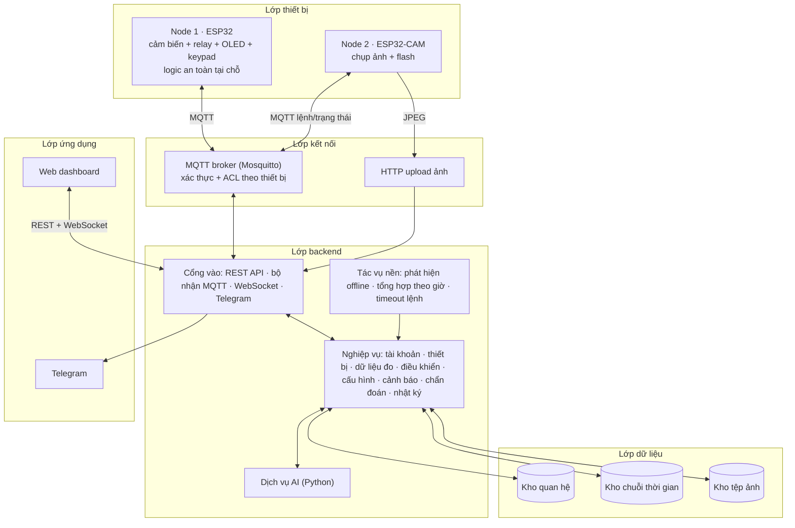
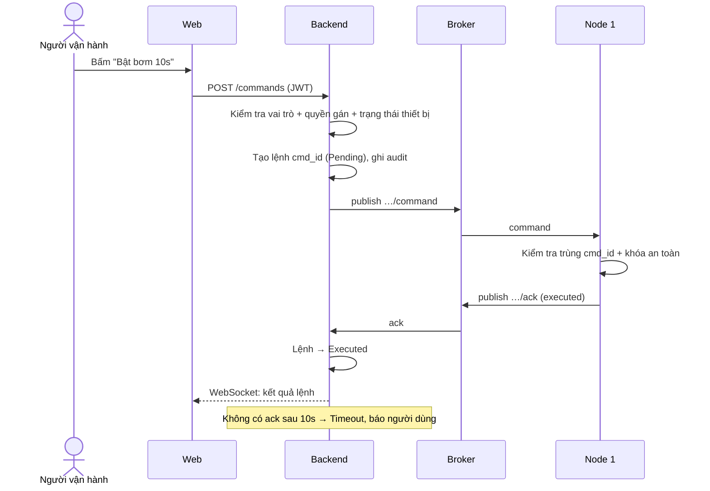
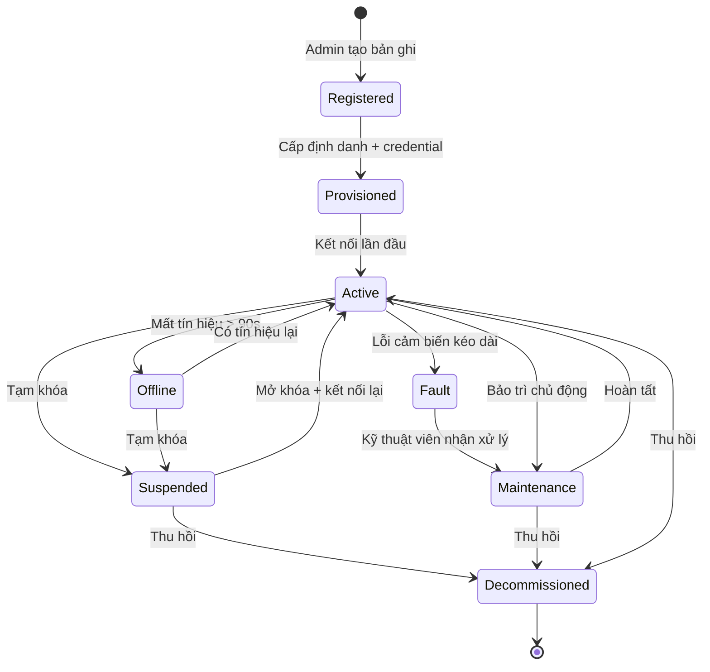

# Phân tích hệ thống — Hệ thống chăm sóc vườn ươm thông minh

> **Tài liệu lịch sử (v0.1, 31/10).** Các điểm ⚠ ở đây đã được chốt trong `dac-ta-he-thong.md` §22, nhiều chỗ đã thay đổi (2 cảm biến đất, không TimescaleDB, không Docker từ 05/11...). Khi hai tài liệu khác nhau, **đặc tả là nguồn đúng**. Giữ file này để làm báo cáo phần phân tích.

> Đồ án kết thúc học phần **IoT và ứng dụng** · Bản phân tích v0.1 · 31/10/2026
>
> Đầu vào: (1) đề bài đồ án, (2) bộ slide thuyết trình 14 trang của nhóm, (3) danh sách linh kiện hiện có, (4) các quyết định đã chốt khi thảo luận.
>
> Ký hiệu: **FR** = yêu cầu chức năng, **NFR** = yêu cầu phi chức năng, **UC** = use case, **[ĐỀ x.y]** = mục tương ứng trong đề bài, **⚠** = điểm cần nhóm chốt.

---

## Mục lục

0. Tổng quan quy trình phân tích
1. Bài toán và phạm vi
2. Bước 1 — Phân tích yêu cầu
3. Bước 2 — Kiến trúc
4. Phân tích phần cứng
5. Bước 3 — Mô hình dữ liệu
6. Bước 4 — Giao diện và giao thức
7. Bước 5 — Hành vi (mô hình trạng thái)
8. Bước 6 — Phân quyền và bảo mật
9. Chức năng nâng cao
10. Giao diện người dùng
11. Kế hoạch kiểm thử
12. Đối chiếu với yêu cầu đề bài
13. Rủi ro và điểm cần chốt
14. Lộ trình thực hiện

---

## 0. Tổng quan quy trình phân tích

Phân tích đi theo 6 bước giống bộ slide. Mỗi bước cho ra một mô hình, và mô hình đó là đầu vào của bước sau:

| Bước | Câu hỏi trả lời | Sản phẩm | Mục |
|---|---|---|---|
| 1. Yêu cầu | Ai dùng, để làm gì, tốt đến mức nào? | Tác nhân, use case, FR, NFR | §2 |
| 2. Kiến trúc | Hệ thống chia thành những khối nào? | Sơ đồ phân lớp, khối nghiệp vụ, sơ đồ triển khai | §3, §4 |
| 3. Dữ liệu | Cần lưu những gì, ràng buộc ra sao? | ERD, ràng buộc toàn vẹn | §5 |
| 4. Giao diện | Các thành phần nói chuyện với nhau thế nào? | REST API, topic MQTT, payload, sequence diagram | §6 |
| 5. Hành vi | Đối tượng thay đổi trạng thái thế nào? | Máy trạng thái thiết bị, lệnh, cảnh báo, chẩn đoán | §7 |
| 6. Bảo mật | Ai được làm gì, chống lại mối đe dọa nào? | Ma trận quyền, mô hình đe dọa | §8 |

Sau 6 bước là **hiện thực** và **kiểm thử truy vết ngược**: mỗi use case có ít nhất một ca kiểm thử (§11).

---

## 1. Bài toán và phạm vi

### 1.1. Bối cảnh và vấn đề

Giai đoạn cây giống là giai đoạn nhạy cảm nhất: rễ nông, sức chống chịu kém. Chỉ vài giờ thiếu nước là cây héo, còn thừa nước kéo dài thì úng rễ và sinh nấm bệnh. Thực tế hiện nay có ba vấn đề:

| # | Vấn đề | Hệ quả |
|---|---|---|
| V1 | Tưới theo kinh nghiệm hoặc hẹn giờ cố định, không dựa trên độ ẩm thật của đất | Lúc thừa, lúc thiếu nước |
| V2 | Sự cố ban đêm (nóng đột ngột, hết nước bể, mất điện) chỉ phát hiện vào sáng hôm sau | Hỏng cả khay cây |
| V3 | Chủ vườn không thể có mặt liên tục, khó phát hiện sớm lá bệnh | Bệnh lây lan trước khi được xử lý |

### 1.2. Vì sao cần giải pháp IoT [ĐỀ 4.1]

1. **Dữ liệu chỉ có ở thực địa.** Độ ẩm trong đất, vi khí hậu quanh khay, ánh sáng tại điểm trồng phải đo tại chỗ bằng cảm biến. Không thể nhập tay hay lấy từ nguồn có sẵn.
2. **Kết quả là hành động vật lý.** Bơm phải chạy, quạt phải quay. Một ứng dụng web chỉ nhắc được người đi tưới.
3. **Phải phản ứng liên tục, kể cả khi mất mạng.** Chu kỳ phát hiện và can thiệp tính bằng phút, 24/7. Logic an toàn phải chạy ngay trên thiết bị tại vườn.

### 1.3. Đối tượng sử dụng và bên liên quan

| Đối tượng | Mô tả | Nhu cầu chính |
|---|---|---|
| Quản trị viên | Quản trị hệ thống | Quản lý tài khoản, đưa thiết bị vào và ra khỏi hệ thống, xem audit |
| Người vận hành | Chủ vườn, kỹ thuật viên chăm sóc | Giám sát, điều khiển, chỉnh ngưỡng, xử lý cảnh báo, xác nhận chẩn đoán |
| Người xem | Ví dụ chủ đầu tư, khách đặt cây giống | Chỉ xem dữ liệu và tình trạng cây |
| Bên liên quan gián tiếp | Giảng viên (đánh giá), nhà cung cấp hạ tầng (WiFi, Telegram) | — |

### 1.4. Mục tiêu hệ thống

- **M1.** Giám sát liên tục độ ẩm đất, nhiệt độ, độ ẩm không khí, ánh sáng và mực nước bể.
- **M2.** Tự động tưới và thông gió theo ngưỡng cấu hình được. Có khóa an toàn tại thiết bị.
- **M3.** Cho phép điều khiển và cấu hình từ xa. Mọi lệnh đều được thiết bị xác nhận.
- **M4.** Cảnh báo kịp thời khi vượt ngưỡng, khi thiết bị offline, khi phát hiện lá bất thường.
- **M5.** Quản lý người dùng, phân quyền và toàn bộ vòng đời thiết bị.
- **M6.** Chụp ảnh khay cây định kỳ và đánh giá sức khỏe lá bằng AI, để hỗ trợ ra quyết định.

### 1.5. Phạm vi triển khai

| Trong phạm vi | Ngoài phạm vi |
|---|---|
| Một vườn ươm nhỏ trong nhà, dưới 20 m², 1–2 khay cây | Vườn quy mô lớn, nhiều khu cách xa nhau (LoRa) |
| 2 node vật lý: Node 1 điều khiển, Node 2 camera | Nguồn điện lưới, pin mặt trời |
| Backend, CSDL, broker chạy trên máy tính cá nhân bằng Docker Compose, cùng mạng WiFi | Triển khai cloud công cộng (chỉ là hướng mở rộng) |
| Web dashboard | Ứng dụng di động gốc (native app) |
| Thông báo qua Telegram | SMS, Zalo |
| AI chẩn đoán 3 lớp lá trên cây cà chua giống | Chẩn đoán đa loài, chẩn đoán bệnh rễ |
| Thiết bị mô phỏng để kiểm thử tải (bổ trợ) | Thay thế thiết bị thật bằng mô phỏng |

### 1.6. Ràng buộc [ĐỀ 4.1]

| Loại | Ràng buộc |
|---|---|
| Chi phí | Dùng linh kiện đã mua (§4). Chỉ bổ sung vài món giá rẻ |
| Thiết bị | ESP32-WROOM-32 (Node 1), ESP32-CAM OV2640 (Node 2). Bộ nhớ, GPIO và sức tính toán hạn chế, nên AI chạy ở backend |
| Năng lượng | Toàn hệ thống chạy 5V DC từ củ sạc 5V/3A và 5V/2A. Không đấu điện lưới [ĐỀ 10] |
| Mạng | WiFi nội bộ, có thể chập chờn. Thiết bị phải tự kết nối lại và đệm dữ liệu |
| Độ trễ | Không yêu cầu thời gian thực cứng. Độ trễ vài giây chấp nhận được |
| Độ tin cậy | Logic tưới và khóa an toàn phải chạy được khi backend hoặc mạng không khả dụng |
| An toàn | Tải ở tiếp điểm NO (mất điện thì tải tắt). Giới hạn thời gian bơm. Chặn bơm khi bể cạn |
| Quyền riêng tư | Camera chỉ hướng vào khay cây, không thu hình người. Ảnh lưu nội bộ, có phân quyền và thời hạn lưu |

### 1.7. Tiêu chí đánh giá thành công

1. Chu trình đầu cuối chạy được: đo → gửi → lưu → phát hiện ngưỡng → ra lệnh → thiết bị thực thi → xác nhận.
2. Ba vai trò hoạt động đúng phân quyền, kiểm chứng bằng kiểm thử.
3. Vòng đời thiết bị đi đủ các trạng thái. Thiết bị bị thu hồi không kết nối được broker.
4. Đạt toàn bộ chỉ tiêu NFR01–NFR07 (§2.5).
5. AI có chỉ số đánh giá trên ảnh thật do Node 2 chụp, kèm ma trận nhầm lẫn.
6. Demo trực tiếp đủ 10 bước của đề [ĐỀ 8.4] và phần AI.

---

## 2. Bước 1 — Phân tích yêu cầu

### 2.1. Tác nhân (7)

| Loại | Tác nhân | Vai trò trong hệ thống |
|---|---|---|
| Người | Quản trị viên | Kế thừa mọi quyền của Người vận hành, thêm phần quản trị |
| Người | Người vận hành | Kế thừa mọi quyền của Người xem, thêm điều khiển và xử lý |
| Người | Người xem | Chỉ đọc, trên thiết bị được gán |
| Thiết bị | Node điều khiển (Node 1) | Gửi số liệu đo, nhận lệnh và cấu hình |
| Thiết bị | Node camera (Node 2) | Chụp và tải ảnh khay cây, nhận lệnh chụp và cấu hình |
| Thời gian | Bộ định thời | Kích hoạt tác vụ định kỳ: phát hiện offline, tổng hợp dữ liệu |
| Hệ thống ngoài | Kênh nhắn tin (Telegram) | Nhận thông báo cảnh báo |

### 2.2. Danh sách use case (24)

**Nhóm người dùng** (mọi UC đều «include» UC00 Đăng nhập)

| Mã | Use case | Tác nhân chính | Ưu tiên |
|---|---|---|---|
| UC00 | Đăng nhập, đăng xuất, làm mới phiên | Mọi người dùng | Bắt buộc |
| UC01 | Xem dashboard thời gian thực | Người xem | Bắt buộc |
| UC02 | Xem lịch sử, biểu đồ, xuất dữ liệu | Người xem | Bắt buộc |
| UC03 | Xem danh sách cảnh báo | Người xem | Bắt buộc |
| UC04 | Xem ảnh và kết quả chẩn đoán | Người xem | Nâng cao |
| UC05 | Gửi lệnh điều khiển (bơm, quạt, …, lệnh chụp ảnh) | Người vận hành | Bắt buộc |
| UC06 | Thay đổi ngưỡng, cấu hình thiết bị | Người vận hành | Bắt buộc |
| UC07 | Xác nhận, đóng cảnh báo | Người vận hành | Bắt buộc |
| UC08 | Xác nhận hoặc bác bỏ kết quả chẩn đoán | Người vận hành | Nâng cao |
| UC09 | Đổi mật khẩu, cập nhật thông tin cá nhân | Mọi người dùng | Bắt buộc |
| UC10 | Quản lý người dùng (tạo, khóa, gán vai trò) | Quản trị viên | Bắt buộc |
| UC11 | Đăng ký và cấp phát thiết bị | Quản trị viên | Bắt buộc |
| UC12 | Gán thiết bị cho người dùng, khu vực | Quản trị viên | Bắt buộc |
| UC13 | Tạm khóa, mở khóa, thu hồi (decommission) thiết bị | Quản trị viên | Bắt buộc |
| UC14 | Chuyển thiết bị sang bảo trì, ghi nhận lỗi | Quản trị viên, Người vận hành | Bắt buộc |
| UC15 | Cấu hình luật cảnh báo | Quản trị viên | Bắt buộc |
| UC16 | Xem nhật ký audit | Quản trị viên | Bắt buộc |

**Nhóm thiết bị và thời gian**

| Mã | Use case | Tác nhân chính | Ưu tiên |
|---|---|---|---|
| UC17 | Gửi dữ liệu đo (telemetry) | Node 1 | Bắt buộc |
| UC18 | Báo trạng thái trực tuyến (heartbeat, LWT, phiên bản firmware) | Node 1, Node 2 | Bắt buộc |
| UC19 | Thực thi lệnh, gửi xác nhận | Node 1, Node 2 | Bắt buộc |
| UC20 | Nhận cấu hình mới | Node 1, Node 2 | Bắt buộc |
| UC21 | Tải ảnh khay cây lên («include» UC24) | Node 2 | Bắt buộc với Node 2 |
| UC22 | Phát hiện thiết bị offline | Bộ định thời | Bắt buộc |
| UC23 | Tổng hợp dữ liệu theo giờ | Bộ định thời | Nên có |

**Use case lõi, do use case khác kích hoạt**

| Mã | Use case | Được kích hoạt bởi |
|---|---|---|
| UC24 | Chẩn đoán ảnh lá | UC21 |
| UC25 | Sinh cảnh báo («include» UC26) | UC17 vượt ngưỡng, UC22 offline, UC24 bất thường |
| UC26 | Gửi thông báo qua Telegram | UC25 |

> Tổng cộng 24 UC cụ thể, cộng 3 UC lõi. Slide 4 gom chúng thành 10 UC tổng quát.

### 2.3. Đặc tả các use case quan trọng

**UC11 — Đăng ký và cấp phát thiết bị**

- **Tác nhân:** Quản trị viên.
- **Tiền điều kiện:** Đã đăng nhập với vai trò quản trị.
- **Luồng chính:**
  1. Nhập loại thiết bị (controller/camera), tên, khu vực, phiên bản phần cứng.
  2. Hệ thống sinh `device_id` duy nhất và mật khẩu MQTT ngẫu nhiên. Mật khẩu chỉ lưu dạng băm.
  3. Hệ thống tạo tài khoản và ACL trên broker, chỉ cho phép nhánh topic của thiết bị đó.
  4. Hiển thị thông tin xác thực **một lần duy nhất** để nạp vào `secrets.h`. Trạng thái là **Provisioned**.
  5. Thiết bị kết nối lần đầu, gửi `status: online`. Trạng thái chuyển sang **Active**.
- **Luồng thay thế:** Thông tin xác thực bị lộ thì quản trị viên cấp lại. Mật khẩu cũ mất hiệu lực ngay.
- **Hậu điều kiện:** Thiết bị có bản ghi, có tài khoản broker riêng, có dòng audit.

**UC05 — Gửi lệnh điều khiển** (ví dụ bật bơm 10 giây)

- **Tác nhân:** Người vận hành.
- **Tiền điều kiện:** Được gán thiết bị với mức quyền điều khiển. Thiết bị ở trạng thái Active.
- **Luồng chính:**
  1. Người dùng bấm bật bơm, gửi `POST /commands`.
  2. Backend kiểm tra vai trò, quyền gán và trạng thái thiết bị. Tạo lệnh với `cmd_id` duy nhất, trạng thái **Pending**, ghi audit.
  3. Backend publish xuống topic `command`.
  4. Node 1 kiểm tra trùng `cmd_id` và khóa an toàn (bể cạn, đang nghỉ, cảm biến lỗi), rồi thực thi.
  5. Node 1 publish `ack` với kết quả `executed` hoặc `duration_capped`.
  6. Backend cập nhật lệnh sang **Executed** và đẩy kết quả lên giao diện qua WebSocket.
- **Luồng thay thế:**
  - 4a. Khóa an toàn chặn: ack trả `blocked_no_water` hoặc `blocked_cooldown`, lệnh chuyển sang **Rejected**.
  - 5a. Sau 10 giây không có ack: lệnh chuyển sang **Timeout**, người dùng được báo.
  - 2a. Không có quyền: trả 403, ghi audit lần thử.
- **Hậu điều kiện:** Lệnh có trạng thái cuối, được lưu lịch sử.

**UC13 — Thu hồi thiết bị**

- **Tác nhân:** Quản trị viên.
- **Luồng chính:**
  1. Chọn thiết bị, chọn Tạm khóa hoặc Thu hồi, nhập lý do.
  2. Backend vô hiệu tài khoản broker và cắt kết nối hiện tại.
  3. Backend đổi trạng thái sang **Suspended** hoặc **Decommissioned**. Không xóa cứng, lịch sử giữ nguyên. Ghi audit.
- **Hậu điều kiện:** Thiết bị cố kết nối lại thì broker từ chối. Đây là bước 10 của kịch bản demo.

**UC21 + UC24 — Chụp và chẩn đoán ảnh**

- **Tác nhân:** Node 2, hoặc Người vận hành dùng lệnh "chụp ngay".
- **Luồng chính:**
  1. Đến chu kỳ chụp, hoặc nhận lệnh `capture`.
  2. Node 2 bật flash nếu cấu hình yêu cầu, chụp ảnh JPEG.
  3. Node 2 gửi `POST` ảnh lên backend kèm thông tin xác thực thiết bị.
  4. Backend kiểm tra kích thước và định dạng, lưu tệp, tạo bản ghi chẩn đoán ở trạng thái **Queued**.
  5. Dịch vụ AI cắt ảnh thành lưới ô, phân loại từng ô, lưu nhãn và độ tin cậy. Trạng thái chuyển sang **Done**.
  6. Một ô bất thường liên tiếp 3 ảnh với độ tin cậy ≥ 0,8 thì sinh cảnh báo kèm ảnh.
  7. Người vận hành xác nhận đúng hoặc sai (UC08). Phản hồi này dùng làm dữ liệu huấn luyện lại.

### 2.4. Yêu cầu chức năng

| Mã | Yêu cầu | Đề bài |
|---|---|---|
| **Thiết bị** | | |
| FR-D1 | Node 1 đọc độ ẩm đất (2 điểm), nhiệt độ và độ ẩm không khí, ánh sáng, mực nước bể | 4.2 |
| FR-D2 | Mỗi node có `device_id` và thông tin xác thực riêng | 4.2, 4.5 |
| FR-D3 | Gửi telemetry định kỳ (mặc định 10 giây), có timestamp, đơn vị và số thứ tự | 4.2, 4.3 |
| FR-D4 | Nhận lệnh và cấu hình từ xa. Trả ack cho mọi lệnh | 4.2, 4.4e |
| FR-D5 | Điều khiển bơm và quạt qua relay. Node 2 điều khiển đèn flash | 4.2 |
| FR-D6 | Heartbeat định kỳ và LWT. Báo phiên bản firmware và phần cứng | 4.2, 4.4b |
| FR-D7 | Tự kết nối lại WiFi và MQTT. Đệm tối thiểu 100 bản ghi khi mất mạng, gửi bù khi có lại | 4.2 |
| FR-D8 | Logic tưới và thông gió tự động tại thiết bị, có khóa an toàn | 1.6 |
| FR-D9 | Hiển thị trạng thái tại chỗ trên OLED. Điều khiển tay bằng keypad, có mã PIN | — |
| FR-D10 | Node 2 chụp ảnh theo chu kỳ hoặc theo lệnh, tải ảnh lên backend | 5.2 |
| **Người dùng** | | |
| FR-U1 | Tạo tài khoản (do quản trị tạo, hoặc đăng ký chờ duyệt) | 4.4a |
| FR-U2 | Đăng nhập, đăng xuất. Phiên có hạn, làm mới được | 4.4a |
| FR-U3 | Đổi mật khẩu, cập nhật thông tin | 4.4a |
| FR-U4 | Trạng thái tài khoản: hoạt động hoặc bị khóa | 4.4a |
| FR-U5 | Ba vai trò, kèm phân quyền theo thiết bị được gán | 4.4a |
| **Vòng đời thiết bị** | | |
| FR-L1 | Đăng ký, cấp định danh và thông tin xác thực | 4.4b.1–2 |
| FR-L2 | Gán thiết bị cho người dùng, vườn, khu vực | 4.4b.3 |
| FR-L3 | Kích hoạt, cấu hình từ xa | 4.4b.4–5 |
| FR-L4 | Theo dõi online/offline, phiên bản phần cứng và firmware | 4.4b.6–7 |
| FR-L5 | Ghi nhận lỗi, chuyển sang bảo trì | 4.4b.8 |
| FR-L6 | Tạm khóa, thu hồi quyền kết nối, decommission | 4.4b.9–10 |
| **Dữ liệu** | | |
| FR-T1 | Tiếp nhận và kiểm tra hợp lệ telemetry (khoảng giá trị, kiểu, trùng `seq`) | 4.4c |
| FR-T2 | Lưu theo thời gian. Tra cứu theo thiết bị và khoảng thời gian | 4.4c |
| FR-T3 | Hiển thị hiện tại và lịch sử bằng bảng và biểu đồ | 4.4c |
| FR-T4 | Thống kê min/max/trung bình theo giờ và ngày. Xuất CSV | 4.4c |
| **Cảnh báo** | | |
| FR-A1 | Luật cảnh báo cấu hình được (chỉ số, toán tử, ngưỡng, thời gian duy trì, mức độ) | 4.4d |
| FR-A2 | Sinh cảnh báo khi vượt ngưỡng, khi offline, khi AI phát hiện bất thường | 4.4d |
| FR-A3 | Lưu lịch sử. Người dùng xác nhận và đóng cảnh báo | 4.4d |
| FR-A4 | Gửi Telegram. Không gửi lặp cùng luật, cùng thiết bị trong 30 phút | 4.4d |
| **Điều khiển** | | |
| FR-C1 | Gửi lệnh từ giao diện. Kiểm tra quyền ở backend | 4.4e |
| FR-C2 | Lưu lịch sử lệnh và kết quả thực thi | 4.4e |
| **Hệ thống** | | |
| FR-S1 | Ghi audit log cho thao tác quan trọng | 4.5 |
| FR-S2 | Dashboard tổng quan trạng thái hệ thống | 4.4d |

### 2.5. Yêu cầu phi chức năng

| Mã | Chỉ tiêu | Ngưỡng | Cách đo |
|---|---|---|---|
| NFR01 | Độ trễ cảm biến → dashboard | < 3 giây (p95) | So `ts` trên thiết bị (đồng bộ NTP) với thời điểm hiển thị, trên 100 mẫu |
| NFR02 | Độ trễ lệnh → ack | < 2 giây (p95) | So thời điểm tạo lệnh với thời điểm nhận ack, trên 50 lệnh |
| NFR03 | Thời gian phát hiện offline | ≤ 90 giây | Rút nguồn node, bấm giờ đến khi dashboard hiện Offline |
| NFR04 | Chạy liên tục | 72 giờ không treo | Theo dõi heartbeat và số lần khởi động lại |
| NFR05 | Tỷ lệ mất bản tin | < 1% | Đếm khoảng trống `seq` trong CSDL |
| NFR06 | Khôi phục sau mất mạng | < 30 giây kết nối lại, 0 mất dữ liệu khi mất mạng ≤ 15 phút | Tắt router, bật lại, kiểm tra dữ liệu gửi bù |
| NFR07 | Đệm khi mất mạng | ≥ 100 bản ghi | Ngắt mạng lâu hơn 100 chu kỳ |
| NFR08 (bổ sung) | Xử lý bản tin trùng | 0 bản ghi trùng, 0 lệnh thực thi 2 lần | Gửi lặp cùng `seq` hoặc `cmd_id` |
| NFR09 (bổ sung) | Khả năng tải | ≥ 20 thiết bị mô phỏng × 1 bản tin/giây | Script mô phỏng, đo CPU, RAM và độ trễ backend |

### 2.6. Kịch bản sử dụng chính

| # | Kịch bản | Use case liên quan |
|---|---|---|
| KB1 | Đêm nóng 35°C: quạt tự bật, cảnh báo Telegram gửi chủ vườn | UC17, UC25, UC26 |
| KB2 | Đất khô dưới ngưỡng: Node 1 tự tưới; bể cạn thì khóa bơm và cảnh báo | UC17, UC25 |
| KB3 | Chủ vườn đi vắng: mở web, xem biểu đồ, bật bơm tay, nhận ack | UC01, UC02, UC05, UC19 |
| KB4 | Camera phát hiện đốm lá ở một ô: cảnh báo kèm ảnh, kỹ thuật viên xác nhận | UC21, UC24, UC25, UC08 |
| KB5 | Mất WiFi 10 phút: Node 1 vẫn tưới theo ngưỡng, có mạng lại thì gửi bù dữ liệu | UC17, UC22 |
| KB6 | Thay node hỏng: thu hồi node cũ, đăng ký node mới, gán vào khu vực | UC11, UC12, UC13 |

---

## 3. Bước 2 — Kiến trúc

### 3.1. Kiến trúc phân lớp [ĐỀ 6]



Lớp edge/gateway: hệ thống không có gateway riêng. Node 1 tự làm **edge**: chạy logic điều khiển, khóa an toàn và đệm dữ liệu tại chỗ. Cần nêu rõ điều này trong sơ đồ các lớp.

### 3.2. Khối nghiệp vụ (8 khối + tác vụ nền)

| Khối | Use case phục vụ | Ghi chú |
|---|---|---|
| Tài khoản và quyền | UC00, UC09, UC10 | |
| Quản lý thiết bị | UC11–UC14, UC18 | Chứa máy trạng thái vòng đời, đồng bộ ACL broker |
| Dữ liệu đo | UC01, UC02, UC17, UC23 | Kiểm tra hợp lệ, chống trùng `seq` |
| Điều khiển | UC05, UC19 | Lệnh là việc một lần, có trạng thái cuối |
| Cấu hình | UC06, UC20 | Cấu hình là trạng thái được giữ lại (retain) |
| Cảnh báo | UC03, UC07, UC15, UC25, UC26 | Rule engine, chống gửi lặp |
| Chẩn đoán ảnh | UC04, UC08, UC21, UC24 | Gọi dịch vụ AI |
| Nhật ký | UC16 | Chỉ ghi thêm |
| Tác vụ nền | UC22, UC23 | Bộ định thời |

### 3.3. Quyết định kiến trúc

| # | Quyết định | Lý do | Đánh đổi |
|---|---|---|---|
| QĐ1 | Logic tưới và khóa an toàn chạy trên Node 1, backend chỉ đổi ngưỡng và gửi lệnh tay | Mất mạng hay backend dừng thì cây vẫn an toàn | Đổi logic phải nạp lại firmware |
| QĐ2 | MQTT cho telemetry, lệnh, cấu hình và trạng thái | Nhẹ, publish/subscribe, có LWT và retain, hợp thiết bị yếu | Phải vận hành broker |
| QĐ3 | Ảnh gửi qua HTTP POST, không qua MQTT | Ảnh 10–30 KB vượt buffer mặc định của PubSubClient. HTTP hỗ trợ upload tệp tốt | Thêm một kênh cần xác thực thiết bị. Đề cho phép nếu giải thích được [ĐỀ 4.3] |
| QĐ4 | AI chạy ở backend, không chạy trên ESP32-CAM | ESP32-CAM không đủ RAM và CPU cho mô hình phân loại | Phụ thuộc mạng. Bù lại, Node 2 hỏng thì việc tưới không bị ảnh hưởng |
| QĐ5 | Phân lớp nghiêm ngặt: cổng vào chỉ xác thực và kiểm tra đầu vào, quy tắc nằm ở lớp nghiệp vụ | Web và bot dùng chung một quy tắc phân quyền | Thêm mã trung gian |
| QĐ6 | QoS 1 cho lệnh và cấu hình, chống trùng ở tầng ứng dụng bằng `cmd_id` và `seq` | Đơn giản hơn QoS 2. PubSubClient chỉ publish QoS 0 | Phải tự quản lý dedup |
| QĐ7 | Triển khai bằng Docker Compose | Chạy một lệnh, dễ demo, đáp ứng mục nâng cao | Nhóm cần làm quen Docker |

### 3.4. Sơ đồ triển khai

```
┌──────────────── Máy tính (Docker Compose) ────────────────┐
│  mosquitto:1883/8883   backend:8080   ai-service:8000      │
│  postgres(+timescale):5432   frontend:80   volume ảnh      │
└──────────────────────────┬────────────────────────────────┘
                           │ WiFi LAN (router nhóm)
          ┌────────────────┼────────────────┐
     Node 1 (ESP32)   Node 2 (ESP32-CAM)   Trình duyệt người dùng
                                            Telegram API (Internet)
```

### 3.5. Lựa chọn công nghệ ⚠

Bộ slide hiện ghi: FastAPI, PostgreSQL + TimescaleDB, React, Mosquitto, Telegram. Thành phần nào cũng có lựa chọn thay thế:

| Thành phần | Theo slide | Phương án thay thế | Tiêu chí chọn |
|---|---|---|---|
| Backend | FastAPI (Python) | Spring Boot (Java) | Ngôn ngữ nhóm thạo nhất. Người làm backend phải bảo vệ được phần này |
| Dịch vụ AI | Python | Python (bắt buộc vì hệ sinh thái mô hình) | Nếu backend là Java thì AI tách thành service riêng, gọi qua HTTP |
| CSDL | PostgreSQL + TimescaleDB | PostgreSQL thường + bảng tổng hợp theo giờ | TimescaleDB tiện cho chuỗi thời gian nhưng thêm độ phức tạp |
| Frontend | React | Vue, hoặc template phía server | |
| Broker | Mosquitto | EMQX | Mosquitto nhẹ, ACL đủ dùng |

> Phân tích ở các mục sau không phụ thuộc vào công nghệ cụ thể.

---

## 4. Phân tích phần cứng

### 4.1. Node 1 — Node điều khiển

| Chức năng | Linh kiện | Đại lượng / vai trò |
|---|---|---|
| Vi điều khiển | ESP32-WROOM-32 NodeMCU-32S 30 chân + đế ra chân | Xử lý, WiFi |
| Độ ẩm đất | 2 × module cảm biến độ ẩm đất (analog) | %, quy đổi từ ADC sau hiệu chuẩn |
| Nhiệt độ, độ ẩm không khí | DHT22 | °C, %RH |
| Ánh sáng | BH1750 (I2C) | lux |
| Mực nước bể | HC-SR04 + cầu chia áp 1k/2k cho chân ECHO | cm, quy đổi sang % |
| Hiển thị tại chỗ | OLED 1.3" I2C (dùng chung bus với BH1750) | Trạng thái, IP, cảnh báo |
| Nhập tại chỗ | Keypad 3×4 | Chế độ tay, nhập PIN |
| Cơ cấu chấp hành | Relay 4 kênh → bơm chìm mini, quạt 5V, (động cơ mini ⚠) | Tưới, thông gió |
| Bảo vệ | Tụ 1000 µF, diode 1N4007 song song tải cảm, tải ở tiếp điểm NO | Chống sụt áp, triệt xung ngược |
| Nguồn | Củ sạc 5V/3A → domino | Cấp relay và tải. ESP32 dùng chung GND |

Ngân sách GPIO khoảng 17 chân: 2 ADC1, 1 DHT22, 2 I2C, 2 HC-SR04, 3 relay, 7 keypad. Board 30 chân đáp ứng được. Cảm biến đất **bắt buộc** dùng ADC1 (GPIO32–39), vì ADC2 không đọc được khi WiFi bật.

### 4.2. Node 2 — Node camera

| Chức năng | Linh kiện | Ghi chú |
|---|---|---|
| Vi điều khiển + camera | ESP32-CAM OV2640 + đế nạp | Ảnh JPEG, độ phân giải cấu hình được |
| Đầu ra điều khiển được | Đèn flash trên board (GPIO4) | Đáp ứng yêu cầu nhận lệnh, điều khiển đầu ra |
| Cảm biến phụ (tùy chọn) ⚠ | DHT11 (đang dư) | Có thì Node 2 gửi thêm telemetry số |
| Nguồn | Củ sạc 5V/2A qua đế nạp | Nguồn yếu sẽ brownout khi bật camera và WiFi |

Node 2 phải là **thiết bị đầy đủ**, không chỉ là camera: có định danh riêng, heartbeat/LWT, nhận lệnh `capture` và cấu hình (chu kỳ, độ phân giải, flash), trả ack, tự kết nối lại, và đi qua đủ vòng đời như Node 1.

### 4.3. Logic tại thiết bị (edge, Node 1)

| Logic | Mô tả |
|---|---|
| Tưới tự động có trễ | Độ ẩm < `soil_low` thì bơm, đến khi > `soil_high`, hoặc hết `pump_max_s` |
| Giới hạn an toàn | Thời gian bơm tối đa mỗi lần, thời gian nghỉ (cooldown) giữa 2 lần |
| Khóa bể cạn | Mực nước < `tank_min` thì chặn bơm (cả tự động lẫn lệnh tay) và gửi event |
| Thông gió | Nhiệt độ > `temp_high` hoặc độ ẩm KK > `hum_high` thì bật quạt, có trễ |
| Hợp nhất 2 cảm biến đất ⚠ | Cả 2 hợp lệ và lệch ≤ 30 điểm: lấy trung bình. Lệch > 30: báo lỗi cảm biến và tạm khóa tưới tự động. Chỉ 1 hợp lệ: dùng 1, kèm cảnh báo. Không còn cái nào hợp lệ: khóa tưới tự động |
| Đệm khi mất mạng | Hàng đợi vòng ≥ 100 bản ghi, gửi bù theo thứ tự `seq` |
| Chống lệnh trùng | Nhớ 20 `cmd_id` gần nhất. Lệnh trùng thì gửi lại ack cũ, không thực thi lại |
| Chế độ tay tại chỗ | Keypad + PIN để bật/tắt bơm, quạt. Vẫn chịu khóa an toàn. Sinh event `local_override` |
| Cấu hình | Lưu NVS. Nhận từ topic `config` (retained) khi khởi động |

### 4.4. Chênh lệch so với bộ slide hiện tại ⚠

| Slide đang ghi | Thực tế linh kiện | Cần làm |
|---|---|---|
| 3 cảm biến đất, lấy trung vị | Chỉ có 2 | Đổi thuật toán (§4.3) hoặc mua thêm 1 cảm biến |
| Relay 3 điều khiển đèn LED | Không có đèn LED trong danh sách | Mua dải LED 5V, hoặc bỏ cơ cấu chiếu sáng |
| — | Có động cơ mini 3–6V chưa rõ vai trò | Gán vai trò (rèm che nắng mô phỏng?) hoặc để dự phòng |
| OLED (giả định SSD1306) | OLED 1.3" thường dùng chip SH1106 | Kiểm tra chip trước khi chọn thư viện |
| Bảng chân GPIO 34, 35, 32 | Còn 2 cảm biến | Cập nhật lại bảng chân |

### 4.5. Linh kiện cần bổ sung

| Mức | Món | Lý do |
|---|---|---|
| Bắt buộc | Jack DC cái có cọc vít, hoặc module USB ra dây | Đưa điện từ củ sạc vào domino |
| Bắt buộc | Cáp USB truyền dữ liệu | Nạp code |
| Bắt buộc | Bể nước, chậu/khay, đất, cây giống cà chua | Mô hình demo |
| Nên có | Dải LED 5V | Cơ cấu chiếu sáng theo BH1750 |
| Nên có | Thêm 1 breadboard | Node 1 chật |
| Cho AI | Lá cà chua bệnh, hoặc ảnh in lá bệnh | Demo đủ nhiều lớp |

---

## 5. Bước 3 — Mô hình dữ liệu

### 5.1. Thực thể (14)

| Thực thể | Thuộc tính chính | Kho |
|---|---|---|
| Người dùng `users` | id, username, email, password_hash, role, status, created_at | Quan hệ |
| Phiên `sessions` | id, user_id, refresh_token_hash, expires_at, revoked | Quan hệ |
| Vườn `gardens` | id, name, address | Quan hệ |
| Khu vực `zones` | id, garden_id, name, crop_type | Quan hệ |
| Thiết bị `devices` | id, device_code, type (controller/camera), zone_id, status, hw_version, fw_version, mqtt_username, credential_hash, last_seen_at, created_at | Quan hệ |
| Gán thiết bị `device_assignments` | user_id, device_id, permission (view/control), assigned_by | Quan hệ |
| Cấu hình `device_configs` | id, device_id, version, payload (JSON), applied (ack), created_by | Quan hệ |
| Lệnh `commands` | cmd_id, device_id, action, params, status, issued_by, issued_at, ack_at, result | Quan hệ |
| Bản ghi đo `telemetry` | device_id, seq, ts (thiết bị), received_at, metric, value, unit | **Chuỗi thời gian** |
| Sự kiện `device_events` | device_id, ts, type (pump_on, tank_low, sensor_fault, local_override, …), detail | **Chuỗi thời gian** |
| Chẩn đoán ảnh `diagnoses` | id, device_id, image_path, captured_at, status, grid_results (JSON), top_label, confidence, reviewed_by, review_verdict | Quan hệ + tệp |
| Luật cảnh báo `alert_rules` | id, scope (zone/device), metric, operator, threshold, duration_s, severity, cooldown_min, enabled | Quan hệ |
| Cảnh báo `alerts` | id, rule_id (nullable), device_id, type, severity, message, status, opened_at, ack_by, ack_at, closed_at | Quan hệ |
| Nhật ký audit `audit_logs` | id, actor_id, action, target_type, target_id, detail, ip, ts | Quan hệ (chỉ ghi thêm) |

Bảng phụ: `telemetry_hourly`, chứa min/max/avg theo giờ do UC23 sinh ra.

### 5.2. Quan hệ chính

- Vườn 1–n Khu vực, Khu vực 1–n Thiết bị.
- Người dùng n–n Thiết bị qua `device_assignments`. Bảng này là **lớp phân quyền thứ hai** (§8).
- Thiết bị 1–n với: bản ghi đo, sự kiện, cấu hình, lệnh, chẩn đoán, cảnh báo.
- Luật cảnh báo 1–n Cảnh báo. Người dùng 1–n Phiên và Audit log.

### 5.3. Ràng buộc toàn vẹn

| # | Ràng buộc | Phục vụ yêu cầu |
|---|---|---|
| R1 | Thiết bị không xóa cứng. Thu hồi chỉ đổi trạng thái | Giữ lịch sử, FR-L6 |
| R2 | `UNIQUE(device_id, seq)` trên telemetry. Trùng thì bỏ qua | NFR08 |
| R3 | `cmd_id` duy nhất toàn hệ thống | Chống thực thi 2 lần |
| R4 | `UNIQUE(user_id, device_id)` trên bảng gán | Không gán trùng |
| R5 | Audit log chỉ INSERT, không UPDATE hay DELETE | FR-S1 |
| R6 | `device_code` và `mqtt_username` duy nhất | Định danh riêng |
| R7 | Giá trị đo phải nằm trong miền vật lý của cảm biến (ví dụ DHT22: −40…80°C) | FR-T1 |

### 5.4. Chính sách lưu trữ

- Telemetry thô: giữ 30 ngày. Bảng tổng hợp theo giờ: giữ lâu dài.
- Ảnh: giữ 14 ngày. Ảnh đã được người dùng xác nhận thì giữ lâu hơn để huấn luyện lại.
- Audit log: không xóa trong phạm vi đồ án.

---

## 6. Bước 4 — Giao diện và giao thức

### 6.1. REST API cho người dùng

| Tài nguyên | Phương thức chính | Quyền |
|---|---|---|
| `/auth` | login, refresh, logout | Công khai (login) / đã đăng nhập |
| `/users`, `/users/me` | CRUD, đổi mật khẩu, khóa | Quản trị / bản thân |
| `/gardens`, `/zones` | CRUD | Quản trị |
| `/devices` | đăng ký, sửa, cấp lại khóa, đổi trạng thái, gán | Quản trị (ghi), được gán (đọc) |
| `/devices/{id}/config` | xem, cập nhật | Vận hành được gán |
| `/telemetry` | truy vấn theo thiết bị và khoảng thời gian, tổng hợp, xuất CSV | Được gán |
| `/commands` | gửi lệnh, xem lịch sử | Vận hành được gán |
| `/alerts`, `/alert-rules` | xem, xác nhận, đóng; CRUD luật | Được gán / Quản trị |
| `/diagnoses` | xem, xác nhận kết quả | Được gán / Vận hành |
| `/audit-logs` | xem, lọc | Quản trị |
| `/ws` | WebSocket đẩy telemetry, trạng thái, cảnh báo, kết quả lệnh | Chỉ thiết bị được gán |

**Phía thiết bị:** `POST /device-api/images`. Xác thực bằng thông tin riêng của thiết bị, giới hạn kích thước ảnh, chỉ nhận `image/jpeg`. Thiết bị ở trạng thái Suspended hoặc Decommissioned thì bị từ chối.

### 6.2. Cấu trúc topic MQTT

Gốc topic: `nursery/{garden_id}/{device_id}/…`

| Topic | Chiều | QoS | Retain | Nội dung |
|---|---|---|---|---|
| `…/telemetry` | ↑ | 0 (PubSubClient) | Không | Số liệu đo, mỗi 10 giây |
| `…/status` | ↑ | 1 (LWT) | Có | online/offline, fw_version, ip, rssi, uptime |
| `…/event` | ↑ | 0 | Không | pump_on/off, tank_low, sensor_fault, local_override |
| `…/ack` | ↑ | 0 | Không | Kết quả thực thi lệnh |
| `…/command` | ↓ | 1 | Không | Lệnh điều khiển |
| `…/config` | ↓ | 1 | **Có** | Ngưỡng, chu kỳ. Khởi động lại là nhận ngay bản mới nhất |

ACL broker: thiết bị chỉ được publish lên 4 topic ↑ và subscribe 2 topic ↓ **của chính mình**. Backend có tài khoản riêng, được subscribe `nursery/+/+/#` (topic ↑) và publish các topic ↓.

### 6.3. Định dạng bản tin

Mọi bản tin là JSON và luôn có `device_id`, `ts` (epoch ms, đồng bộ NTP), `seq` (tăng dần, lưu qua khởi động lại). Ví dụ:

```json
// telemetry (Node 1)
{"device_id":"n1-a3f9","seq":10452,"ts":1793421000000,
 "data":{"soil1":{"v":41.2,"u":"%"},"soil2":{"v":43.0,"u":"%"},
         "air_temp":{"v":29.4,"u":"C"},"air_hum":{"v":76.1,"u":"%"},
         "light":{"v":1830,"u":"lux"},"tank":{"v":62,"u":"%"}},
 "state":{"pump":0,"fan":1,"mode":"auto"},"buffered":false}

// command (xuống)
{"cmd_id":"c-7d21e0","action":"pump_on","params":{"duration_s":10},
 "issued_at":1793421005000,"expires_in_s":10}

// ack (lên)
{"device_id":"n1-a3f9","cmd_id":"c-7d21e0","ts":1793421005420,
 "result":"executed","detail":{"actual_s":10}}
```

Các giá trị `result` của ack: `executed` · `duration_capped` · `blocked_no_water` · `blocked_cooldown` · `blocked_sensor_fault` · `invalid` · `expired`.

### 6.4. Cơ chế tin cậy

| Cơ chế | Cách làm |
|---|---|
| Xác nhận lệnh | Mỗi lệnh có `cmd_id`. Sau 10 giây không có ack thì chuyển Timeout |
| Lệnh hết hạn | Thiết bị bỏ qua lệnh đến muộn quá `expires_in_s` (ack `expired`) |
| Online/offline | LWT báo offline ngay khi rớt kết nối. Thêm bộ định thời: không có tin quá 90 giây thì Offline |
| Chống trùng | `seq` cho telemetry, `cmd_id` cho lệnh |
| Kết nối lại | Backoff tăng dần (1 → 2 → 4 … tối đa 30 giây) cho cả WiFi và MQTT |
| Gửi bù | Bản ghi đệm gửi lại với `buffered: true`. Backend dùng `ts` của thiết bị, không dùng giờ nhận |
| Upload ảnh lỗi | Thử lại 3 lần, sau đó bỏ qua và gửi event `upload_failed` |

### 6.5. Sequence diagram (tối thiểu 2, nhóm chuẩn bị 4) [ĐỀ 6]

**SD1 — Gửi lệnh bật bơm**



**SD2 — Đăng ký và kích hoạt thiết bị:** Admin → POST /devices → sinh credential → tạo user và ACL broker → hiển thị credential một lần → nạp firmware → thiết bị CONNECT → publish status online → backend chuyển Active.

**SD3 — Chụp và chẩn đoán ảnh:** Bộ định thời/lệnh → Node 2 chụp → POST ảnh → backend lưu, tạo diagnosis Queued → AI service → kết quả → luật "3 ảnh liên tiếp" → cảnh báo + Telegram.

**SD4 — Phát hiện offline và tự phục hồi:** Node mất điện → broker phát LWT → backend chuyển Offline, sinh cảnh báo → node có điện lại → kết nối lại → gửi bù dữ liệu đệm → Active, đóng cảnh báo offline.

---

## 7. Bước 5 — Hành vi (mô hình trạng thái)

### 7.1. Vòng đời thiết bị (8 trạng thái) [ĐỀ 4.4b]



| Trạng thái | Được kết nối broker? | Nhận lệnh từ người dùng? | Dữ liệu được lưu? |
|---|---|---|---|
| Registered | Không | Không | — |
| Provisioned | Có | Không | Có (lần kết nối đầu) |
| Active | Có | Có | Có |
| Offline | (mất kết nối) | Không, lệnh bị chặn ở backend | Gửi bù khi có lại |
| Fault | Có | Hạn chế: chặn tưới tự động | Có |
| Maintenance | Có | Chỉ Quản trị và Vận hành | Có, gắn cờ bảo trì |
| Suspended | **Không, broker từ chối** | Không | Không |
| Decommissioned | **Không, xóa ACL vĩnh viễn** | Không | Chỉ giữ lịch sử |

### 7.2. Lệnh điều khiển

`Pending` → một trong ba trạng thái cuối: `Executed` (bao gồm duration_capped), `Rejected` (khóa an toàn chặn hoặc lệnh không hợp lệ), `Timeout` (sau 10 giây không có ack).

### 7.3. Cảnh báo

`Open` → `Acknowledged` (người vận hành nhận đã biết) → `Closed` (đã xử lý). Cảnh báo offline tự đóng khi thiết bị trở lại Active. Cùng luật, cùng thiết bị: không mở cảnh báo mới và không gửi Telegram lặp trong 30 phút.

### 7.4. Chẩn đoán ảnh

`Queued` → `Done` hoặc `Failed` → (người dùng) `Confirmed` hoặc `Rejected`. Ảnh `Confirmed` hoặc `Rejected` được đưa vào tập huấn luyện lại.

---

## 8. Bước 6 — Phân quyền và bảo mật

### 8.1. Ma trận vai trò và quyền [ĐỀ 6]

| Chức năng | Quản trị | Vận hành | Người xem |
|---|---|---|---|
| Quản lý tài khoản | Có | Không | Không |
| Đăng ký, cấp phát, thu hồi thiết bị | Có | Không | Không |
| Gán thiết bị cho người dùng | Có | Không | Không |
| Xem dữ liệu, biểu đồ, ảnh | Tất cả | Được gán | Được gán |
| Gửi lệnh, đổi ngưỡng | Có | Được gán (mức control) | Không |
| Xử lý cảnh báo, xác nhận chẩn đoán | Có | Được gán | Không |
| Chuyển bảo trì | Có | Được gán | Không |
| Cấu hình luật cảnh báo | Có | Không | Không |
| Xem nhật ký audit | Có | Không | Không |
| Đổi mật khẩu bản thân | Có | Có | Có |

Phân quyền có hai lớp. **Vai trò** quyết định làm được loại việc gì. **Bảng gán** quyết định làm trên thiết bị nào, và ở mức view hay control.

### 8.2. Ba điểm kiểm tra quyền

1. **API:** mọi request kiểm tra vai trò và quyền trên đúng `device_id` trong đường dẫn. Đổi id trên URL cũng không xem trộm được.
2. **WebSocket:** chỉ đẩy dữ liệu của thiết bị người đó được gán.
3. **Broker:** mỗi thiết bị một tài khoản và chỉ được dùng nhánh topic của mình. Lộ khóa của một thiết bị không ảnh hưởng thiết bị khác.

### 8.3. Biện pháp kỹ thuật [ĐỀ 4.5]

| Yêu cầu đề | Biện pháp |
|---|---|
| Băm mật khẩu | bcrypt cho mật khẩu người dùng và credential thiết bị |
| API yêu cầu xác thực | JWT access token 15 phút, refresh token 7 ngày (lưu dạng băm, thu hồi được) |
| Kiểm tra quyền ở backend | Middleware vai trò + kiểm tra bảng gán ở tầng nghiệp vụ (§8.2) |
| Định danh thiết bị riêng | `device_id` + mật khẩu MQTT riêng từng thiết bị |
| Không lộ bí mật lên GitHub | `.env`, `secrets.h` nằm trong `.gitignore`. Repo chỉ có `.env.example` và `secrets.example.h`. Bật secret scanning |
| Kiểm tra đầu vào | Schema validation cho REST và payload MQTT. Kiểm tra miền giá trị. Giới hạn kích thước ảnh |
| Khóa, thu hồi thiết bị | Vô hiệu tài khoản broker và cắt kết nối ngay (§7.1) |
| Audit log | Đăng nhập (kể cả thất bại), tạo/khóa tài khoản, cấp/thu hồi thiết bị, gửi lệnh, đổi cấu hình, đổi luật |
| TLS | HTTPS cho web (reverse proxy, chứng chỉ tự ký). MQTT/TLS cổng 8883 nếu ESP32 kịp tích hợp, nếu không thì ghi rõ vào phần hạn chế |
| Quyền riêng tư | Camera hướng vào khay. Ảnh chỉ người được gán xem. Xóa sau 14 ngày. Thu thập tối thiểu: tên đăng nhập, email |

### 8.4. Mô hình mối đe dọa [ĐỀ 6]

| # | Mối đe dọa | Thành phần | Biện pháp kiểm soát |
|---|---|---|---|
| T1 | Giả mạo thiết bị gửi dữ liệu giả | Broker | Credential riêng, ACL theo topic, có thể thu hồi |
| T2 | Người dùng xem hoặc điều khiển thiết bị không được gán (IDOR) | API, WS | Kiểm tra bảng gán ở backend |
| T3 | Đánh cắp phiên | Web | Token ngắn hạn, refresh thu hồi được, HTTPS |
| T4 | Dò mật khẩu | API login | bcrypt, khóa tạm sau 5 lần sai, audit |
| T5 | Lộ bí mật qua GitHub | Repo | .gitignore, file mẫu, secret scanning |
| T6 | Phát lại lệnh cũ (replay) | MQTT | `cmd_id` + `expires_in_s`, thiết bị nhớ lệnh đã chạy |
| T7 | Dữ liệu độc hại hoặc sai miền | Bộ nhận | Validation, loại bỏ và ghi log |
| T8 | Nghe lén trong LAN | Kết nối | TLS (nếu kịp). Mạng WiFi riêng cho thiết bị |
| T9 | Lệnh nguy hiểm (bơm chạy mãi gây tràn) | Node 1 | Giới hạn thời gian bơm và khóa an toàn tại thiết bị, không tin hoàn toàn vào backend |
| T10 | Ảnh chứa người | Node 2 | Góc đặt camera, phân quyền xem, thời hạn lưu |

### 8.5. Kiểm thử bảo mật (đề yêu cầu ≥ 2, nhóm làm 5)

| # | Kiểm thử | Kỳ vọng |
|---|---|---|
| ST1 | Người vận hành A gọi API thiết bị của người B | 403, có audit |
| ST2 | Gọi API với token hết hạn hoặc sửa chữ ký | 401 |
| ST3 | Thiết bị đã thu hồi kết nối lại broker | CONNACK bị từ chối |
| ST4 | Thiết bị publish sang topic của thiết bị khác | Broker chặn, backend không nhận |
| ST5 | Gửi telemetry sai miền hoặc sai schema | Bị loại, ghi log |

---

## 9. Chức năng nâng cao

### 9.1. AI chẩn đoán lá từ ảnh Node 2 [ĐỀ 5.2]

| Hạng mục đề yêu cầu | Nội dung |
|---|---|
| Nguồn dữ liệu | PlantVillage (ảnh phòng lab, nền sạch), PlantDoc (ảnh thực địa), ảnh do chính Node 2 chụp |
| Đặc điểm | Lệch miền lớn giữa PlantVillage và ảnh ESP32-CAM: độ phân giải thấp, ánh sáng không đều, chụp cả khay |
| Đối tượng | Cây giống **cà chua**, vì có nhiều lớp trong dataset và dễ mua |
| Nhãn | Gộp về 3 lớp: **Khỏe mạnh · Vàng lá · Đốm lá**. Thêm "Không xác định" khi độ tin cậy dưới ngưỡng |
| Tiền xử lý | Cắt ảnh khay thành lưới 3×3 ô, resize 224×224, chuẩn hóa, augmentation (độ sáng, mờ, xoay). Chia train/test **theo khay và ngày chụp** để tránh rò rỉ dữ liệu |
| Mô hình | MobileNetV2 tiền huấn luyện ImageNet, transfer learning qua 3 giai đoạn: PlantVillage → PlantDoc → ảnh tự chụp |
| Chỉ số | Accuracy, F1 từng lớp, ma trận nhầm lẫn. Báo cáo **hai tầng**: trên tập test dataset, và trên 30–50 ảnh thật của nhóm |
| Tích hợp | Chỉ cảnh báo khi cùng một ô bất thường 3 ảnh liên tiếp với độ tin cậy ≥ 0,8. Cảnh báo kèm ảnh và vị trí ô. **AI không tự can thiệp**, người dùng xác nhận |
| Demo | Ít nhất 2 kết quả khác nhau trực tiếp: cây khỏe + lá bệnh thật hoặc ảnh in lá bệnh. Nói rõ ảnh in là đầu vào kiểm thử |

> Chỉ demo cây khỏe thì đủ để chứng minh luồng dữ liệu, nhưng **không chứng minh được AI**. Mô hình luôn trả "khỏe" thì không phân biệt được với mã cứng.

### 9.2. Các hướng nâng cao khác

| Hướng | Trạng thái dự kiến |
|---|---|
| Edge computing (logic và khóa an toàn tại Node 1) | Có, nằm trong thiết kế lõi |
| Xử lý mất mạng và đồng bộ lại (đệm 100 bản ghi) | Có |
| Rule engine cho cảnh báo | Có (luật cấu hình được) |
| Docker Compose | Có |
| Đánh giá mở rộng bằng thiết bị mô phỏng | Nên có (NFR09) |
| Hỗ trợ nhiều loại thiết bị (controller + camera) | Có, tự nhiên từ kiến trúc 2 node |
| OTA | Chưa làm, đưa vào hướng phát triển. Nếu làm, phải demo được chuyển phiên bản thật |

---

## 10. Giao diện người dùng [ĐỀ 4.6]

| Màn hình | Vai trò thấy | Nội dung chính |
|---|---|---|
| Đăng nhập | Tất cả | Form, thông báo lỗi, khóa tạm khi sai nhiều lần |
| Dashboard tổng quan | Tất cả | Thẻ thiết bị (online/offline), giá trị mới nhất, cảnh báo đang mở, ảnh mới nhất |
| Chi tiết thiết bị | Tất cả (theo gán) | Thông tin, trạng thái vòng đời, fw/hw, biểu đồ realtime, lịch sử lệnh và sự kiện |
| Điều khiển và cấu hình | Vận hành, Quản trị | Nút bơm/quạt/chụp ảnh (hiển thị kết quả ack), form ngưỡng |
| Lịch sử dữ liệu | Tất cả | Chọn thiết bị và khoảng thời gian, biểu đồ, bảng, thống kê, xuất CSV |
| Cảnh báo | Tất cả (xử lý: Vận hành) | Danh sách, lọc, xác nhận, đóng |
| Ảnh và chẩn đoán | Tất cả (xác nhận: Vận hành) | Ảnh, lưới ô tô màu theo nhãn, độ tin cậy, nút xác nhận đúng/sai |
| Quản lý thiết bị | Quản trị | Đăng ký, cấp lại khóa, gán, tạm khóa, thu hồi |
| Quản lý người dùng | Quản trị | Tạo, khóa, đổi vai trò |
| Luật cảnh báo | Quản trị | CRUD luật |
| Nhật ký audit | Quản trị | Lọc theo người, hành động, thời gian |
| Tài khoản cá nhân | Tất cả | Đổi mật khẩu, thông tin |

---

## 11. Kế hoạch kiểm thử [ĐỀ 7]

### 11.1. Kiểm thử chức năng (truy vết về use case)

| Mã | Quy trình đề yêu cầu | UC | Bằng chứng |
|---|---|---|---|
| FT1 | Đăng nhập và phân quyền 3 vai trò | UC00, UC10 | Ảnh màn hình từng vai trò, log 403 |
| FT2 | Đăng ký, kích hoạt thiết bị | UC11, UC18 | Trạng thái Registered → Provisioned → Active |
| FT3 | Thiết bị gửi telemetry | UC17 | Bản ghi trong CSDL, log broker |
| FT4 | Dashboard cập nhật dữ liệu | UC01 | Video |
| FT5 | Gửi và xác nhận lệnh, gồm cả trường hợp bị khóa an toàn | UC05, UC19 | Lịch sử lệnh với 3 kết quả khác nhau |
| FT6 | Đổi cấu hình, thiết bị áp dụng | UC06, UC20 | Hành vi thay đổi theo ngưỡng mới |
| FT7 | Phát hiện offline | UC22 | Thời gian đo được (NFR03) |
| FT8 | Sinh và xử lý cảnh báo, gồm Telegram | UC25, UC26, UC07 | Ảnh tin nhắn, lịch sử cảnh báo |
| FT9 | Khóa hoặc decommission thiết bị | UC13 | Log broker từ chối kết nối |
| FT10 | Chụp, chẩn đoán, xác nhận | UC21, UC24, UC08 | Ảnh và kết quả trên giao diện |

### 11.2. Kiểm thử phi chức năng

Đo theo NFR01–NFR09 (§2.5). Mỗi chỉ tiêu ghi đủ ba phần: **phương pháp**, **dữ liệu đo** (bảng hoặc biểu đồ), **nhận xét**.

### 11.3. Kiểm thử bảo mật

ST1–ST5 (§8.5).

### 11.4. Kiểm thử phần cứng

Lắp và test từng linh kiện bằng sketch chẩn đoán trước khi ghép, theo nguyên tắc "lắp một, test một". Hiệu chuẩn cảm biến đất (ADC khô, ADC ướt) và ghi vào tài liệu `hardware/`.

---

## 12. Đối chiếu với yêu cầu đề bài

### 12.1. Các điều kiện giới hạn điểm [ĐỀ 9]

| Điều kiện | Đáp ứng bằng |
|---|---|
| Có thiết bị vật lý hoạt động | 2 node thật (§4) |
| Có backend quản lý, không chỉ dashboard | Backend tự xây, 8 khối nghiệp vụ (§3.2) |
| Có quản lý người dùng và thiết bị | UC10–UC14, vòng đời 8 trạng thái |
| Có xác thực và phân quyền | §8 |
| Mã nguồn chạy được | Docker Compose + README |
| Demo được luồng đầu cuối | SD1, FT3–FT5 |
| Mọi thành viên vấn đáp được | Phân công theo lớp, mỗi người tự trình bày phần mình |

### 12.2. Danh sách 14 mô hình bắt buộc [ĐỀ 6]

| # | Mô hình | Vị trí trong tài liệu này | Trạng thái |
|---|---|---|---|
| 1 | Sơ đồ bối cảnh hệ thống | §2.1 (tác nhân), cần vẽ | ⬜ Cần vẽ |
| 2 | Sơ đồ use case | §2.2, slide 4–5 | ✅ Có (slide) |
| 3 | Sơ đồ kiến trúc tổng thể | §3.1 | ✅ |
| 4 | Sơ đồ các lớp | §3.1 | ✅ |
| 5 | Sơ đồ khối phần cứng | §4.1–4.2 | ⬜ Cần vẽ |
| 6 | Sơ đồ kết nối cảm biến, cơ cấu chấp hành | §4.1, chờ sơ đồ nối dây | ⬜ Cập nhật theo 2 cảm biến đất |
| 7 | Sơ đồ triển khai | §3.4 | ✅ (bản phác) |
| 8 | ERD | §5 | ⬜ Cần vẽ từ §5.1 |
| 9 | Mô tả API | §6.1 | ⬜ Chi tiết hóa (OpenAPI) |
| 10 | Topic và payload MQTT | §6.2–6.3 | ✅ |
| 11 | Sequence diagram ≥ 2 | §6.5 | ✅ SD1, ⬜ SD2–SD4 vẽ chi tiết |
| 12 | Mô hình trạng thái vòng đời | §7.1 | ✅ |
| 13 | Ma trận vai trò và quyền | §8.1 | ✅ |
| 14 | Mô hình mối đe dọa | §8.4 | ✅ |

### 12.3. Cấu trúc repo [ĐỀ 8.1]

```
README.md  .env.example  .gitignore
firmware/   node1-controller/  node2-camera/  test-hardware/
backend/    ai-service/
frontend/
database/   schema, migration, dữ liệu mẫu
deployment/ docker-compose.yml, mosquitto (acl, conf)
hardware/   sơ đồ nối dây, BOM, ảnh prototype
tests/      kiểm thử API, kịch bản kiểm thử, script mô phỏng thiết bị
docs/       báo cáo, slide, sơ đồ thiết kế (bao gồm tài liệu này)
```

Mỗi thành viên commit bằng tài khoản GitHub của mình. Tag `v1.0.0` khi nộp.

---

## 13. Rủi ro và điểm cần chốt

### 13.1. Điểm cần chốt ⚠

| # | Vấn đề | Đề xuất |
|---|---|---|
| C1 | Công nghệ backend: FastAPI hay Spring Boot | Chọn theo người phụ trách backend. AI vẫn dùng Python |
| C2 | 2 hay 3 cảm biến đất | Giữ 2, dùng thuật toán §4.3, sửa slide 11 |
| C3 | Cơ cấu chiếu sáng | Mua dải LED 5V (rẻ), giữ kịch bản "thiếu sáng thì bật đèn" |
| C4 | Vai trò động cơ mini | Để dự phòng nếu không có kịch bản rõ |
| C5 | DHT11 gắn Node 2 hay không | Có, nếu còn GPIO trống trên ESP32-CAM |
| C6 | MQTT có TLS hay không | Ưu tiên chạy ổn trước. TLS cho web bắt buộc, MQTT/TLS nếu kịp |
| C7 | Lịch thuyết trình của nhóm (4, 11 hay 18/11) | Quyết định mức hoàn thiện cần có trước buổi thuyết trình |

### 13.2. Rủi ro

| Rủi ro | Khả năng | Ảnh hưởng | Giảm thiểu |
|---|---|---|---|
| Thời gian ngắn (≈ 3,5 tuần đến hạn nộp) | Cao | Cao | Ưu tiên phần bắt buộc. AI làm song song bởi 1 người |
| ESP32-CAM brownout, ảnh lỗi | Trung bình | Trung bình | Nguồn 5V/2A riêng, tụ, độ phân giải vừa phải |
| AI kém trên ảnh thật | Cao | Trung bình | Fine-tune bằng ảnh tự chụp. Báo cáo trung thực. Ngưỡng "không xác định" |
| Bơm gây reset ESP32 | Trung bình | Cao | Tụ, diode, nguồn tách, GND chung |
| Không tìm được lá bệnh | Trung bình | Trung bình | Ảnh in từ tập test |
| WiFi tại phòng demo không ổn định | Trung bình | Cao | Mang router riêng, video dự phòng |
| Lộ bí mật lên GitHub | Thấp | Cao | .gitignore từ commit đầu tiên, kiểm tra trước khi push |

---

## 14. Lộ trình thực hiện

| Giai đoạn | Thời gian | Đầu ra chính |
|---|---|---|
| G0 — Chốt thiết kế | 31/10 – 03/11 | Chốt C1–C7, vẽ đủ 14 mô hình, cập nhật slide, tạo repo, Docker Compose khung |
| G1 — Nền tảng | 04/11 – 10/11 | Lắp và test Node 1 từng phần. Node 1 gửi telemetry qua MQTT. Backend: auth, users, devices, nhận telemetry. Web: đăng nhập, dashboard cơ bản. Node 2 chụp và upload. Bắt đầu thu ảnh |
| G2 — Nghiệp vụ đầy đủ | 11/11 – 17/11 | Lệnh + ack, cấu hình retain, logic edge + khóa an toàn, đệm offline. Vòng đời + ACL broker. Cảnh báo + Telegram. Huấn luyện AI và tích hợp |
| G3 — Kiểm thử | 18/11 – 22/11 | FT1–FT10, NFR01–NFR09, ST1–ST5. Thu số liệu, ảnh, video |
| G4 — Hoàn thiện nộp | 22/11 – 24/11 | Báo cáo 20–30 trang, README, release `v1.0.0` |
| G5 — Demo | 25/11 – 02/12 | Diễn tập 10 bước demo + AI, video dự phòng |

Mốc cố định của học phần: thuyết trình 4/11, 11/11 hoặc 18/11 · nộp báo cáo và code 24/11 · demo và vấn đáp 25/11 hoặc 02/12.
